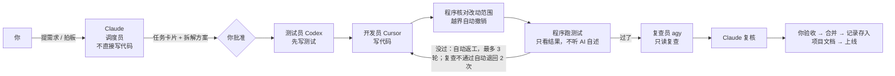

# 超级助手（Super Agent）· 多 AI 协作包

**一句话：一个可以接入任何代码项目的“AI 开发小团队”。** Claude 当调度员，负责和你对齐需求、拆解方案、派活、验收；Cursor 写代码，Codex 先写测试，agy 做独立复查。全程留下看得懂的记录，你只在几个关键节点点头。

> 适合：不会写代码、靠 AI 做产品的人（产品经理、创业者），以及手上同时有多家 AI 订阅、想让它们分工协作的人。
> 目的：把 Claude 的额度留给最值钱的“想清楚”，写代码和测试交给其他工具。

---

## 你会怎么用它

两种入口，读写同一套记录：

- **行政人员（v0.3）**：在设置页第一行选服务商和模型（腾讯云、阿里百炼或其他同类格式的服务），填一次密钥。之后聊天、查进度都找行政，它用便宜的模型回答，要改产品时弹“变成任务？”，你确认后才生成卡片。每个项目各一份设置，每家密钥各存一把，只在这台电脑的钥匙串里。聊天内容和项目资料会发给你选的服务商。**11-17 起开发助手里行政是必配的**：窗口左边的聊天只和行政聊，没配行政时窗口停在团队页，不再退回去和调度员聊。
- **agy 改走官方接法（v0.92.1，11-23）**：团队里用 agy 的岗位（写测试、写代码、复查）和团队检测，不再用 Google 点名个人订阅不支持的 `agy -p`，改走官方给第三方程序开的 `agy acp`（T3 Code 同路）。卡片进度、卡住提醒、报错原因、团队检测都和原来一样；权限照旧全部自动批；新接法出错时直接报错，不退回老办法。已知限制：agy 的活跑到一半被停、超时或正在跑时，卡片上它那一棒的用量显示“读不到”，做完的照常有数。注意：接法和 T3 一样了，但仍是程序自动派活，Google 认不认算“人在场使用”说不准。
- **跑外部项目第三批：外部项目兜底（11-24，v0.93）**：①网页项目也有“全部测试”兜底：项目配一次全部测试命令（`collab config full-test <项目> "<命令>"`），复查的同时在副本里跑；这次改坏了原来能过的功能就退回写代码的并附上没过的输出，改之前就不过的卡停下说明；没配的右栏写明“没有兜底”。②施工单要求“放进项目前看页面 / 对照原型图”的卡，复查通过后停在“等看页面”，右栏列出要对照的图（点了能打开）；点“已看过，和图一致”才能放进项目，“有出入”要写一句，可以退回去改或照样放；放进项目那一步也会再查一次。③复查员每条问题标病根：连续两轮都是“要求没写清”且同一个病根，卡停在“需要定规则”，起草的 AI 先拟 2～3 个规则选项；连续两轮都是“做错了”且同一个病根，下一次写代码换成备份（默认 Codex），这张卡后面都用它。④“继续改”新加的文件超过原范围一半、或改了验收标准时，确认前提醒“像是重新设计”，仍确认会记一笔。⑤测试副本的环境：名字像密钥的设置不带，地址里的账号密码去掉，其余照带（Python 项目的全部测试也一样）。停在“需要定规则”时只能用“继续改”把规则写进去（不能原样接着跑，排着的无关修改也不会让它自己开工）；右栏原型图在右栏里看大图（png、jpg、webp），等看页面时也能打开改好的版本；行政确认框也提醒“像是重新设计”。已知不足：施工单里 `01..06.png` 这种简写认不出图；按名字拦密钥拦不全（如 DB_PASS）；同一仓库多个包互相链接时全部测试可能测到旧代码（单独立项）；规则选项删头去尾留两个冲突的仍能发出去。
- **跑外部项目第二批：少白跑、显示说实话（11-24，v0.93）**：①复查员把证据写成“内容”“说明”或只写“施工单第 N 行”时照样认下，不再为格式白跑一次最高档复查；交代里写明了字段名。②复查要改的文件不在任务卡允许范围时，直接停卡交给人，写明哪些文件、怎么处理（扩范围或认定不归本卡）；范围没扩就点“接着跑”会照样停；写代码的改了范围外的文件被撤掉后，下一次派活会告诉它哪几个被撤、别再改。③窗口“停下”对终端起的卡也能真停，同组留下的子工具一起停；停不掉如实说“没停住”，不再记成“已停下”；起草没停住时放弃、接受、继续改、接着跑都不往下做。④右栏：本卡合计旁写“新消耗约 N”（合计里大部分是重复读缓存）；各环节轮数从最后一次改要求算起，整卡累计放鼠标提示；照施工单直接生成的方案，写方案那格标“程序”；接手格写实际是谁（`collab takeover --by Gemini`）。⑤照施工单生成的方案带上施工单的验收命令和走查要求。⑥“测试收尾”只在真还原了越界改动时才写；起草“继续改”的摘要显示它找到的共同原因。已知不足：判定测试另开的进程组停下时不跟着停（改动前就这样）；同一件事被复查员换说法重提仍算两件；外部项目跑卡时追加到台账的流水被人删就没了。
- **跑外部项目别白跑（11-23，v0.93）**：第一次接外部网页项目（train）暴露的空转问题：①测试没过、报错全在测试文件自己身上（写法、类型、语法错）时，交回写测试的改，不再一直退给不许改测试的写代码的；写测试的看出是产品没写好可以说明，程序转回写代码的；交回 2 次还不行就停下叫人。②停在“测试没过”后接着跑（比如有人接手修好），先重跑一次本卡测试，过了就不再派写代码的白跑一轮。③接着跑时，每个岗位第一次派活附上“前情”：停过几次、谁接手说了什么、副本里已有哪些测试和改动、自己上一棒最后的汇报（像密钥的内容会隐去）。④测试员复查退回后新建的测试文件，不再被当成越界改动。⑤右栏“本卡合计”下面多一行“干活共 X 小时 Y 分”，只算干活时间，停卡、等人点按钮不算。⑥放进项目修两处：在项目文件夹里用“.”叫放进项目不再找错副本；Next.js 这类 app/[id]/… 带方括号的文件按真文件名认，不再漏提交。已知不足：认“测试文件自己的错”只认带位置的编译、类型、语法报错，认不准的一律照旧退给写代码的；Codex 隔离会拦网页项目的测试工具（模型自己申请放行能绕过），这次不改。
- **交活自动附走查截图（11-21，v0.93）**：改界面的卡在施工单里写好走查步骤，写代码的交活且本卡测试通过后，程序自动用后台无界面 Chrome 按步骤点一遍页面并截下每一步图片放进卡片的 `走查截图/`；走查失败或一张图都没留下会退回写代码并写明卡在哪一步，复查员则会收到每步截图与设计图去核对“现在 vs 图”。在卡片界面里，带走查截图的卡片原文下方默认展开「走查截图（N 张）」（支持收起/展开），有设计图时左右并排显示，点击任何一张可直接铺满整个开发助手大窗口看无框高清大图，并支持左右按钮或方向键顺滑翻图（按 `Esc`、点右上角关闭或点黑色空白处退出）；没有写走查的卡片保持原样不变。已知限制：仅走查窗口里的网页部分，不管 Mac 外壳菜单或窗口切换；全部测试和跑走查要求本机装有 Chrome 且运行用 Python 装好 playwright，换电脑需要重装。
- **复查意见固定格式（下一版，11-18，未发版）**：复查员每次回复末尾必须附一份固定格式的复查清单，每条问题写清轻重、是不是这次改出来的、用户看到的现象、出在哪、凭什么（实跑的命令和输出，或对照的代码位置）。程序只认这份清单：格式不对先请复查员重写一次，还不对就停下交给 Claude 看原话，不再从原话里猜问题，绝不自动放行；第一行写“不通过”而清单写“通过”也不放行。每轮复查都会提醒哪些老测试被改过、哪些测试新加了“跳过”。卡停下时用大白话说剩下几件事，严重的会标出来。已知不足：复查员每轮都能挑出更偏的边角，三轮收不住时要人来收口；中途恰好在某两步之间被打断的几种情况、复查员重写时改写原意，程序还认不出（记在以后再修）。
- **跑卡看得清、复查更严（v0.5，11-18）**：跑卡时右栏每个环节固定三行——谁在做、一句大白话结果（最多两行）、小字“共几轮 · 累计用时 · 累计用量”，鼠标停上去看每轮明细，最底下单独一行“本卡合计 N token”。复查挑出的问题只要是这次改出来的，再小也自动退回去修；开工前就有的（不严重的）只记进台账，点确认时不再弹技术条目；复查最终放行的显示绿勾。退回时先让写测试的补测试守住问题，再让写代码的把同类问题一起改；退回后的复查只看改动、强度降一档。团队里 Codex 可以选 GPT-6.2-Sol。已知不足：复查员意见写得不规整时程序仍可能认漏，下一版改成固定格式。
- **做完后确认（v0.4）**：一张卡做完时，右栏写明你应该看到什么、在哪看，点“打开改好的版本”就能在浏览器里看结果。没问题点“确认没问题，放进项目”，不满意点“不满意，继续改”，不要了点“放弃这个需求”。预览运行的是模型写的代码，和施工时跑测试的风险差不多。
- **左栏删除和归档（v0.4）**：主对话里鼠标移到一行上，时间的位置会变成删除图标，确认后真删，找不回来；Codex 模式下 Codex 里的那段记录也一起删。不是超级助手开的对话（比如在 Codex 桌面版里开的）只能看不能删。等待处理里已完成或已放弃的卡可以归档，收进列表底部的“已归档”，能点开看、能取消归档。放弃一张卡时，改好的版本也一起删掉。
- **跑卡更稳、团队可选腾讯云（11-19，v0.6）**：点“接受剩下的问题”会先在后台跑完全部测试，全过才进待确认；写测试的交活后程序先跑一遍新测试，一跑就全过说明测不到问题，退回重写；写代码的模型半天不回话时，提醒会分清是“模型没回话”还是“在跑命令”，并建议换成今天跑得正常的具体模型；复查只退在这个项目里碰得上的问题（推测出来、又极巧合的记进以后再修，安全或丢数据的照退）。卡片记录只记运行时间、不记钟点，交接列表显示开工后第几分钟。放进项目时卡片记录存进施工单所在文件夹、和代码进同一次提交；批准开工时只有真有代码没存才弹“先存再开工 / 直接开工 / 先不开工”小框。团队三个岗位都能选“腾讯云”（用行政那把密钥，混元 HY4、HY4 Flash；两个 DeepSeek 免费额度已用完，要在腾讯云开通后付费）。
- **显示和说法更清楚（第三批，11-19，v0.7）**：界面和记录里不再出现“调度员”；测试超时停下后点“接着跑”只重跑测试；右栏写方案格写“方案已定”、最后一句写“已放进项目”、不再叠字；写代码那步的进度条只数这张卡开工时没过的那几项（“本卡要做的 N 项，已过 x 项”，没全过不显示满格）；被服务限流停下会说“服务限流”；左栏已完成的卡多一行“完成于 年-月-日 时:分”；找行政建卡时，粘贴的话里标了“要做什么 / 不做什么 / 怎么算做完”会照你写的填，标题用施工单的标题。
- **有施工单就直接开工（第四批和两张小修，11-20，v0.7）**：卡片引用了施工单，程序直接从施工单读出方案、允许改的文件和验收命令，不再叫 AI 写方案（不到 1 秒），开工时也不备交接资料；批准前点过“不满意，继续改”的照旧由 AI 重写。写代码前程序先跑一遍新测试的那一两分钟，右栏“跑测试”格转圈计时、标题下写“程序在写代码前先跑一遍新测试”；标题下那一行不再露出“调度员”；复查员写“结论:不通过”（半角冒号）时复查格不亮绿勾。提示、报错和行政、积木库管家的说法里不再自称“超级助手”，改说“这个应用”。规则里补了写方案、备交接资料两个岗位的职责，新模型有试用期；每张卡每一步用了什么模型、多久，记在 docs/流程数据/。
- **左下角一键切换项目（11-20，v0.8）**：点左栏左下角的项目名（带向下小箭头），往上弹出“选择项目”浮层：搜索框、最近打开的项目（最多 20 个，和菜单“文件 → 最近打开”同一份）、底部“＋ 添加项目”。切走时跑着的卡在后台照跑；每个项目记住上次打开的对话、卡片和主对话里没发的字，切回来恢复（停用了行政的项目停在团队设置页，配好行政后再恢复卡）。
- **换哪个模型当产品经理、架构师都能照规则做；团队页能选 Gemini Ultra 新模型（11-20，v0.92）**：产品经理、架构师的规矩（判大小、需求共识、方案、施工单、复查验收、走查、台账、发版本、盯卡）都写进 agents/角色/ 和 agents/手册/，开发流程规范只留一页摘要；中、大需求的施工单开工前先交 Codex 复查，通过了才给粘贴的话。团队页 agy 的模型下拉多了 Gemini 4 Neon（低/中/高/极高）、Gemini 4 Carbon（低/中/高）和 Orchestrator Neon/Carbon/Argon（不分强度）。docs/流程数据/点评记录.md 补齐到 CARD-021 并写了第 2 次复盘。
- **给模型的话全部搬进规则包（11-20，v0.91）**：程序发给大模型的每一句话——派活时给写代码、写测试、复查、写方案、备交接资料的交代，复查清单的格式，行政的身份说明和提醒，积木库管家的身份说明和手册，行政和积木库管家能用的工具说明——都在 agents/ 里，改说法只改那里（agents/交代/ 下每份交代用 `{空位}` 标出程序每次填的东西）。搬家没改字：搬前搬后发给模型的话逐字比对（tests/fixtures/交代快照/）。规则包体检会查空位被删、交代缺失、工具说明缺行、旧说法回来。卡停下时右栏顶部写“卡住了（原因在中间卡片标题下）”。
- **规则包和右栏小修（11-20，v0.9）**：给大模型的规则从代码里搬进项目最外层的 agents/ 文件夹（按角色和手册分成多份，agents/README.md 写明谁读哪几份），改规则只改这里，不用改代码；跑卡时程序把每个角色那份规则原样放在派活的话最前面（改完规则要重新生成应用才进跑卡）。右栏每一步的 token 用量另起一行；卡停下时右栏顶部只写“卡住了”和按钮，原因全文放进中间卡片标题下那一行（默认收起一行，点“展开”看全文）；停下时的建议先说严重或丢数据的问题、建议交给 Claude 接手或讲清楚再跑一轮。由 Claude 接手修好的卡，复查格变绿勾写明“已由 Claude 接手修好”，流程里多一格“Claude 接手”（接手的人用 `python3 -m collab takeover` 记下），本卡合计下面写完成时间。卡片允许改的文件后面带括号备注时，程序也认得。
- **桌面窗口（v0.2）**：（11-17 起开发助手左边只和行政对话，团队里没有调度员这一行，外壳也不再读老配置里残留的调度员；没配行政就停在团队页。下面是 v0.2 的老说明，仅供参考，窗口里已经没有“和调度员聊天”“选调度员”的入口。）打开「超级助手」，选一个项目文件夹。左边和你选的调度员对话（Codex / Cursor / agy，由你亲手选）：Codex 默认是**聊天视图**——一问一答、它画的图直接显示、有风险的动作弹出“允许/拒绝”、随时可以停止、顶部可随时切换本项目的**历史对话**或一键开启**新对话**，需要时可从菜单“对话 → 打开终端（高级）”进入终端；右边面板全程与左边实时联动，不仅在任务卡片施工时显示每一站进度与交接，连平时调度员排查项目、对齐方案、做最终页面核验时也会实时转动，并支持意外退出后的**断点续跑**（已完成步骤不重做）。
- **终端**：在任意项目里打开 Claude Code，说一句：

> **“用协作包做这个需求：粘贴链接后要显示处理进度。”**

接下来：

1. Claude 读你的项目，起草一份“项目说明”（怎么运行、怎么测试、哪些不能动），你看一眼说“对”。
2. Claude 用大白话复述需求，有歧义就问你几道选择题。
3. Claude 写好**拆解方案**（涉及界面时还会给你一张设计稿），你同意了才开工。
4. 干活的 AI 在项目的**独立副本**里施工，不碰你正在改的代码。你可以随时看进度：现在在哪一步、用了多久、最近有没有动静。
5. 做完后 Claude 自己复核一遍，用大白话告诉你结果；你验收。
6. 你同意后才会合并、上线、推送。

你需要做的只有：**提需求、回答选择题、看方案、验收、决定上不上线。**

---

## 它是怎么工作的



几条关键规则：

- **调度员不动手**：Claude 只调度和验收，不直接改产品代码（哪怕一行，也派给开发员）。
- **过没过由程序判定**：只看测试命令的结果，不相信任何 AI 说“我做完了”。
- **测试先行**：测试员先按验收标准写测试，开发员再写代码。
- **范围控制**：每张任务卡片写明允许改哪些文件，改了别的会被程序自动撤销。
- **有人盯着卡住**：同样的报错连续出现两次，提前停下；干活的 AI 5、10 分钟没动静时行政会主动告诉你，连续 15 分钟没有任何动静（文件没变、输出也没涨），看门人会停掉它，并写明原因转给你。卡片标题下一行随时写着此刻谁在干什么。
- **复查不通过自动退回**：带着复查员的结论交回写代码的去改，最多 2 次；还不过才停下叫你，你可以继续改，或“接受剩下的问题，进入待确认”。
- **每个岗位各选模型**：团队设置里写测试、写代码、复查各选各的模型和思考强度（11-17 起没有调度员这一行；写方案、备交接资料是后台作业，固定用 Codex、思考强度“低”，模型跟写测试那一岗）。
- **全程留痕**：每一步谁做了什么、每轮测试结果、返工原因、复查结论，都写进文件；关键节点自动登记到项目台账。

设计参考了 DeepSeek Harness 团队的《Super-agent 设计探索》（调度与执行分层、执行者上下文隔离、外部看门人），以及面向非开发者的 vibe-workflow 开发规范。

---

## 准备工作

- macOS 或 Linux，Python 3.9 及以上，git
- 已安装并登录：
  - [Claude Code](https://claude.com/claude-code)（调度员）
  - Cursor CLI，命令名是 `agent`（开发员）
  - Codex CLI，命令名是 `codex`（测试员）
  - agy，命令名是 `agy`（复查员）
- 用来施工的项目必须是 git 仓库

一键检查三家工具能不能用、能不能写文件：

```bash
bash docs/多agent协作包/联调冒烟测试.sh
```

## 安装

```bash
# 1. 下载到本机（默认位置；放到别处的话，把 skill/super-agent/SKILL.md 里的路径一起改掉）
git clone https://github.com/Rskyss/super-agent.git ~/Desktop/project/开发助手   # 11-17 工具分家：协作包和开发助手在这里；超级玩家的代码在 ~/Desktop/project/超级玩家/super-agent

# 2. 安装 Claude Code 全局技能：之后在任何项目里说“用协作包”就会触发
mkdir -p ~/.claude/skills/super-agent
cp ~/Desktop/project/开发助手/skill/super-agent/SKILL.md ~/.claude/skills/super-agent/
```

之后在任何项目里对 Claude 说“用协作包做 XXX”即可。

**协作包不会复制进你的项目**（v0.2 起），始终只用上面下载的那一份。第一次在某个项目里用时会“接入”：

```bash
python3 ~/Desktop/project/开发助手/collab init <项目路径>
```

接入只在项目里新增一个 `.collab/` 文件夹（施工过程记录，只留在本机），并把它加进项目的 `.gitignore`。用旧方式装过协作包的项目，执行 `migrate <项目路径>` 改成新方式；加 `--remove-old-package` 才会删掉项目里的旧副本。

### 桌面窗口（可选，仅 macOS）

```bash
bash ~/Desktop/project/开发助手/desktop/mac/build.sh --install
```

第一次会从 GitHub 下载开源终端组件 SwiftTerm（固定 1.99.0 版）并编译，生成 `~/Applications/开发助手.app`（2026-11-17 由“超级助手”改名，专门用来开发超级玩家）。**它是冻结的**：只用生成时装进应用里的那份代码，之后项目里的改动不会影响它；要用上新改动就重新运行上面的命令（临时调试可带 `--source-root` 读源目录）。打开后选一个项目文件夹：没接入过的会自动接入，旧方式装过的会先问你要不要删旧副本；第一次打开会先出**团队配置**：配好行政和三位执行员（写测试、写代码、复查），逐个点每个角色后面的“检测生效”确认都能真干活（团队第一次要三位执行员全部测通才能保存；行政配好后也可以先不存团队、直接回对话），再开始对话。以后点左栏底部的齿轮改，改了谁就测谁。（11-17 起窗口里没有调度员，这句是老说明：以前调度员启动时会自动收到开场交代。）

**切换项目（11-20 起）**：点左栏左下角的项目名（带向下小箭头），往上弹出“选择项目”浮层：搜索框、最近打开的项目（最多 20 个，和菜单“文件 → 最近打开”同一份）、底部“＋ 添加项目”（选文件夹导入）。切走时跑着的卡在后台照跑；每个项目记住上次打开的对话、卡片和主对话里没发的字，切回来恢复。停用了行政的项目切回来停在团队设置页、不恢复卡（配好行政后再恢复）。

**积木库**（左栏底部齿轮旁的“积木库”，或菜单“窗口 → 积木库”）：单独一个窗口，整台电脑一份，用来把你订阅的 AI 工具和大模型接进来。第一次先绑定一个大模型当积木库管家（和项目窗口的“行政”是两个：行政管需求和任务卡片，管家管接积木）（腾讯云、阿里百炼或其他同类，要按用量付费的 API 密钥）；之后跟管家说“我想装 Codex”“接一个大模型 API”，它会体检电脑、查装没装、出提议，你点确认后程序去检测，检测通过才放进基础层。现成接法：Codex、Cursor、agy；体检认出装好的这几家会在基础层里灰着显示“待接入”，点一下检测，通过就放进去。名单外的工具，管家用基础层里的“联网搜索”（Tavily，要你给一把密钥）找官网，程序自己读页面核对安装命令、查安装包底细，你确认后才装；“下载脚本直接运行”的装法会标红。官方没有的工具（比如小红书），管家会说“官方没有”，列出别人做的最多 3 个，各写谁做的、能干什么、风险，推荐一个让你选；装提议上标“非官方”和红字风险（GitHub 这类代码托管站上的一律算非官方）。接大模型 API 按整家接：一家平台一个积木块，提议上不选模型，检测时程序自己拿这家的模型名单，拿到就算接上，再顺手挑这家自己的几个聊天模型试通（都不通标黄“已接上”、写出平台原话，照样能放进基础层），接好后点开那个积木块能看到名单；用哪个模型留给以后的能力层（检测通过只代表这家接上了，不代表每个模型都开通了）。管家的规矩分成三本手册（接命令行工具、接大模型 API、联网搜索和网上安装），办哪类事翻哪本；聊天里那行灰字会写“搜了网上 1 次 · 读了 1 个网页”，点开看每一步，重开也在。接进来的分四类：AI 助手、普通工具（用一条只查不改的命令检测，要密钥的在提议上一把一格填）、大模型 API、联网搜索。只有 API 的大模型按地址接。密钥只存在本机钥匙串，和项目窗口共用，存过的不用再填。积木库开着时关项目窗口只是藏起来，两个窗口都关了才退出。

---

## 记录在哪里

结果跟着项目走（进 git），过程只留在本机（不进 git）：

| 位置 | 内容 | 进 git |
|---|---|---|
| `docs/开发进度跟踪.md` | 项目总台账：方案批准、运行结束、合并、记录存入文档都会自动登记一行（只追加） | 进 |
| `docs/项目说明.md` | 怎么启动、怎么测试、哪些不能动 | 进 |
| `docs/功能名/` | 卡片完成后存入的记录：需求共识、方案、验收记录、过程摘要 | 进 |
| `.collab/任务板.md` | 每张卡现在在哪一步、返工几次 | 不进 |
| `.collab/cards/卡片编号/` | 任务卡片、方案、执行记录、每轮测试结果、返工记录、复查结果、汇报 | 不进 |
| `.collab/cards/卡片编号/流转.jsonl` 与 `流转/` | 边干边记：每次派活的原文、回复全文、测试输出、执行者的实时输出（桌面窗口右边就读这些） | 不进 |

---

## 目录结构

```
collab/                     协作包本体（只此一份，不复制进项目）
  README.md                 调度手册：给调度员看的完整操作流程、上线清单、踩过的坑
  规则.md                   规则书：给干活的 AI 看的底线和各角色要点
  cli.py                    命令入口
  dispatch.py               派发主流程（测试先行、范围控制、返工、复查）
  flow.py                   流转记录：边干边记，谁在干、彼此说了什么
  agents.py                 三家工具的调用方式，含看门人
  judge.py                  判定：只看测试命令的退出码
  scope.py / vcs.py         改动范围核对、独立副本、自动撤销
  watch.py                  实时进度（终端版）
  archive.py / ledger.py    归档与台账
  install.py / config.py    接入与迁移、模型配置
  blocks*.py                积木库：接法说明和资料夹、环境体检、按接法说明检测、核实名单里的安装、网上安装
  blocks_web.py             积木库：读网页、联网搜索、安装命令核对、安装包底细
desktop/                    桌面窗口
  view.py / server.py       右边流转面板的数据（只读记录、只服务本机）；聊天地址要一次性口令
  chat.py / dispatchers/    左边聊天视图：调度员接口（统一聊天事件）、Codex 接入
  clerk/                    行政：对话、工具、提议；roles/ 里是各处的说明（积木库管家.md 和 积木库手册/ 三本手册等）
  opening.json              调度员的开场交代与守则（终端、聊天共用）
  static/                   右边面板页面、左边聊天页面
  mac/                      Mac 窗口外壳（左边真终端）、图标、生成脚本
skill/super-agent/SKILL.md  Claude Code 全局技能（入口，指向调度手册）
tests/                      单元测试
docs/                       需求共识、方案、联调手册、试跑与验收记录、开发进度
```

## 命令速查

一般由 Claude 执行，你不需要记。`<P>` 是项目路径。

| 命令 | 作用 |
|---|---|
| `python3 collab init <P>` | 接入项目（不复制协作包） |
| `python3 collab migrate <P> [--remove-old-package]` | 旧方式装过的项目改成新方式 |
| `python3 collab check <P>` | 检测连通：团队里每个人真干一件小事，看通没通 |
| `python3 collab confirm-profile <P>` | 确认项目说明 |
| `python3 collab new-card <P> CARD-001 --requirement 需求.md` | 新建任务卡片 |
| `python3 collab approve <P> CARD-001` | 批准拆解方案 |
| `python3 collab run <P> CARD-001 --test-command "npm test"` | 派发施工（可选 `--dev-tool / --test-tool / --review-tool`、`--page-check`、`--session-jsonl auto`） |
| `python3 collab watch <P> CARD-001` | 实时看进度 |
| `python3 collab status <P>` | 任务板 |
| `python3 collab archive <P> CARD-001 --feature 功能名` | 归档到 `docs/功能名/` |

模型可以按项目调整：在项目的 `.collab/配置.json` 里写 `cursor`、`codex`、`codex_effort`、`agy` 中想改的项即可。

## 运行测试

```bash
python3 -m unittest discover -s tests -p 'test_*.py'
```

测试里有走查工具的检查（`tests/test_walk_tool.py`，约 40 秒），要本机装 Chrome，并给跑测试、跑卡用的那份 Python 装上 playwright（开发助手用的是登录终端里 `python3` 指向的那份，现在是 Homebrew 的：`python3 -m pip install --user --break-system-packages playwright`，浏览器用本机 Chrome，不用另外下载）。缺了这两样，这项检查会报错并写明缺什么，全部测试判“没过”。换电脑要重装。

---

## 实际跑过的结果

- **真实项目**：在一个 Next.js 视频转文字项目里，完成了“粘贴链接后显示处理进度”：测试员先写了 22 条验收测试，开发员实现，返工 1 次后通过；用真实视频实测后上线。
- **完整流程演练**：一个小需求从建卡到合并归档，7 分钟完成，0 返工，复查结论“通过”。

## 已知限制

- Cursor 在自动模式下**不能执行命令**，所以跑测试、撤销越界改动、整理汇报都由程序完成；上线这类需要执行命令的活，适合交给 Codex。
- 越界处理有三种模式（A 自动撤销 / B 标出让你决定 / C 允许并提醒），目前程序只实现了 A。
- 一次只施工一张卡，暂不支持多张卡并行。
- 需要登录才能看到的页面，自动检查还需要人工登录一次，或交给 Codex 实测。
- 额度记录统计的是同一时间段里 Claude 的全部用量，只能当作大致参考。
- 默认模型名来自作者本机环境，换环境时请在 `.collab/配置.json` 里调整。
- 桌面窗口目前只有 macOS 版；调度员的开场交代只能叮嘱，不能保证它百分之百照做（你在左边看得见）。
- 聊天视图目前只接了 Codex（用的是 Codex 标着“试验中”的聊天接口，升级后可能要跟着改）；Cursor、agy 当调度员又没配行政时，中间是终端。Claude 暂不作为调度员或执行员。超级助手里的对话，“允许吗？”一律问你本人（即使你的 Codex 设了让 AI 代为审批）；开工（派活）一定要你点“允许”。
- Cursor、agy 干完才给回复，桌面窗口里看不到它们干活过程中的实时输出，只能看到“几秒前有动静”。
- 积木库：管家用的模型有时会说“提议已经弹出来了”其实没出（2026-11-09 验收时 7 次里 3 次）。程序会自动提醒它一次，还没出就跟它说一声“没看到提议”。安装名单目前只有 Codex（npm、Homebrew）和 Node（Homebrew），名单外的走网上安装，只认 npm、Homebrew 官方目录、curl … | sh 三种写法（pip、Homebrew 第三方仓库不支持）；只能在网页或手机 App 里用的订阅，超级助手自己不破解，没有别人做好的工具就接不进来。每次打开积木库会读一遍钥匙串里存的密钥，重新打包应用后系统可能为每一把问一次是否允许。

## 规划中

- 排班：在窗口里安排谁写代码、谁写测试、谁复查，以及各岗位的说明。
- 远期：让普通人用自己订阅的 AI 自由分工（见 `docs/普通人可视化编排/远期设想.md`）。
- 多张卡并行施工；真实页面检查自动化。

## 参考

- DeepSeek Harness《Super-agent 设计探索》与开源原型 [dsh-superagent-prototype](https://github.com/deepseek-ai/dsh-superagent-prototype)（资料整理见 `docs/多agent协作包/参考/`）
