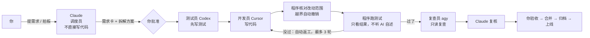

# 超级助手（Super Agent）· 多 AI 协作包

**一句话：一个可以放进任何代码项目的“AI 开发小团队”。** Claude 当调度员，负责和你对齐需求、拆解方案、派活、验收；Cursor 写代码，Codex 先写测试，agy 做独立复查。全程留下看得懂的记录，你只在几个关键节点点头。

> 适合：不会写代码、靠 AI 做产品的人（产品经理、创业者），以及手上同时有多家 AI 订阅、想让它们分工协作的人。
> 目的：把 Claude 的额度留给最值钱的“想清楚”，写代码和测试交给其他工具。

---

## 你会怎么用它

在任意项目里打开 Claude Code，说一句：

> **“用协作包做这个需求：粘贴链接后要显示处理进度。”**

接下来：

1. Claude 读你的项目，起草一份“项目说明”（怎么运行、怎么测试、哪些不能动），你看一眼说“对”。
2. Claude 用大白话复述需求，有歧义就问你几道选择题。
3. Claude 写好**拆解方案**（涉及界面时还会给你一张设计稿），你同意了才开工。
4. 干活的 AI 在项目的**独立副本**里施工，不碰你正在改的代码。你可以随时看进度：现在在哪一步、用了多久、最近有没有动静。
5. 做完后 Claude 自己复核一遍，用大白话告诉你结果；你验收。
6. 你同意后才会合并、上线、推送。

你需要做的只有：**提需求、回答选择题、看方案、验收、决定上不上线。**

---

## 它是怎么工作的



几条关键规则：

- **调度员不动手**：Claude 只调度和验收，不直接改产品代码（哪怕一行，也派给开发员）。
- **过没过由程序判定**：只看测试命令的结果，不相信任何 AI 说“我做完了”。
- **测试先行**：测试员先按验收标准写测试，开发员再写代码。
- **范围控制**：每张需求卡写明允许改哪些文件，改了别的会被程序自动撤销。
- **有人盯着卡住**：同样的报错连续出现两次，提前停下；干活的 AI 连续 15 分钟没有任何文件变化，看门人会停掉它，并写明原因转给你。
- **全程留痕**：每一步谁做了什么、每轮测试结果、返工原因、复查结论，都写进文件；关键节点自动登记到项目台账。

设计参考了 DeepSeek Harness 团队的《Super-agent 设计探索》（调度与执行分层、执行者上下文隔离、外部看门人），以及面向非开发者的 vibe-workflow 开发规范。

---

## 准备工作

- macOS 或 Linux，Python 3.9 及以上，git
- 已安装并登录：
  - [Claude Code](https://claude.com/claude-code)（调度员）
  - Cursor CLI，命令名是 `agent`（开发员）
  - Codex CLI，命令名是 `codex`（测试员）
  - agy，命令名是 `agy`（复查员）
- 用来施工的项目必须是 git 仓库

一键检查三家工具能不能用、能不能写文件：

```bash
bash docs/多agent协作包/联调冒烟测试.sh
```

## 安装

```bash
# 1. 下载到本机（默认位置；放到别处的话，把 skill/super-agent/SKILL.md 里的路径一起改掉）
git clone https://github.com/Rskyss/super-agent.git ~/Desktop/project/super-agent

# 2. 安装 Claude Code 全局技能：之后在任何项目里说“用协作包”就会触发
mkdir -p ~/.claude/skills/super-agent
cp ~/Desktop/project/super-agent/skill/super-agent/SKILL.md ~/.claude/skills/super-agent/
```

之后在任何项目里对 Claude 说“用协作包做 XXX”即可。项目里还没有装协作包时，Claude 会先告诉你，然后执行：

```bash
python3 ~/Desktop/project/super-agent/collab install <项目路径>          # 首次安装
python3 ~/Desktop/project/super-agent/collab install <项目路径> --update # 升级（不动已有记录）
```

安装会在项目里新增两个文件夹：`collab/`（协作包本体）和 `.collab/`（协作记录）。不会修改项目里已有的任何文件。

---

## 记录在哪里

| 位置 | 内容 |
|---|---|
| `.collab/任务板.md` | 每张卡现在在哪一步、返工几次 |
| `.collab/cards/卡片编号/` | 需求卡、拆解方案、设计稿、执行记录、每轮测试结果、返工记录、复查结果、汇报 |
| `docs/开发进度跟踪.md` | 项目总台账：方案批准、运行结束、合并、归档都会自动登记一行（只追加） |
| `docs/功能名/` | 卡片完成后的归档：需求共识、方案、验收记录、过程记录 |

---

## 目录结构

```
collab/                     协作包本体（装进项目的就是这个文件夹）
  README.md                 调度手册：给 Claude 看的完整操作流程、上线清单、踩过的坑
  规则.md                   规则书：给干活的 AI 看的底线和各角色要点
  cli.py                    命令入口
  dispatch.py               派发主流程（测试先行、范围控制、返工、复查）
  agents.py                 三家工具的调用方式，含看门人
  judge.py                  判定：只看测试命令的退出码
  scope.py / vcs.py         改动范围核对、独立副本、自动撤销
  watch.py                  实时进度
  archive.py / ledger.py    归档与台账
  install.py / config.py    安装、模型配置
skill/super-agent/SKILL.md  Claude Code 全局技能（入口，指向调度手册）
tests/                      单元测试
docs/                       需求共识、方案、联调手册、试跑与验收记录、开发进度
```

## 命令速查

一般由 Claude 执行，你不需要记。`<P>` 是项目路径。

| 命令 | 作用 |
|---|---|
| `python3 collab install <P> [--update]` | 安装 / 升级协作包 |
| `python3 collab confirm-profile <P>` | 确认项目说明 |
| `python3 collab new-card <P> CARD-001 --requirement 需求.md` | 新建需求卡 |
| `python3 collab approve <P> CARD-001` | 批准拆解方案 |
| `python3 collab run <P> CARD-001 --test-command "npm test"` | 派发施工（可选 `--dev-tool / --test-tool / --review-tool`、`--page-check`、`--session-jsonl auto`） |
| `python3 collab watch <P> CARD-001` | 实时看进度 |
| `python3 collab status <P>` | 任务板 |
| `python3 collab archive <P> CARD-001 --feature 功能名` | 归档到 `docs/功能名/` |

模型可以按项目调整：在项目的 `.collab/配置.json` 里写 `cursor`、`codex`、`codex_effort`、`agy` 中想改的项即可。

## 运行测试

```bash
python3 -m unittest discover -s tests -p 'test_collab_*.py'
```

---

## 实际跑过的结果

- **真实项目**：在一个 Next.js 视频转文字项目里，完成了“粘贴链接后显示处理进度”：测试员先写了 22 条验收测试，开发员实现，返工 1 次后通过；用真实视频实测后上线。
- **完整流程演练**：一个小需求从建卡到合并归档，7 分钟完成，0 返工，复查结论“通过”。

## 已知限制

- Cursor 在自动模式下**不能执行命令**，所以跑测试、撤销越界改动、整理汇报都由程序完成；上线这类需要执行命令的活，适合交给 Codex。
- 越界处理有三种模式（A 自动撤销 / B 标出让你决定 / C 允许并提醒），目前程序只实现了 A。
- 一次只施工一张卡，暂不支持多张卡并行。
- 需要登录才能看到的页面，自动检查还需要人工登录一次，或交给 Codex 实测。
- 额度记录统计的是同一时间段里 Claude 的全部用量，只能当作大致参考。
- 默认模型名来自作者本机环境，换环境时请在 `.collab/配置.json` 里调整。

## 规划中

- 可视化编排：在界面上把自己订阅的 AI 安排到不同岗位、看见每个人在做什么（见 `docs/普通人可视化编排/`）。
- 多张卡并行施工；真实页面检查自动化。

## 参考

- DeepSeek Harness《Super-agent 设计探索》与开源原型 [dsh-superagent-prototype](https://github.com/deepseek-ai/dsh-superagent-prototype)（资料整理见 `docs/多agent协作包/参考/`）
