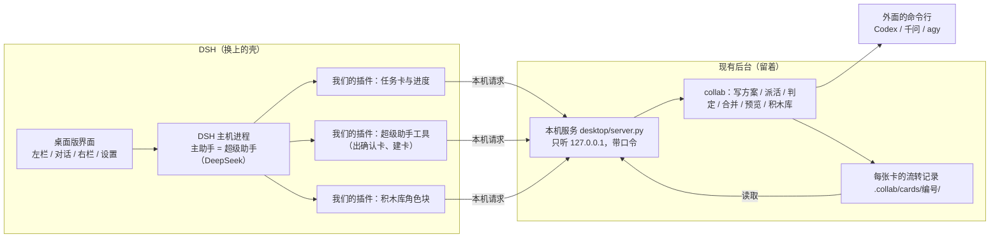
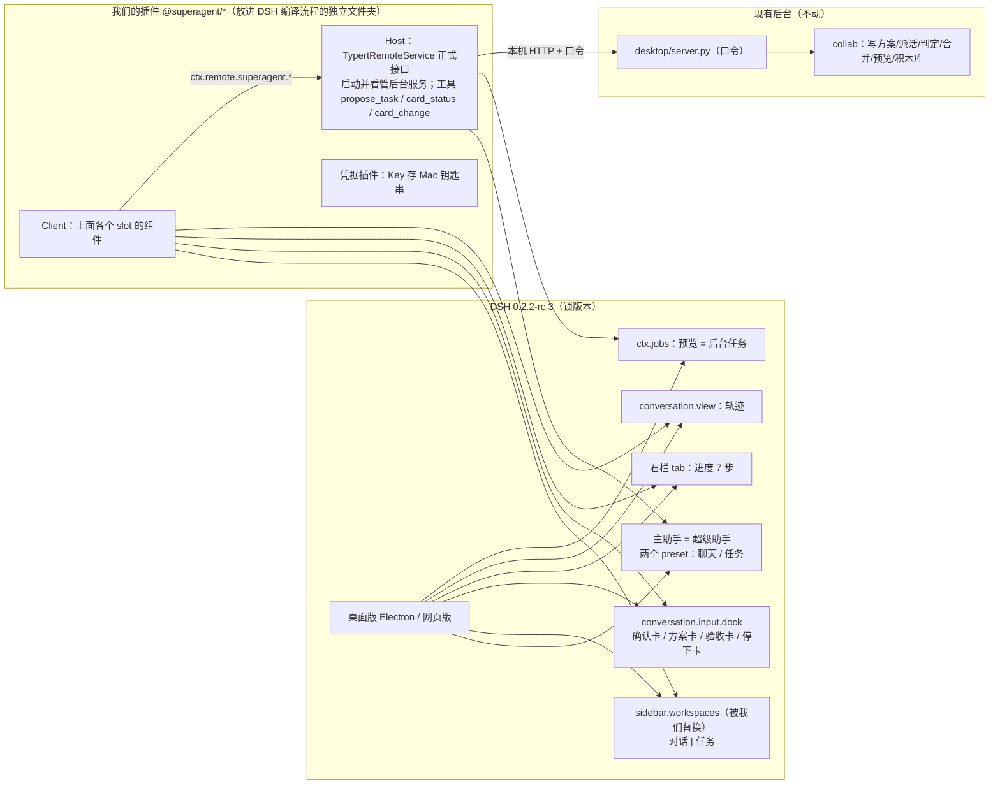

# DSH 改版 · 第一段方案（含第 0 步实测）

> 状态：**用户 2026-11-15 批准**（“可以，按推荐来，开始实测”）；第六节 5 条按推荐定。依据：[需求共识](需求共识.md)、[页面说明](页面说明.md)、[现有产品对照](现有产品对照.md)。
> 用户口径（11-15）：把 DSH 的标准壳（前端框架、产品结构、界面）拿过来改，快点跑起来，边用边开发；先做实测。

## 一、这一段要做成什么

做完第一段，你能在**新界面**里完整走一张真实的开发卡：

跟超级助手说需求 → 确认卡 → 建任务卡 →（没有调度员就先接一个）→ 调度员写方案 → 你批方案 → 写测试 → 写代码 → 跑全部测试 → 复查 → 先预览、再放进项目。

从这以后就用新界面开发超级助手自己，发现问题边用边补。新界面验收通过之前，现在的超级助手照常用，不关。

分两步走：**第 0 步实测（1–2 天）→ 你看实测报告拍板 → 第 1 步正式搬。**

## 二、第 0 步：实测（Claude 亲自做）

### 怎么测

- **用一份全新的 DSH**：从官方仓库（github.com/deepseek-ai/deepseek-harness）下载，固定一个版本，放在单独的文件夹。**不碰**桌面上那份 deepseek-harness（没有版本记录，另一个会话在改），**不碰**现在在用的超级助手和它的设置、钥匙串。
- **只加插件，不改 DSH 自己的代码**。实在要改，每一处记成补丁，算进结论。
- **用一个临时的测试项目**，跑一个真实的小需求（从待办里挑一个半小时能做完的）。
- 超级助手用 DeepSeek V4.1。Key 用你现有的那把，存放方式见第 5 项，不写进任何文件和记录。

### 测哪 6 项、怎么算过

| # | 测什么 | 怎么算过 | 不过怎么办 |
|---|---|---|---|
| 1 | **调度员从 DSH 里调起来，进度进右栏**：在新界面确认一张卡后，后台跑现有的写方案、写测试、写代码、复查（Codex / 千问），右栏每步实时更新 | 右栏每步状态跟实际一致，延迟不超过约 5 秒；能停下 | 这是最关键的一项，不过就不走这条路 |
| 2 | **左栏“对话 \| 任务”、每张任务卡单独一页**，只靠插件做 | 不改 DSH 代码做出来；或只改很少几处、能存成补丁 | 改动多 → 回到“只挑零件、在现有产品上按新图改” |
| 3 | **超级助手按我们的规矩出确认卡，卡贴在输入框上面** | 说一句需求，超级助手出 03 那样的确认卡，贴在输入框上；接着聊不被顶走；点确认能建卡 | 卡只能放在聊天里 → 记下，评估要不要自己做 |
| 4 | **轨迹、后台任务接我们的数据** | 至少一张卡的每一步出现在“轨迹”里；预览出现在“后台任务”里，能停 | 接不上 → 第一段先不做这两样，右栏照旧，记下要几天 |
| 5 | **Key 安全存放** | DeepSeek Key 存进 Mac 钥匙串或 DSH 的加密存放，页面、记录里都查不到 | 只能明文存 → 记下，第 1 步补 |
| 6 | **超级助手做一张能力卡**（顺手测，半小时） | 按 10 页五行做出“公众号选题”能力卡，试做结果对 | 做不出 → 能力卡第一段先不改，仍按现在的做法 |

### 测完交什么

一份实测报告（放 `docs/DSH改版/实测报告.md`）：每项过没过、截图、花了多久、要改 DSH 几处、第 1 步大概要几天。**结论用一句话写在最上面：走 / 不走 / 部分走。**

### 结果怎么用（事先定好，免得测完再争）

- 1、2、3 都过 → 进第 1 步。
- 1 不过，或 2 要大改 DSH → 不换壳，回到“只挑零件、在现有产品上按新图改”，今天对齐的页面照样用。
- 4、5、6 不过 → 不影响走不走，只影响第一段做多少。

## 三、第 1 步：正式搬（第一段范围）

**做**（都按页面说明）：

| 层 | 页面 |
|---|---|
| 前台 | 00a–00e 首次使用（只配超级助手）、01 新会话、03 / 03c 确认卡、19 改类型 |
| 任务 | 03b 建卡、04a 批方案、04 干活中、05 你验收（含轨迹、后台任务）、14 停下要你决定、09 任务总览、17 没有任务 |
| 接调度员 | 12 / 13 / 13b 那套流程，只接调度员（Codex 等） |
| 设置 | 06 积木库（先做顶部“角色”块和列表，够看、够换调度员） |

**这一段不做**（跑起来后用新界面开发自己时再做）：07 能力层页、08 业务流程页、15 通用、16 定时任务、10 / 11 造能力（视实测第 6 项）、18 拿不准给选项、接调度员以外的零件、过去 71 张卡的记录搬家。

**后台**：写方案、派活、判定、越界拦截、施工副本、预览、放进项目、积木库检测全部用现有的，只改显示和叫法（见现有产品对照第三、四节）。

第 1 步的《任务清单》等实测报告出来、你拍板后再写。→ 已写：[任务清单](任务清单.md)（11-15，待批）。

### 三a、第 1 步具体怎么做（11-15 实测后补，**用户 11-15 批准**）

依据：[实测报告](实测报告.md)（结论“走”）、需求共识八a（用户定：任务卡 = 单独的对话；左栏保留“对话 | 任务”两个标签）。

**你会看到的样子**

1. **打开超级助手**：就是 DSH 的桌面窗口，换上我们的名字和图标。第一次打开先配超级助手（00a–00e），只配这一个。
2. **左栏**：上面“＋ 新会话”，下面“对话 | 任务”两个标签。
   - “对话”：你和超级助手的聊天，一段一行。
   - “任务”：所有任务卡，按“等你处理 / 进行中 / 已完成”分组，“任务”旁的数字只数等你处理的；点“任务”标签、还没选卡时，中间是 09 总览；一张都没有是 17。
3. **聊天里出确认卡**（03）：超级助手按我们的规矩整理需求，确认卡贴在输入框上面，接着聊不会被顶走。还没接调度员时卡上多一行提醒（03c）。点“确认，建任务”→ 聊天里出一张任务卡小条（03b）。
4. **任务卡 = 一个单独的对话**：点任务卡（左栏或小条上的“查看任务”）打开它自己的对话：
   - 中间是只针对这个任务的对话：问进度、插话改要求（改验收标准先出确认条，04）；
   - 右栏是 7 步进度，实时更新；
   - 等你点的卡（批方案 04a、验收 05、停下 14、接调度员）贴在输入框上面；
   - 顶上“对话 | 轨迹”两个标签：轨迹里是每一步谁做的、做了什么、用时、原文；
   - 验收时“打开预览”，顶上出现“1 个后台任务 · 预览”，能看能停。
   - 任务在跑的时候，你在别的对话里聊什么都不干扰它；任务对话里的超级助手只谈这张卡。
5. **接调度员**：用到时才提示（03c → 卡里第一张就是接调度员的卡）；设置 → 积木库最上面“角色”块也能接、能换（06）。这一段只接 Codex、agy 这类订阅命令行。
6. **旧的超级助手照常用**，两个可以同时开；新的验收通过前开发活还在旧的上面跑。

**超级助手的两种工作模式**（用 DSH 现成的“工作模式”机制）

| 模式 | 用在哪 | 它知道什么、能做什么 |
|---|---|---|
| 超级助手 · 聊天 | 新会话 | 前台规矩：判断是聊聊还是干活、一次只出一张卡、问号带建议、没调度员先提醒；能出确认卡、能查任务列表 |
| 超级助手 · 任务 | 每张任务卡的对话 | 只谈这张卡：能读这张卡的需求、方案、每步进度和汇报；你要改要求时出确认条，确认后转给调度员；不自己改代码 |

**用 DSH 现成的 / 改我们现有的 / 新做**

| 东西 | 来源 |
|---|---|
| 窗口、左栏框架、对话页、设置框架、右栏、贴输入框的位置、轨迹那排标签、后台任务显示、模型设置、工作模式 | DSH 现成 |
| 写方案、派活、判定、越界拦截、施工副本、预览、放进项目、积木库检测和接入 | 改我们现有的（后台不动，只接上） |
| 左栏“对话 \| 任务”列表 | 新做（替换 DSH 自带的会话列表；DSH 的列表不能只靠插件加标签和过滤） |
| 确认卡、任务卡小条、右栏 7 步、方案卡、验收卡、停下卡、轨迹内容、09 总览 | 新做（用 DSH 的零件和配色） |
| 超级助手两种模式的说明书 | 改我们现有的（行政规矩、积木库手册改写） |
| Key 存钥匙串 | 新做一个小插件（DSH 允许换存法） |

**这一步的泼冷水**

1. **左栏要自己重做一个列表**：DSH 自带的会话列表有改名、归档、搜索、拖动排序、按文件夹分组等功能，换成我们的以后，这些要用到哪个做哪个。第一版只做：新会话、切换、改名、归档、两个标签和分组。
2. **接口要换正式做法**：实测用的网页转接，桌面版用不了；正式接口要按 DSH 的方式编译，我们的插件要放进 DSH 的编译流程里（只加我们自己的文件夹，不改 DSH 的代码）。
3. **桌面版要重新打包**：图标、名字、开机启动、和旧版并存，这些要一项项弄。
4. **工作量估计 8–12 个工作日**（不确定，主要看左栏和桌面打包顺不顺）。超级助手跑卡能并行一部分。
5. **DSH 是预览版**：0.2.2-rc.3，锁定这个版本不追升级；它自己的毛病我们绕开，绕不开的记下来。

## 四、泼冷水

1. **2 天可能不够**。DSH 是 0.2.2-rc 这类预览版，可能自己有毛病；第 1 项（外面的命令行接进 DSH）是最大的未知。到 2 天就停，按当时结果写报告，不硬拖。
2. **会抢额度**。实测要用 Codex、千问跑一张真卡，和正在跑的开发卡抢订阅额度。建议实测期间第二期（能力层）暂停。
3. **两套并行要多花力气**。新界面验收前，旧超级助手也要能用；这期间旧的只修挡路的问题。
4. **换壳后 Mac 窗口要重新打包**。DSH 桌面版是另一种外壳，打包、开机自启、钥匙串这些要重新弄一遍，不在实测里，第 1 步算工作量。
5. **今天对齐的页面不会白做**：就算实测不过、不换壳，这些页面也照样按图改进现在的产品。

## 五、分工

- **Claude**：亲自做实测（属于实验），写实测报告、第 1 步任务清单，第 1 步里把关和最终验收。
- **你**：批这份方案和下面的待拍板项；实测时可能要你点一次钥匙串允许；看实测报告拍板走不走。
- **现在的超级助手**：第 1 步有施工单的开发活交给它跑。

## 六、跟方案一起批的几件事（需求共识第九节，都给了推荐）

1. 开发顺序按需求共识第八节（实测 → 分段搬 → 新界面验收后再切换）——**推荐：同意**。
2. 实测期间第二期（能力层）暂停——**推荐：暂停**，免得抢额度、也免得在可能换掉的界面上施工。
3. 实测最多 2 天——**推荐：2 天**。
4. 过去 71 张卡的记录要不要搬进新界面“任务”——**推荐：第一段不搬**，留在旧界面和 docs 里，以后要看再说。
5. 需求共识第七节那几条 Claude 建议——今天对齐时大多已定或已改（比如 09 标签已改成按类型分）；剩下的“定时任务结果也生成任务卡”“退回修改在同一张卡里继续”**推荐照此定**。

---

## 七、技术设计（给下一个会话的 AI 看，用户可跳过）

- **机制约定**：DSH 插件只做“显示 + 转发”，干活一律由现有 collab 在后台子进程里做（现有做法：后台子进程与本机服务分离）；插件靠读流转记录拿进度（实测第 1 项要验证是轮询还是推送）。
- **超级助手**：DSH 主助手接 DeepSeek；我们的规矩写成 DSH 说明书（agent-preset / skill）；出确认卡、建卡是 DSH 工具插件，背后调现有 desktop/clerk/tasks.py 的提议 → 确认 → 建卡。
- **贴输入框的卡**：优先用 ui-user-questions / ui-approval；实测第 3 项验证能否承载我们的确认卡。
- **轨迹、后台任务**：ui-trajectory、ui-jobs；需要把流转记录、预览进程转成它们认的格式（实测第 4 项估工作量）。
- **补丁规矩**：插件做不到才改 DSH 源码，每处存补丁文件、锁定版本、不追升级（需求共识第一节）。
- **隔离**：实测用独立文件夹、独立 DSH 配置目录、临时测试项目、测试用钥匙串名字（沿用现有“自测一律用测试钥匙串”的共用判断思路），不读写现有超级助手的设置。

### 第 1 步技术设计（11-15 实测后补）

- **卡 ↔ 会话**：确认建卡后，Host 用 `session.create` 指定会话名 `task-<卡号>`、preset“超级助手 · 任务”、工作区 = 项目文件夹；卡片记录里存会话名。左栏“任务”标签按我们后台的卡片列表 + 会话名渲染；“对话”标签只列不是任务的会话。
- **任务模式的超级助手**：preset 带专用说明书 section；工具 `card_status(卡号)` 读 `/api/view`、`/api/plan`；`card_change` 只生成确认条，用户点了才调 `/api/clerk/card` 的 revise。
- **右栏**：注册一个 `sidebarRightTabs` 类型（kind = superagent-progress），任务会话打开时自动开它。
- **贴输入框的卡**：一个 `conversation.input.dock` 组件按会话类型和卡片阶段显示对应卡，同一时间只显示一张。
- **轨迹**：在 `conversation.view` 注册“轨迹”视图，内容读每张卡的流转记录（不用 DSH 自带轨迹——它只显示会话自己的消息，看不到 Codex 的活）。
- **预览**：Host 在任务会话名下登记 `ctx.jobs`（kind = preview），输出接预览进程，“停止”转给现有 preview 停止接口。
- **后台服务**：Host 启动时拉起 `desktop/server.py`（随机端口 + 一次性口令），退出时关掉；取代原来 Swift 外壳做的这件事。
- **插件工程**：源码放本仓库 `dsh-plugin/`，构建时链接进 DSH 工作区 `packages/superagent/`，用 DSH 的 `pnpm run build`；DSH 自身代码不改，确需改的存 `patches/` 并记台账。
- **机制约定**：插件只做显示和转发；干活一律走现有 collab 后台子进程；进度靠 Host 订阅/轮询流转记录推给 Client（实测轮询 2 秒够用）。

#### 已落地的做法（第 1、2 项，11-15）

- **位置**：锁定版 DSH 在 `~/Desktop/project/dsh-base`（0.2.2-rc.3）；插件源码在本仓库 `dsh-plugin/core`（包名 `@superagent/core`）。`dsh-plugin/sync.sh` 先核对 DSH 名称和版本、整条路径不经过符号链接，再同步到 `packages/superagent/core`、登记根配置、编译。DSH 自身只改 3 个根 tsconfig 各一行 + `pnpm-lock.yaml`，补丁存 `dsh-plugin/patches/`。
- **正式接口**：Host 服务 `SuperagentGateway`（`TypertRemoteService`，namespace `superagent`）：status / cards / view / plan / cardAction（操作白名单）/ proposal / dismissProposal / pendingChange / decideChange。边界类型放 `src/types.ts`（`./types` 子路径，Typert 要求）。浏览器侧自己 `ctx.remote.$mount()` 挂贡献，用到 `remote.superagent` 的界面放进 `inject` 了它的子插件。网页版和桌面版（Electron）都走同一个 `/api/superagent/*`。
- **后台进程**：`src/backend.ts` 的 `BackendProcess` 看管 `desktop/server.py`（随机端口、一次性口令、`--watch-parent`）：随 Host 启动就起；并发共用一次启动；启动失败可重试；只有当前进程退出才清记录；卸载和启动超时都“请退 + 宽限后强杀”；命令不存在不积累。测试 `tests/backend.spec.ts`。
- **两种工作模式**：写在插件的 `cordis.patch.yml`：`preset-superagent-chat`（persona 说明书 + time-context + `@superagent/core/chat-tools` + 压缩）、`preset-superagent-task`（同上，换 `task-tools`），并重述 `agent-preset-registry` 默认 `superagent-chat`。聊天模式没有改文件和终端工具。
- **工具**：`chat-tools.ts`：propose_task（存进网关、每会话一张）、list_tasks；`task-tools.ts`：card_status（会话名 `task-<卡号>` 自动认卡，读不到方案只在 400/404 时当没有）、card_change（存进网关，等确认条）。纯逻辑测试 `tests/tools.spec.ts`。
- **测试命令**：在 DSH 目录 `pnpm exec vitest run packages/superagent/core/tests/`。
- **确认卡（第 3 项）**：网关按会话只存一张确认卡（一次只出一张）；`confirmProposal` 把确认卡编号当请求号发给后台 `POST /api/cards/new`，后台把请求号写进这张卡自己的 `来源.json`，建卡前在文件锁内按请求号查找，同一请求再来只返回原卡（网络断了重试不重复建卡；不单独记一份，免得记录写失败又重复建卡）。后台建卡和原行政点确认共用 `desktop/clerk/tasks.py` 的 `create_card(on_created=…, request_id=…)`：先记下已建卡再开始写方案，写方案起不来时卡照样在、界面照实提示。`dispatcherStatus` 三态（有 / 没有 / 这次没查到），只有“没有”才在卡上出 03c 提醒，每 10 秒重查。界面 `ConfirmDock` 贴在 `conversation.input.dock`（DSH Goal 卡同款样式，可收起）；轮询按请求序号只认最新、已处理的卡不再复活（`src/confirm-state.ts`）；“不对，改成…”只在真要发的那一刻输入框空着时才替你发一句话，否则不动你的草稿、提示你自己说（界面测试 `confirm-dock.client.spec.tsx`）。Python 测试 `tests/test_dsh_card_new.py`，插件测试 `tests/proposal.spec.ts`、`confirm-state.spec.ts`。
- **任务卡 = 会话（第 4 项）**：确认建卡后界面马上建这张卡的任务对话：先 `remote.workspace.create({path: 项目})` 把项目登记成工作区（只给 cwd 时 DSH 会当成没选工作区的空对话、发不了消息），再 `remote.session.create({workspaceId, sessionId: task-<项目sha1前8位>-<卡号>, agentPreset: superagent-task})`，标题“卡号 标题”。卡号↔会话名记在项目 `.collab/dsh会话.json`（`src/task-session.ts`）：先到先得、绑定后不覆盖、一个会话只属一张卡、会话名带的项目指纹必须是当前项目、记录坏了不覆盖、读写加目录锁；界面同一张卡同时只走一次建对话（建卡后自动建 + 马上点查看任务不会建两个）。聊天输入框上方的“任务卡小条”（`TaskStrip`：卡号、标题、进行中/等你处理、查看任务 → `uiWorkspace.openSession`、×；done/dropped 不显示）；任务对话里同一位置显示“这是哪张卡、到哪了”。任务模式工具用记录反查卡号。测试 `tests/task-session.spec.ts`、`task-session-open.client.spec.ts`、`task-strip.client.spec.tsx`。

- **第 0 步收口（11-15）**：确认卡和任务条按会话编号隔离组件实例，切走后旧轮询/按钮回包不再影响新会话；成功建卡即定向通知同会话任务条刷新。任务说明不再遮住本会话刚建的小条。后台已建成的卡即使用户切走也会继续建它的任务对话。真实浏览器 CARD-011 小条 490 毫秒出现、打开任务模式、问进度与刷新均核对通过；原生空任务对话复用在第 7 项隔离。

- **右栏与改要求（第5项，11-15）**：ProgressTab 注册 sidebarRightTabs 的 superagent-progress 类型和 sidebar.right.pane.tab；TaskDockBridge 在当前任务会话自动打开，普通对话不打开。ProgressPanel 每2秒读 view()，将后台 disp 与 phase 推导成“写方案 / 你批方案”，余下五步用原站位；交接空隙标“准备中”，停下或结束不假转圈。ChangeDock 用现有 pendingChange/decideChange，提交锁定、成功撤条、失败保留；工具出条与网关确认前均复验终态。界面状态按卡/会话隔离，旧回包不覆盖新数据。未开工、后台未记录的模型不编造；详情仍显示真实记录。

- **阶段决定卡（第6项，11-15）**：TaskDockBridge按改要求优先级互斥挂载ChangeDock/DecisionDock；决定卡每2秒读view/plan，按phase.actions映射操作，成功撤卡、失败保留。Host plan()按流转里的“方案”计版本；view()补需求标准/追加要求。preview(card,start/stop)转既有接口，启动限时60秒，previewStatus(card)读真实状态，可信本机地址才打开。读不到最新方案/进度时禁用旧卡操作，成功恢复才可点；修改只清未被用户更新的草稿。原图直传暂占位并明确拦截；自由文字追加要求保留原记录且明确优先于旧标准。

#### 已落地的做法：第7项（11-15）

左栏改成“对话 | 任务”，对话可新建、切换、改名、归档；任务按等你处理/进行中/已完成分组，数字只数等你处理。新会话直接新建聊天模式，避免复用空任务对话；任务会话按持久映射、模式、名字三重过滤。时间转中文显示。

验证：新增5项先红后绿；插件80/80，完整构建10/10（时间修复后再次编译）；真实界面点击任务CARD-011、切新聊天、临时改名、归档，回到任务仍是任务模式；截图见验收证据/第7项-左栏.png。实现者未改冻结测试。相关Python未改，沿用第6项25/25结果。

独立复查3轮：第1轮中等类型错误已修，第2轮中等原始时间戳已修，第3轮只读无严重/中等，结论：通过（带遗留）。遗留：DSH原生品牌区/全局新会话快捷键不提供插件覆盖接口，仍走原生复用路径；默认左栏标签不会随外部打开会话自动换页，用户可手动切换。主界面新会话按钮已隔离；不改DSH核心。

#### 已落地的做法：第8项（11-15）

任务对话新增“任务轨迹”：真实流转每步的时间、执行人、摘要、明确用时/用量和原文，用时分布每2秒刷新。预览接入DSH后台任务，绑定本卡会话，可展开真实程序日志，超大日志只读64KB尾窗；登记失败会回滚并如实报告。

验证：共新增12项测试，先红后修，最终插件92/92、完整构建10/10。独立复查共3轮：修正状态误判/回滚/并发顺序/超时、真实日志漏接、框架派生视图丢状态与服务注入。实现者未改冻结测试；未改Python，相关预览/计划Python沿用25项已通过结果。真实走查CARD-011显示21条轨迹并展开原文；点击预览实际打开施工副本目录，顶上出现“1个后台任务”，可查看真实GET请求日志。截图：第8项-任务轨迹.png、第8项-后台任务.png。

第3轮最终结论：通过（带明确占位）。原生停止需3秒内再次点击确认：完整操作已复验成功，原生任务显示已结束，端口51061关闭、进程记录移除，临时开工配置还原。第一次只按了一次按钮，属于走查少一步，已更正记录；没有第4轮代码修改。

遗留：公开视图槽会列出全部入口，当前“轨迹”和“任务轨迹”并存，未达到严格只两个页签；不改DSH核心，等最终验收定接口补丁。未记录的耗时和用量显示—，暂未单算等用户时间。原生后台列表仍显示kind英文preview及取消英文原因。自动清理逻辑有测试覆盖，卡离开待验收由既有后台watcher清理；本轮未为重复验证而改动真卡状态。

#### 已落地的做法：第9项（11-15）

正式任务总览替换调试页：四项真实统计、五类标签、组合搜索和任务表格，点行打开独立任务对话；移除临时“任务”导航入口。无任务时中间和左栏明确引导，按钮能开普通聊天；加载/失败不冒充空态，已归档任务不占左栏数字。

验证：新增10项先红后修，完整构建10/10；插件102/102（4 workers），旧后台启动测试另单独6/6。默认高并发首跑一次出现400ms启动超时，代码/测试未改，单项和限并发整套均过，作为机器负载时序记录。相关Python未改，沿用既有25项结果。

真实走查：11张实际卡显示今年完成1、进行中0、等你处理9、首次验收1/1，已放弃不计完成。接零件和归档筛选空态正确；搜CARD-011只有一行，点击打开待验收；临时空目录显示17，按钮创建普通新聊天，临时聊天已归档；最终复验左栏“还没有任务”正确。截图第9项-任务总览.png、第9项-空态.png，服务已关闭。

独立复查3轮：第1轮修内部返工误算用户验收失败、交付前追加要求误算失败、并行秒数相加；第2轮修坏完成日期误算统计及左栏空态；第3轮只读严重无、中等无，建议日期校验可抽共享小模块。结论：通过。老卡缺记录显示—，不伪造耗时/复查/通过率；用时明确只计施工区间、不含等用户。

#### 已落地的做法：第10项（11-16）

实现接调度员确认卡和设置里的角色块：未检测通过也能先建卡，接好订阅Codex/agy后只为这张未写方案的卡开工；普通轮询读缓存，配置变化或5分钟过期要重新确认检测，失败保留角色、卡和草稿。接入只写独立目录；旧积木库及其子目录、真实钥匙串均不接触。设置可查看助手模型、切到原模型设置；调度员更换回新聊天继续确认。

验证：插件106/106，完整构建10/10；相关Python检测11、HTTP并发1、原建卡9通过。实现者未改冻结测试。最终全量数字将在补记中登记。真实CARD-012确认142ms出小条，未接前deferred且未写方案，确认后实际检测Codex通过，在/tmp专用库保存并自动写出方案，现停在待批准；CARD-011仍待验收。

独立复查3轮：修延迟建卡竞争、卡号/目录边界、旧确认重放、缓存过期、忙时排队、两卡接入串结果、过期回调和编译；最后原子写入影响旧失败注入，在第3轮的测试反馈中收缩到仅新延迟路径，未新增独立复查。结论：带遗留收口，不宣称全部验收通过。

遗留：等待接入且尚未写方案时，旧后台站位仍称调度员active，文字问进度可能误答“已接好、正在写方案”；实际任务卡与确认卡显示等待接入，未擅自开工。达到3轮上限后记录，按用户11-15夜间“重大问题先记录、继续”口径进入下一项。按量接口调度员接入暂未提供，界面已去掉承诺；助手更换第11项改接首次配置。

最终全量：11-16 00:49，2591/2591，FULLRUN_RESULT=过、退出0；完整原始汇总保存在/tmp/superagent-step10-last-full-output.log。此后第10项Python未再修改。

#### 已落地的做法：第11项（11-16）

首次只配置超级助手：默认DeepSeek，含百炼、腾讯云及其他OpenAI兼容；自动验证后拉模型，默认不选，明确选择并得到真实非空回复才保存。失败保留页面，换服务商清空未保存内容并丢弃旧响应，连点不重复。Key只进正式Mac钥匙串Provider，配置只留地址引用；默认工作区已改到独立DSH_HOME/workspaces。设置里的助手更换使用同一引导，现有普通/任务对话打开时跟随新模型，保留历史和草稿。

测试：新增23项先红后绿，插件129/129（11-16 01:41），完整构建10/10；Swift辅助程序真实编译通过。3轮独立复查修复跨模块Provider识别、元数据失败回滚、未处理EPIPE、无实际回复误成功、自定义路径被改、首次引导绕过、实际配置组合身份规则、旧对话模型失效。第3轮编译反馈另作一次省略undefined字段的最小适配，未增加独立复查、未改测试。结论：通过，带轻微界面遗留。

真实走查：全新/tmp用户目录与唯一com.aisoup.superagent.test.UUID服务。错误Key显示401；2模型均未选且确认禁用；选a→实际回复→进原生聊天成功；刷新不再引导；更换b后旧对话实际发消息成功；再更换a，当前旧对话跟随且两轮历史仍在。默认工作区实际在自己的home/workspaces/deepseek-harness/default-workspace。扫描所有普通配置/日志/会话文件，fixture Key命中0、无.credentials.yaml；磁盘只有引用索引。UI存入的值与fixture在OS读取比对相等；本次助手ref和localhost浏览器会话record已精确删除，另一次独立OS烟测条目也已删除。本机假服务/3093及托管后台已关闭，无sa-backend残留。

遗留与范围：原生首次自动建空聊天，成功时再建空聊天会留下额外空行；空白页标题仍是DSH原生“探索未至之境”，第12项只换公开品牌槽。纯真实外部三家账号未读取、未联网测账号，端到端使用受控兼容服务，不宣称外部服务已测通。现有旧测试home继续兼容原Provider，未擅自迁移真实凭据。截图：第11项-Key错误.png、验证后不默认选模型.png、配置后直接聊天.png、更换后旧对话继续使用.png（均同验收证据目录，文件名前缀第11项-）。

#### 已落地的做法：第12项（11-16）

临时桌面包已能本地运行，名为“超级助手”、使用碗图标、带插件与自动托管后台。应用、DSH_HOME、默认工作区、userData、积木库、日志与测试钥匙串服务全部独立；不安装应用程序、不改默认dsh协议、不碰旧版。产物：/private/tmp/superagent-desktop-20261116/超级助手.app；依赖本机仓库，非可分发安装包。

验证：Codex先写2项红灯，再补1项符号链接红灯（2过1失败）；最终插件132/132，编译10/10（01:59–02:00），codesign严格校验通过。实际启动Electron、经本机调试接口操作实际桌面renderer；首次配置显示、未配模型时新会话禁用；实测外部变量/NODE_OPTIONS/旧库变量未进入应用。截图：验收证据/第12项-桌面首次配置.png、原生欢迎占位.png。原生控制工具异常等待约5小时后失效，07:10改调试接口完成，未冒称原生自动化成功。应用已通过app.quit正常退出，未关闭旧版。

独立复查2轮：第1轮严重2处（launcher继承外部环境、子路径符号链接越权）已修；第2轮严重/中等无，结论通过（本地验证范围、带占位）。遗留：原生Welcome/窗口标题/首页仍有DSH文案，首次需“添加 API Key→稍后配置”进入；显式--root不存在需先mkdir或省略自动生成；旧版本来未运行，为守不读真实设置不主动启动，实际双开未验证，等用户/Claude定。只用自有测试钥匙串条目，退出后精确清理；无提交推送。

#### 已落地的做法：第13项（11-16）

真卡CARD-011已在最终新界面完成“没问题，放进项目”，07:14:34实际合入测试项目main；原来新增version命令的需求经确认从0.1.0改为0.1.1，Codex调度/测试/复查、agy Gemini 4 Hydrogen高写代码，真实施工22:23:50→22:27:22，测试返工0、复查退回0。Codex有限场景验收先红（待验收，未合入）后绿：合入后实际version精确0.1.1加换行、无stderr，19项测试全过，有真实合并事件，状态已合并。产品合入只影响指定测试项目；本改版主仓库HEAD未变，无手工提交或推送。

最后插件132/132（11-16 01:59:53）、完整编译10/10（01:59:57）；主仓Python全量2591/2591、result过/exit0（01:58:17），之后Python源码冻结未变；合入项目19/19（07:14:52）。冻结测试校验未变。最终界面轨迹24条含实际合并，左栏9张等处理、1张进行中，概览今年完成2、一次通过2/2；CARD-011显示已完成。截图：第13项-真卡待验收/真卡已合并/合并轨迹/合并后总览.png。

Codex独立复查1轮：严重无；中等无；建议：右栏总用时按开始到合入的经过时间显示530分43秒，含过夜等验收，和总览施工3分钟/轨迹各角色累计4分23秒口径不同，应以后加说明，不能把它当作实际施工耗时。结论：通过（带既有占位和建议，最终仍待Claude验收）。测试卡011/012/013保留；011施工副本由正常产品合入收尾移除，卡记录与项目归档保留。完成走查后3092已关闭；本次临时原生应用已正常退出，测试钥匙串精确清理，不触碰真实用户条目。最终总结另见《第0到13项-交付总结与验收入口.md》。

---

## 八、最终验收后的修复（第 14–21 项，11-15 写，**用户 11-15 批准**）

需求口径见《需求共识》第十节。下面每项写：你会看到什么变化、病根在哪、怎么改。

### 第 14 项 · “继续改”能带截图（占位 1）

- **你会看到**：验收卡点“继续改”时，输入框里贴的截图和文字一起交出去；写代码的、调度员都能看到这张图。轨迹里那条“追加要求”能点开看图。
- **现状**：新界面一看到有截图就拦下，提示“只转交文字”。旧后台的“继续改”也只收文字（它收的“文件”是允许改动的文件清单，不是图片）——**整套流程原本就没有“截图交给写代码的”这条路**，不只是新界面没接。
- **改法**：截图存进这张卡自己的资料夹（`附件/`），需求卡“追加要求”里写明图片位置；派活时把图片一起交给 Codex / agy。
- **先做实验（Claude 亲自）**：agy（Gemini 命令行）能不能按路径看图，我**不确定**；Codex 能。先各试一次，agy 不行就只把图交给调度员（Codex），由它把图里的问题写成文字交给写代码的。实验结果写回本节再施工。

- **实验结果（Claude 11-15 实测，第 14 项可以开工）**：做了一张带四位数字和蓝色方块的测试图，只告诉工具图片位置、不用任何图片参数：
  - Codex（只读、workspace-write 两种权限）：都答对“8462 蓝色”。
  - agy · Gemini 4 Hydrogen（高）：答对两次。
  - 两者在**另一个文件夹里干活、图在它外面**（和真施工“图在卡资料夹、人在施工副本”一样）：都答对。
  - 结论：**不用退一步**。截图存卡资料夹 `附件/`，派活和追加要求里写图片的**完整位置**，并明说“先实际打开这张图再动手”；写测试、写代码、复查、调度员都能直接看。不需要给 Codex 加图片参数，也不要把图片复制进施工副本（会被当成项目改动、也会触发越界检查）。

### 第 15 项 · 追加要求改写进逐条验收标准（占位 2）

- **你会看到**：“继续改”里打的字，先变成一张确认条：“第 2 条：旧 → 新”“新增第 4 条：……”，你点“确认改”后验收标准逐条更新，再交给写代码的；点“算了”什么都不动。
- **病根**：“继续改”只把整段话追加到需求卡末尾，验收标准一条没变；复查员按旧标准查，追加要求只能靠它自己读懂。
- **改法**：复用第 5 项已经有的“改要求确认条”（同一套确认、同一套写回）。由超级助手（任务模式里的模型）把你的话拆成逐条修改；拆不出来的（比如纯描述问题）照旧作为追加要求，不硬改标准。停下卡的“按我说的改”同样走这条路。

### 第 16 项 · 去掉 DeepSeek Harness 欢迎页和字样（占位 4）

- **你会看到**：新版一打开直接进超级助手自己的首次引导（只配超级助手）；窗口标题、“关于”面板、网页标签都写“超级助手”，不再出现 DSH / DeepSeek Harness 和“登录”。
- **病根**：DSH 桌面版启动时，只要还没登录 DeepSeek 账号、也没存任何模型 Key，就固定先弹它的欢迎页，没有公开开关。
- **改法**：这处**只能改 DSH 本体**（一处判断：超级助手版本不弹欢迎页；“关于”面板的名字同理）。按规矩存成补丁放 `dsh-plugin/patches/`，同步脚本自动打上，写明原因。网页标签名用公开设置改，不动本体。

### 第 17 项 · 旧版 Key 和积木库搬到新版（占位 6）

- **你会看到**：打开新版，不用重新填 Key：千问（百炼）、腾讯云、火山方舟、Tavily 这 4 把 Key 已在；积木库里的零件、能力和旧版一样。
- **现状**：旧版 Key 存在钥匙串“local.superagent.clerk”下（4 把，Claude 只看了名字，没读内容）；积木库在 `~/Library/Application Support/超级助手/积木库`。新版用自己的钥匙串名字和自己的积木库位置，按施工单规矩一直隔离，没碰旧的。
- **改法**：写一个“搬家”功能：读旧钥匙串 → 写进新版钥匙串（对应到新版认的模型和零件名字）；积木库整份复制到新版自己的位置。**旧版的东西一律不删不改**，搬完旧版照常能用。可以重复执行（再搬一次只补缺的，不覆盖你在新版里改过的）。
- **连带要改**：新版现在的资料夹在临时目录，电脑重启可能被清掉；搬家前先把新版资料夹挪到长期位置 `~/Library/Application Support/超级助手新版/`（只挪新版自己的）。
- **谁来做**：碰真实钥匙串，Claude 亲自做和亲自执行。执行时 Mac 可能弹窗问“允许超级助手新版读取钥匙串”，要你点一次“允许”。

- **11-15 用户改口径（替代上面“积木库整份复制”）**：旧积木库是老数据，和现在的产品结构不一样，以后由 agent 来做，**不搬**；新版积木库从空开始，只保留开发流程要用的东西（调度员、写测试、写代码、复查这条流程能跑）。**旧版积木库不删**（旧版还在用）。Key 只复制 3 把模型 Key（百炼、腾讯云、火山方舟），Tavily 不复制；原先发现要补的“把零件 Key 交给后台”随之不做。
- **11-15 已执行**：3 把模型 Key 已复制到新版钥匙串（服务 com.aisoup.superagent，账户 legacy:<旧名>），旧版 4 把都还在；只核对有没有，没显示内容。剩下：对应到新版超级助手的模型设置、新版资料挪到长期位置、新版积木库只留流程。

### 第 18 项 · 问进度说错（遗留 1）

- **病根（已查实）**：后台算进度时，卡在“待对齐”就一律写“调度员在和你对齐需求、写方案”，不看方案到底有没有在写。所以“还没接调度员、方案没开写”的卡也被说成在写方案。右栏自己另有一套判断所以显示对，但超级助手回答问题用的是后台那句——**同一份进度两处各解释各的**。旧版界面也受影响（方案写失败、排队时一样会说错）。
- **改法**：在后台根上改：“等待写方案”“方案没写成”各给正确说法；超级助手回答进度和右栏用同一套解释，不再各写一份。

### 第 19 项 · 新会话可能复用任务对话（遗留 2）

- **现状**：Codex 记的是“可能”，没有实际复现记录。查代码：任务对话建的时候已标了“任务模式”，DSH 复用空会话时按规则应该跳过它。
- **改法**：**先复现**（快捷键、左上角品牌区新建各试几次）。复现了再按病根改；复现不了，照实记“没复现”，不改代码。

### 第 20 项 · 小问题一组（遗留 3、4、5）

- **预览误报“浏览器拦截”**：病根是判断“开没开成”的写法本身靠不住（浏览器为了安全，开成功了也返回“空”）。改成不靠这个判断：开预览后统一显示“预览已打开，没看到就点这里”，不再说被拦截。
- **后台任务列表的英文**：显示的是程序内部的类型名和停止原因。先查 DSH 有没有给类型起中文名的地方；有就用，没有就照实记，不为这个改 DSH 本体。
- **“总用时 530 分”含过夜**：右栏、总览、轨迹三处“用时”各算各的。统一成一个说法：右栏显示“干活用时”（不含等你的时间），和总览同一个数；轨迹那条保留“各角色累计”，标题写清。

### 第 21 项 · 网页报错和测试偶发失败（遗留 6 + 验收发现）

- **65 条“插件文件找不到”**：可能是 Claude 验收时中途重新编译造成的，**不确定**。先在不编译的干净启动下复现；复现了查病根修，复现不了记“没复现”。
- **插件测试偶发失败**：电脑忙的时候“后台起不来”那项会超时（验收时出现过一次）。查等待时间是不是定得太死，改成不受电脑忙闲影响。

### 要你定的（都给了推荐；**用户 11-15：都按推荐**——Key 复制、旧版保留；积木库复制一份；欢迎页用补丁改；“不做了”的卡留在已完成组加灰色标记、不算完成数）

1. **Key 搬家**：复制到新版、旧版保留（**推荐**，旧版照常能用，出问题能回头）／搬走、旧版里删掉。
2. **积木库**：复制一份给新版（**推荐**，新版出问题不会弄坏旧版的资料）／新旧共用同一个资料夹（不会两边不一致，但新版的毛病会直接伤到旧版）。
3. **欢迎页这处要改 DSH 本体**（存补丁，同步时自动打上）——你说了“去掉”，这里确认一下可以用补丁的办法。
4. 顺手发现：左栏“已完成”里混着“不做了”的卡（比如 CARD-002）。**推荐**：照旧放在“已完成”组，但加灰色“不做了”标记，不算进“今年完成”（总览已经是这样算的）。

### 泼冷水

- **第 17 项碰真实 Key**：搬错了新版连不上模型。护栏：旧版不删不改；搬家前后都检查（新版能读到、旧版还能读到），只比对有没有、不显示内容。
- **第 14 项可能比想象大**：取决于 agy 能不能看图，实验后才知道。不行就退一步只交给调度员。
- **第 16 项是本体补丁**：以后升级 DSH 要重新核对补丁还能不能打上。
- 第 19、21 项可能“查了没复现、没改”，这是正常结果，不是没做。

### 分工

- **Claude 亲自做**：第 14 项的实验、第 17 项（碰真实钥匙串）、第 16 项的补丁、每项最终验收和真实窗口走查。
- **Codex 总调度 + agy 写代码**（和上一轮一样，写施工单交出去）：第 14 项实验后的开发、第 15、18、19、20、21 项。每项先写失败测试、Codex 复查最多 3 轮。
- **你**：批这份方案和上面 4 个选择；第 17 项执行时点一次钥匙串“允许”；全部修完验收后再提交。

### 技术设计补充（给下一个会话的 AI 看，用户可跳过）

- 进度解释只留一份：`desktop/view.py` 调度员一格按 `card_phase` 的 code（planning / plan_waiting / plan_failed / plan_ready）给状态和说法；插件 `task-tools.ts` 的 `describeView` 和右栏 `progress-view.ts` 共用一份解释（抽成 `src/progress-model.ts`，界面和主机两边都引用），不再各写一套。
- 追加要求逐条化：复用 `card_change` → `pendingChange` / `decideChange` → `ChangeDock`；DecisionDock 的 revise 在有逐条修改时先出确认条，确认后再调 `cardAction(revise)`。
- 截图：存 `.collab/cards/<卡号>/附件/<时间>.png`（大小、类型白名单），需求卡写相对路径；派活（collab 派活处）把附件路径交给工具，Codex 用图片参数，agy 视实验结果。
- 欢迎页补丁：`apps/desktop/src/main.ts` 的 `needsWelcome` 判断前加“超级助手构建不弹”，由 `local-desktop.mjs` 传入的环境标记决定；补丁文件放 `dsh-plugin/patches/`，`sync.sh` 打补丁、打不上就报错停下。
- 搬家：旧钥匙串服务 `local.superagent.clerk`（账户：bailian、tencent、tavily、other:<网址>）→ 新服务 `com.aisoup.superagent`，对应关系在施工时按 DSH 模型提供方和积木库零件名逐个核对后写成表；积木库复制到新版积木库目录，`require_isolated_blocks_home` 继续拦着旧目录（新版永远不直接读写旧库）。

### 修复已落地：第18项（11-16）

病根：后台按“待对齐”粗略状态误认调度员正在干活，聊天和右栏又各解释一遍。改成后台区分等待接入、排队、失败并保留真实原因；插件七步模型抽到共用层，聊天工具与右栏同一份。一起修了旧卡缺来源记录的同类遗漏、旧review站位别名兼容，不改planning/plan_ready既有行为。

验证：继承并保留3项Python/4项界面测试，新补4项共用逐步一致性和1项旧卡红灯（实跑3过1败后agy修绿）；相关24项过。旧用例仅“需求”却期望active与已批行为直接冲突，Codex保留输入和用途，校正成wait并增强排队文案，未删测试。最终插件154/154（35文件，包含Claude并行17的新测试，08:36）、Python全量2600/2600（163秒，result过/exit0）。AGY未改测试；Codex修正自有跨Host/Client测试的编译分类和加载，不变断言。整库编译本项错误已修，当前仍曾被并行17类型错误挡住，按执行记录的检查时间调整留最终补绿灯，不冒称通过。

真实走查：CARD-013重新问进度，答“等待写方案，方案还没开始写”，右栏七步同一含义；旧网页同卡调度一格也等待接入。第2轮复查看了第18项-进度问答.png、旧网页同卡.png，对照页面说明04/04a和04-调度员干活.png，七步/工具/等待正确，无叠字或一字一行。独立复查2轮：第1轮旧卡同类遗漏已修；第2轮严重/中等无，功能通过。建议：实际模型回答仍复述wait/idle，可后续约束措辞。仅测试项目普通问答，未启动调度或改卡。第14项实验结果现已补入，仍按顺序最后做。不提交推送。

### 修复已落地：第20项（11-16）

病根：noopener打开成功也返回null，旧代码把空返回误判为拦截；后台elapsed把过夜等验收算进去，右栏/总览算法和格式分散；左栏完成组没区分放弃。已统一为安全本机预览成功提示与链接、共用施工区间算法和格式、右栏“干活用时”、轨迹“各角色累计用时”、放弃卡灰色“不做了”。生产方已将用户停止原因转中文，同类用时计算抽到纯共用层，没叠加并行角色秒数。

验证：Codex新增7项先红后绿，插件161/161（35文件，08:45:47）；完整编译10/10（08:47前，82秒）。Python未改，沿用本轮2600/2600并留最终统一回归。实际CARD-011右栏=总览=3分，累计角色4分23秒；CARD-002灰色标记且完成数仍2；受控新卡CARD-014真实开本机网页，显示“预览已打开，没看到就点这里”且链接正确，无拦截文字，原生二次确认停止后端口49182关闭。已恢复014初始等待状态、来源/流转/开工配置，移除仅本次带标记副本，卡与会话留存。受控场景不冒称真实开发完成。

独立复查1轮：严重无，中等无，结论通过（公开接口边界留存）。实际打开第20项-总览与不做了标记.png、各角色累计用时.png、预览成功与链接.png、停止中文与原生后缀.png；对照页面说明04/05/05j/09及04-调度员干活.png、05-你验收.png、05j-后台任务.png、09-任务总览.png，时间/标记/预览入口正确，窄栏轨迹没有叠字或一字一行，原两轨迹标签未动。后台类型“preview”和“用户已停止预览; cancelled by the user”已实际复现：ui-jobs直接渲染kind，原生controller固定英文原因、jobs-local结算再追加，没有公开显示名/原因覆盖接口；jobs.i18n.yaml只是文档翻译哈希。按施工单保留这两处核心英文，不改DSH。测试服务收尾后进入21，不提交推送。

#### 第 14 / 16 / 17 项已落地的做法（Claude 11-15）

- 第 16 项：`dsh-plugin/apply_desktop_brand.py`（锚点替换 4 处，`SUPERAGENT_DESKTOP=1` 才生效）由 `sync.sh` 每次执行；标题用 `DSH_CLIENT_TITLE=超级助手` 编译设置；`local-desktop.mjs` 启动环境里设 `SUPERAGENT_DESKTOP=1`。说明见 `dsh-plugin/patches/desktop-brand.md`。
- 第 17 项：`local-desktop.mjs --self-use` → 固定 `~/Library/Application Support/超级助手新版`（`approvedSelfUseRoots` 只放行这一处；上级路径真实路径须与字面一致），钥匙串服务 `com.aisoup.superagent`、不设测试条目名、bundleId `com.aisoup.superagent.newapp`。旧版模型 Key 复制为 `legacy:<旧名>`（Claude 一次性执行，旧版条目未动）；清单 `home/superagent-legacy-keys.json` 只记条目名。`src/legacy-keys.ts`（对应表 + 解析 + `resolveLegacyRequest`）、`MacCredentialProvider.readLegacyKey`（只认 `legacy:`）、`onboarding-host.ts` 的 `resolveLegacyOnboardingRequestOnHost`、网关 `legacyKeyOptions`；首次配置页 `legacyOptions`。发现模型时，编号或名字里含 Key（原样或网址编码）的整条丢掉（手填同样受益）。
- 第 14 项：实验结论见上（不需要图片参数，写完整位置即可）。

### 修复已落地：第21项（11-16）

病根分开查实：正常启动并不缺插件文件，原“65条”在干净启动CARD-011时未复现（console/pageerror/HTTP失败全0）；边开网页边编译时复现组合资源404并空白。失败19个插件含我们的core和DSH多包，旧组合rev超出DSH当前/上一代资源响应保留窗即404，非76个物理文件丢失。构建结束后重启同卡再次全0。只为开发态热编译出现，不为它擅改DSH核心；操作上先关服务再完整编译、完成后重启。确切19包/计数/截图见验收证据第21项JSON与图片，不把热更新归因伪装成业务代码修复。

测试偶发病根是测试夹具400ms同时承担解释器调度时间；800ms延迟稳定红灯已复现。Codex把正常测试启动预算3秒、顽固进程宽限4秒（仍断言2→1及重试不遗忘）、两个长用例预算15秒；afterEach等待真实liveCount归0再清理临时目录，保留全部原用例语义。该项只改测试基础设施，按分工由Codex写测试，不让agy改测试，也没改生产超时。

按要求插件+Python全量同时跑3轮：①插件166/166、Python2600/2600（161.222秒）；②167/167、2600/2600（158.951秒）；③167/167、2600/2600（164.523秒，09:05前完成）。插件数变化来自Claude并行17新增测试，本项用例新增1个。3轮均exit0，相关构建10/10；每轮插件后pgrep -fl sa-backend均无残留。正常启动没复现已单列，不凭猜测写“可能”。

独立复查1轮：严重无，中等无，结论通过（开发态HMR边界记录）。看了第21项-热编译期间空白.png、重新启动后恢复.png，对照页面04与04-调度员干活.png，完整7步/3分和布局恢复，无叠字；没把空白图当成功。自己测试服务与预览已关，CARD-011未改要求/状态，无新卡。接着第19项，不提交推送。

### 修复已落地：第19项（11-16）

先实际复现再修：空任务CARD-015未发消息，快捷键Alt+Meta+N和品牌区“新建会话”各3次都仍是原卡标题/任务条，却被改成聊天模式；主按钮3次正常。病根在原生startSession不传模式，空会话筛选的“未传preset”条件直接允许任何空任务，不能凭注释推定跳过。主按钮原来用明确新建会话无待复用ID，所以正常。

插件在公开uiWorkspace.startSession方法边界做可逆包装，native无参入口复用现有startChat明确新建路径，连已误标Chat的空任务也不会复用；显式任务模式/工作区/草稿参数保留，卸载恢复及交叠生命周期有测试。未改DSH核心，也未直接清洗旧会话。一起统一三个新建入口的错误出口，不再直接展示HTTP/路径/传输原文，首次配置等中文恢复指引保留。

验证：Codex先3项全红，补明确新建/交叠及错误文案回归，所有新测试7项先缺失/错误出口红再绿；最终插件174/174（09:34:34）、编译10/10（09:36:16）。仅前端，Python沿用本轮2600/2600并待最终全量。真实新CARD-016每次TASK模式，三入口各3次全部新普通Chat、任务条0、标题超级助手；改前错标的CARD-015额外试一次也不复用。受控HTTP503实际触发native与主按钮两处中文提示，解除拦截后重试成功，路由拦截已移除。

独立复查3轮：第1轮native技术错误原文、第2轮主按钮同类出口，各中等1项均修；第3轮严重/中等无，结论通过，不开第4轮。看了第19项-空任务对话初始.png、品牌区三次后.png、修后品牌区三次.png、修后失败提示统一中文.png，对照页面说明00c/03b/左栏口径以及00c-保存成功.png、03b-生成任务卡.png：TASK与普通聊天分开、普通新建无任务卡条，错误为中文、无叠字。改前/修后9次JSON均留存。

收尾：按自有测试起始时间、项目路径、零轮消息核对14个新建普通空对话，数量与界面14项一致，已通过界面全部归档，未删记录；本项卡015/016都保留等待写方案，消息轮次0，015由实验误改的模式已用公开模式菜单恢复TASK并核对元数据。自己的3092关闭，无提交推送。接着15。

### 修复已落地：第15项（11-16）

病根：旧revise只追加原话，标准不变；现在review“继续改”和blocked“按我说的改”先由任务对话当前模型经DSH公开llm流接口拆成replaceNth/add。有逐条修改先走既有card_change/pendingChange/decideChange确认条；确认才按整份旧基线校验并更新编号标准+追加原话，取消无文件写入且保留草稿。合法空拆分沿原追加，坏JSON/网络错误不伪装成成功，60秒硬超时。方案批准“我要改”原路径保留。新增持久流转明细供重启识别当前标准，纯追加旧标准提示仍兼容。

同类一起修：refreshTick轮询重启后序号归零导致确认条迟显，改同卡单调序号、保留旧回包与handled保护；真实新卡首次打开unknown session源于Task/Chat/默认工作区三处raw Remote创建绕过Controller即时登记，统一公开ui.sessions.create端口，新CARD018首点成功；确认只清实际提交的旧草稿，期间新输入不丢。

验证：Codex新增20项插件测试、8项Python测试；初始结构化/转发/拦截红灯、后续超时/轮询/当前标题红灯均实跑后修绿，既有测试不删。最终插件194/194（42文件，10:39:54开始）、编译10/10（122.38秒），Python全量2608/2608（159.346秒，10:46:52结束）。全量曾发现新增两句称呼违反旧命名测试，修措辞；又实际复现旧Codex测试150ms定时夹具在350ms启动延迟下失败，Codex改为真实等待事件后释放，原2秒预算和thread_id/状态断言保留，同350ms延迟修后过，不改生产调度逻辑。测试哈希219份，agy未改测试。

真实走查：CARD017新测试卡，review拆出“第2条单击→双击+新增第3条提示”，取消后需求卡字节相等、原话完整保留；blocked重新拆分确认，编号标准与原话写回一致；纯现象“点了以后没有反应”直接追加且标准不变。最后再确认第2条“双击后才保存”、第3条“保存成功后显示绿色提示”，持久流转和当前标准标题一致。真实已配置模型/真实UI/正式HTTP；受控场景只验确认写回，原施工入口因未配允许范围明确停下，不冒充开发完成。CARD017副本已移除，卡/会话/最终需求及流转保留待对齐；CARD018首点回归卡保留等待写方案。CARD011需求/状态未改。

独立复查3轮：第1轮中等2项（序号迟显、创建端口遗漏）均修；第2轮中等1项（当前标准误标原标准）修；第3轮严重/中等无、通过，不开第4轮。逐张打开原标准与验收卡、两条待确认、修后停下卡两条确认、最后两条待确认、最后当前标准标题与文件一致、新卡首次打开成功，逐条对照页面说明04/05和04-调度员干活.png、05-你验收.png：确认条贴输入框上方，逐行旧→新与文件一致，无叠字、一字一行；取消/当前标准/空拆分口径对。证据JSON和最终需求卡见验收证据第15项文件。无新增未解决问题。自己的3092已关，主仓HEAD仍44d4170，测试项目末次提交07:14，sync/patches哈希未变；不提交不推送，下一项14。

### 修复已落地：第14项（11-16）

病根：原界面无条件拦附图，后台只收文字/范围文件，没有图片存储和交接；原1MB请求体也不支持10MB截图。现在原生草稿File按原字节读取，经Host/后台双层PNG/JPG、单张≤10MiB校验；仅修改卡接口64MiB（普通消息1MiB不变），生成时间文件名保存卡片附件目录，需求卡写相对Markdown、flow只记路径，不把图拷入施工副本。集中派活与写方案交接给测试/开发/复查/调度员均用真实绝对路径并要求“先实际打开”。实验严格采用Claude已有结果，未重做实验。

确认行为沿第15项：有逐条修改先出同一确认条，原图仅内存保管、公开只回数量；取消不落图且保留草稿图文；确认或合法空拆分的原追加才保存图片。原图不可用明确拒绝，绝不静默只交文字。确认成功只清完全相同的草稿/图片ID，切会话迟到回包或后来新输入均不清。轨迹只回安全图片元数据，鉴权Remote按卡目录/时间名/常规文件/大小/签名读图，拒软链/越界；弹层完整看图可关闭，保留原文及两个轨迹标签。

同类修复：Host图片WeakMap最初按作用域this存，真实框架代理确认时查不到而漏图，改为共享PendingChange Map身份，新增双Proxy与缺原图拒绝测试；新增无图预检最初多读状态破坏旧起草顺序，改无图立即返回，原测试未动；上传读取晚回包加卸载保护；验收卡过滤仅程序生成的安全图片Markdown行，源需求/flow与原话不删。没有清洗旧历史，CARD019首轮失败的纯文字记录仍在。

验证：新增12项Python（图片8+HTTP4）和22项插件测试，关键链路先红后绿；旧测试全部保留，agy未改任何测试。Codex修了自有HTTP测试读取提前413后断管的夹具，仍读真实响应码，不推断成功。最终Python2620/2620（165.966秒，11:56:19结束），插件216/216（46文件，11:55:42开始、11:55:55结束），完整编译10/10（29.33秒，11:53:57结束）。冻结224份测试最终无变化。

真实CARD019：先取消，需求卡字节相同、附件目录未建、原话和缩略图都留；修后逐条确认和空拆分追加各保存一张PNG，两张均257296字节，与源sha256 5722569cb7f4dee9b23f785914401710c3143c0964c0f8fb5922fb5ce569c16f完全一致。需求相对路径/流转路径/实际交接说明齐全，未拷进副本。轨迹真正打开1440×1000原图、关闭正常，重启后仍可看。>10MiB与GIF均中文拒绝、prepare请求0、草稿保留、卡文件数量不变，坏草稿已原生移除。CDP按本机路径上传受限，使用仅服务该图的临时127.0.0.1传输+原字节FilePayload进入原生文件输入，未模拟保存结果。普通task问答仅一轮“收到”；受控卡原施工入口因无允许范围明确停下，未实际开发/提交，非真实施工完成声明。

独立复查3轮：第1轮严重1漏图修复；第2轮中等1图片Markdown路径显示修复；第3轮严重/中等无、通过，不开第4轮。实际打开附图确认、取消保留、漏图现场、原图保存后验收卡、轨迹入口、轨迹打开原图、超限保留、最终验收记录正常显示、最终重启后轨迹原图，并实际打开卡目录原图；逐条对照页面说明04/05和04-调度员干活.png、05-你验收.png，完整图/确认条/按钮/七步正确，窄表无叠字、一字一行，两个轨迹标签各1保留。证据JSON/需求卡/交接说明见验收证据第14项文件。

收尾：CARD019两张原图、卡/会话/需求/流转都保留待对齐/deferred；只移除自有标记临时副本。所有本轮卡014–019均保留等待写方案。自己的3092、单图服务、假后台、假Codex、Python后台均无残留，端口3092/58731/49182无监听。主仓HEAD仍44d4170、测试项目HEAD仍07:14的dc956c5，sync/patches哈希未变，本轮不提交不推送。全部授权项收口，接着只写总总结，停下等Claude最终验收。

#### 最终验收中补的修复（Claude 11-16）

- 拆分改要求（`revision.ts` / `revision-host.ts`）：把附图张数交给拆分模型；附了图时多一条规矩——看不到图不编造，按截图改的那条去掉被推翻部分、注明“（以本次附的截图为准）”。
- 派活（`collab/dispatch.py`）：继续改那轮测试员可改掉/删掉和追加要求冲突的旧用例（要汇报），其余旧测试不许重写；复查员拿到“这轮被改/删的已有测试”清单和原样位置（`测试前备份/` 或 `git show HEAD:`），删无关旧用例判不通过。用 `git diff -z` 认中文文件名。

---

## 九、最终验收后第二批（第 22–26 项，11-16 写，**待用户批准**）

### 第 22 项 · 新版改名“超级玩家”
- **你会看到**：程序坞、搜索、⌘Tab、窗口标题、关于面板都叫“超级玩家”；新版界面里的“超级助手”（左上角、配置页“配置超级玩家模型”、两种工作模式名“超级玩家 · 聊天 / 任务”、确认卡和任务卡上的说法）都换掉；它和你聊天时自称“超级玩家”。
- **不改的**：新旧版共用的后台里写着“超级助手”的话（比如部分任务卡说明、流转记录用语），改了旧版也跟着变。施工时列出这些地方的清单给你，以后旧版停用再统一改。
- 新版资料夹从“超级助手新版”改名“超级玩家”（反正第 26 项要清空重建）。

### 第 23 项 · 所有改要求入口都逐条改写验收标准
- **你会看到**：方案阶段点“我要改”、旧版界面点“继续改 / 按我说的改”、旧版行政里确认改要求，都先出“第 N 条：旧 → 新”确认，确认后验收标准跟着改；拆不出逐条修改的照旧追加。
- **病根**：第 15 项只接了新版验收卡和停下卡两个入口；Codex 复查指出其余入口仍只追加，且“重写方案”不会改需求卡里的旧标准，会留下前后矛盾的标准。
- **改法**：复用第 15 项那套拆分和确认；旧版界面的确认条用旧版现有的确认框样式。

### 第 24 项 · 去掉空对话页的 DeepSeek 鲸鱼和“探索未至之境 · 预览版”
- **你会看到**：空对话页显示超级玩家自己的图标和一句话（比如“说出你想做的事”），不再有鲸鱼、“预览版”。
- **改法**：图标用 DSH 公开的位置换（和左栏图标同一个办法）；那句话先查有没有公开的改法，没有就和欢迎页一样用补丁改（这点我**不确定**，施工时定）。

### 第 25 项 · 腾讯云两个预置
- 首次配置里列“腾讯云 TokenHub”（旧版用的地址）和“腾讯混元”两个，各自默认地址对；其余预置不变。

### 第 26 项 · 新版回到第一次打开（最后做）
- 22–25 都做完、最终验收前，把新版清空：模型设置、钥匙串里新版的 Key（含复制来的 3 把）、聊天记录、调度员接入、积木库；重新生成新版。测试项目和任务卡保留；旧版的应用、设置、钥匙串、积木库一律不动。
- 清空后你打开新版，应该看到全新的首次配置页、没有“用旧版的……”按钮，从 0 到 1 配一遍。

### 分工（你问“交给 Codex 还是你来开发”——我的建议）
- **Codex 总调度 + agy 写代码**（写施工单交出去，流程同前：先写失败测试、写代码、跑测试、看画面复查、最多 3 轮）：第 22 项界面和说法部分、第 23 项、第 24 项图标部分、第 25 项。这些是常规开发，量也较大（改名要逐处核对）。
- **我来做**：第 22 项应用外壳部分（应用名、资料夹、标题，这些在我写的打包和补丁脚本里，避免两边同时改一个文件）、第 24 项那句话如果要补丁、第 26 项清空（碰钥匙串和你的数据，属于危险操作）、最终验收和真实窗口走查。
- 理由：常规开发交给流程能省我的额度、也一直按关卡走；危险的、改打包补丁的、最后把关的我亲自做。

### 泼冷水
- 改名范围大，容易漏或改到不该改的（比如共用后台的话）。施工单会要求列出“改了哪些、故意没改哪些”。
- 第 26 项清空后，“用旧版的……”按钮就没了；你要重新填 Key。
