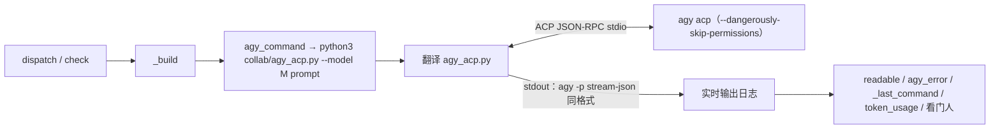

# 方案：开发助手里的 agy 改走 ACP

> 2026-11-22，状态：✅ 用户已批准（11-22 回“可以”）
> 依据：[需求共识](需求共识.md)（用户 11-22 定 1B 2A）

## 做完后你能感受到什么

- **界面上什么都不变**：卡片实时进度、卡住提醒、token 用量、报错原因、团队检测，和现在一样。
- **变的是看不见的那层**：开发助手叫 agy 干活时，不再用 Google 点名不支持的一次性命令，改走官方给第三方程序开的门（T3 Code 走的同一条路）。
- 唯一可能看得出的差别：agy 出错时，卡片上的原因说法可能和以前略有不同（都是 agy 自己说的原话）。

## 怎么做（一句话）

在开发助手和 agy 之间加一个“翻译”：开发助手照旧发活、照旧读结果；翻译负责用 ACP 跟 agy 说话，再把 agy 的回话**翻成和现在一模一样的格式**交回来。这样后面读进度、读用量、认报错、看门人那一大片都不用动。

| 要做的东西 | 来源 | 说明 |
|---|---|---|
| 翻译（新文件 `collab/agy_acp.py`） | 新做 | 现成的不行：DSH 有 ACP 接法，但它是另一套程序（Node），搬进来比自己写一个小翻译更重；开发助手里没有任何 ACP 代码 |
| 派活出口（`agy_command`） | 改现有 | 原来拼 `agy -p …`，改成拼“用翻译去叫 agy” |
| 读进度、读用量、认报错、看门人 | 用现成的，不改 | 翻译吐出来的格式和原来一致，它们照旧读 |
| 团队检测 | 用现成的，不改 | 它也是走派活出口叫 agy，跟着自动换 |

翻译做的事：
1. 拉起 `agy acp`，并开启“全部自动批”（口径 1B）。
2. 开会话、选模型和强度（例如 Gemini 4 Neon 高）、把活发过去。
3. agy 每走一步（想、读文件、跑命令、写文件），翻成原来格式的一行吐出来；agy 来问权限，一律批（1B）。
4. 做完时吐出原来格式的“结果”一行：成功带回复原文和用量；失败带 agy 自己说的原因。
5. 出错不退回老办法（口径 2A），直接按失败结果交回。

## 影响面清单

```
1. 动的是什么？   关键词：agy_command、"agy", "-p"、agy -p
   全仓搜到（不含应用打包产物）：代码 1 个（collab/agents.py）、测试 3 个（test_collab_agents.py、
   test_flowfix_17_agy_stream.py、test_collab_config.py）、文档 1 个（台账，只是历史记录，不改）。
   页面文字 / 外壳 / 规则包：搜不到 agy -p。
2. 谁在读、谁在写？
   - collab/agents.py `_build` → 唯一调用 agy_command 的地方 → 跟着改（就是改这里）
   - collab/agents.py `_agy_result`/`readable`/`agy_error`/`_last_command` → 读输出格式 → 不用改（翻译吐同样格式）
   - collab/token_usage.py `_agy_from_lines` → 读 result/step_update 里的用量 → 不用改（同上）
   - collab/dispatch.py（报错原因、派活）→ 只调 readable/agy_error → 不用改
   - collab/check.py 团队检测 → 走 ask → _build → 自动跟着换；它的“装没装”检查找的是 agy 命令 → 不用改
   - 停工：_stop 按进程组整组停，翻译和它拉起的 agy 在同一组 → 不用改（施工时实测确认）
   - desktop/、collab/blocks*.py 里的 agy：是团队页选项、积木库预置工具、文字，不派活 → 不用改
   以上按文件归类核实，读输出格式的几处逐个读过代码；blocks* 没逐行核实。
3. 有几个入口？   写测试、写代码、复查、起草、团队检测都经 _build → agy_command 这一处；规则放在必经处：是。
4. 会连带变什么？ 文档：collab/README.md 补一句 agy 怎么接；测试：新加翻译的测试，3 个老测试里断言
   “命令是 agy -p”的要跟着改；界面文字：无；台账：一条；README：无；规则包：无。
5. 和已批准文档矛盾吗？ 对过需求共识（1B 2A、不做清单）：无。
6. 老数据、老配置、已装应用？ 配置不用改（agy 选的模型名 ACP 认得同一套）；已装应用要重装才生效；
   影响正在跑的卡：有——改的就是跑卡叫 agy 的方式，施工和重装时不能有卡在跑。
7. 这次明确不改什么？ 超级玩家、w2、IP；团队页模型列表；界面；本机 agy 包装壳。
8. 怎么证明做对了？ 测试：翻译的测试（用假 agy 模拟各种回话，先红后绿）+ 全部老测试；
   走查：真实应用里团队检测 agy 通过 + 在一个练习用的假项目上跑一张小卡、agy 当写测试员（未做）。
9. 有没有奇怪的老代码？ 有：agents.py 第 74 行注释“㉙”——当初改成边干边吐，是为了让看门人知道 agy
   在干活（十几分钟只读不改文件会被误判卡住）。决定：留，翻译必须照样边干边吐，不能等做完才一次吐出。
```

## 谁来做

我（Claude）亲自做，不交开发助手跑卡。理由：改的正是“跑卡怎么叫 agy”，而 agy 现在就是开发助手的写测试员——让它给“改自己的接法”写测试，等于边干活边换自己的工具（规则包《架构师》：改正在用的跑卡流程，自己做）。照规矩建一张“自己做”的卡，你在窗口里能看到进度。

做完交 Codex 极高档独立复查，最多 3 轮。

## 泼冷水

- **合规只是更近一步。** 接法和 T3 一样了，但还是程序自动派活、没人盯着；Google 会不会算“人在场使用”，说不准。
- **权限全部自动批（1B）**：安全性和现在一样，没有变好。
- **多了一个翻译环节**：多一个可能出错的地方。agy 以后升级如果改了 ACP 的说法，翻译要跟着修；为此翻译里遇到认不出的回话会原样记下，出错时卡片上能看到原文。
- **出错不退回（2A）**：如果 ACP 这条路哪天坏了，agy 岗位会直接干不了活，要么等修、要么临时在团队页换人。
- **格式翻译不会百分之百一样**：agy 原来那种格式里有些细节（比如步骤编号）ACP 不给，翻译只保证后面几处真正在读的字段一致；其余细节对不上不影响使用。
- 工作量估计半天到一天（推测），主要花在测试和真卡试跑上。

## 技术设计（写给接手的 AI，用户可跳过）



- 进程：翻译由 `_run` 起（start_new_session），agy 是翻译的子进程，同一进程组；`_stop` 整组停，翻译退出时也要主动关掉 agy。
- 叫哪个 agy：优先 PATH 上的原版（本机 `agy` 是包装壳、会在子命令前塞参数，施工时实测它和 `acp` 子命令能不能共存，不能就找 `agy-real`，都没有就用 `agy`）。
- 模型：配置里是 `gemini-4-neon-high` 这种“模型-强度”编号。11-22 实测 `session/new` 返回的 availableModels 用的正是这套编号；用 `session/set_model`（或 set_config_option 的 model + thought_level）设置，施工时实测哪个可用。设不上（模型名不认识）→ 吐 status=ERROR、error=agy 原话的结果行。
- 事件映射（只保证下游在读的字段）：
  - 开头吐 `{"event":"init",...}`。
  - `tool_call`（开始）→ `step_update` state=ACTIVE、step_type=tool、tool_name、tool_info.parameters；跑命令类映射成 tool_name=`run_command`、parameters.CommandLine（`_last_command` 和看门人读它）。
  - `tool_call_update`（完成）→ 同一步 state=DONE。
  - `agent_message_chunk` → 拼回复原文；`agent_thought_chunk` → 一行 step_update（只为“有动静”）。
  - `session/prompt` 返回 usage（inputTokens、cachedReadTokens、outputTokens、thoughtTokens）→ 结果行 usage 换成 agy 原来的键（input_tokens、cache_read_tokens、output_tokens、thinking_tokens、total_tokens）。注意 ACP 的 inputTokens 是否已含缓存，施工时对照一次真跑定，别算重。
  - stopReason=end_turn → status=SUCCESS；其他 stopReason、JSON-RPC 报错、agy 提前退出 → status=ERROR，error 写原因原文。
- 权限：`session/request_permission` 一律选第一个 allow_always，没有就 allow_once（1B）。
- 不退回 `agy -p`（2A）。
