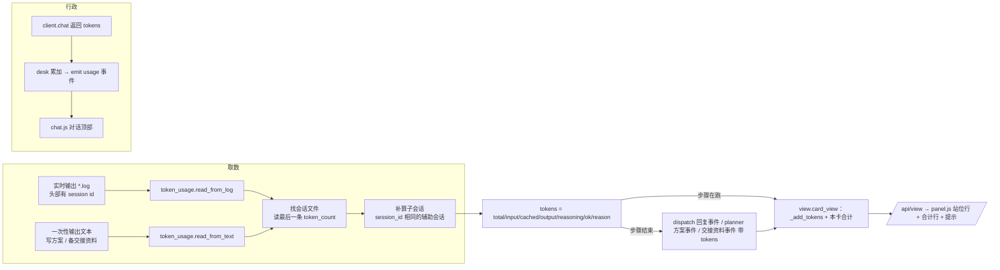

# 方案：开发助手显示 token 用量

> 依据 [需求共识](需求共识.md)（用户 2026-11-17 批准）。**待用户批准。**
> 判大小：**大**。这是新规范下第一个真实任务。本方案按规范第 6 节写，含**影响面清单**（第 6 节）和“技术设计”（末尾，写给下一个会话的 AI 看，你可以跳过）。

## 1. 你会看到什么

**右栏每个环节**（写方案、写测试、写代码、复查）：在原来那行计时后面多一项“已用 N token”。

- 在跑：`已干 4:57 · 58 秒前有动静 · 已用 87.3 万 token`，数字随着每一轮对话完成往上涨；
- 跑完：`已用 220.8 万 token`，定格。
- **把鼠标放上去**，提示里写分项：`输入 217.8 万（其中缓存读取 208.3 万）· 输出 3.0 万 · 新消耗 9.5 万（不含缓存读取）`。
- 读不到：`用量 —（原因）`，不显示 0。

**整张卡**：环节列表下面一行：`本卡合计 540.4 万 token（其中交接资料等其他 2.0 万）`。

**返工、自动退回**：同一环节几轮相加，不清零；某一轮读不到，写“有 N 轮没读到”。

**行政**：每段对话顶部、行政名字旁边：`已用 N token`，每回答一次增加，重开应用后还在。

## 2. 一个我刚查到、你必须知道的事：两种“token 数”差 7 倍

Codex 自己跑完时会打印一行 `tokens used`，会话记录里还有另一个合计。**它们不是同一个数**。拿我自己刚跑的一次复查对比：

| | 数字 | 含义 |
|---|---|---|
| Codex 打印的 `tokens used` | **138,259** | **不含**缓存读取：新输入 + 输出 |
| 会话记录里的合计 | **1,035,411** | **含**缓存读取：输入（其中缓存读取 897,152）+ 输出 |

共识里你批准的是**合计（含缓存读取）**，所以界面上的主数字用后一个。**但你要是拿它去和 Codex 自己显示的、或订阅/账单页面上的数字比，会差很多倍**，所以我把“新消耗（不含缓存读取）”放在鼠标提示里，和 Codex 自己的数对得上。主数字用哪个，列在第 9 节第 2 条，由你定。

## 3. 数据从哪来（做法）

| 环节 | 取数办法 | 已验证 |
|---|---|---|
| **写测试、写代码、复查**（Codex 壳；千问也是） | 每一步运行时，工具把输出实时存成一份“实时输出”文件，**文件头部有这次 Codex 的“会话编号”**；按编号找到 Codex 的会话记录，读**最后一条累计用量**（每完成一轮对话更新一次） | ✅ 在真实卡 CARD-002 的实时输出里看到了会话编号；本机 648 个会话记录都有累计用量，含千问的约 30 个 |
| **写方案** | 它是一次性跑完再取输出的，**跑完才能拿到会话编号**，所以**跑完后一次性显示**（见第 9 节第 1 条） | ✅ 输出里有会话编号 |
| **备交接资料** | 同上，跑完取输出里的编号，计入“其他” | ✅ |
| **辅助会话**（Codex 自己的自动审查，约 2 万，很小） | 会话记录里有“父会话编号”，按它归入同一环节的“其他” | ✅ 在那张真卡里查到了 |
| **行政** | 每次调用模型接口，接口本来就返回这一次的用量，**现在代码拿到了没汇总**；改成累加起来 | ✅ 读了代码，字段存在；**没验证过实际值** |

**这一点解决了共识里我最担心的难题**：写测试和备交接资料同时在同一个目录跑，**不用靠时间猜**，每个都有自己的会话编号，不会对错号。

## 4. 做成几张卡

我建议**拆两张卡**，先 A 后 B，原因是每张卡小、出问题好定位，也对千问友好：

| 卡 | 内容 | 主要改哪里 |
|---|---|---|
| **A（第一张）** | 卡片各环节：读取 + 记录 + 右栏显示 + 本卡合计 | 协作包（新增读取模块、派活记录）、右栏取数、右栏页面 |
| **B** | 行政对话累计 | 行政对话、对话页面 |

两张都由开发助手自己跑（项目打开的是开发助手这个仓库）；每张卡前由 Claude 写施工单，并把可直接粘贴的话写在聊天里给你。

## 5. 分工和流程

- **Claude**：写这份方案、任务清单、每张卡的施工单和可直接粘贴的话；准备**测试样本**（用真实会话记录的结构做的最小样本，放进施工单）；最终验收（回放对照、全量、真实走查）；核实复查意见。
- **开发助手**：A 卡、B 卡的施工（写测试 → 写代码 → 跑测试 → 复查）。
- **你**：批准文档、粘贴、在开发助手里批准方案和允许开工、真实窗口看一眼。
- **卡在跑的时候我不碰开发助手这个仓库**（挡路的毛病除外）；做完**要重装才生效**，重装要你先退出应用。

## 6. 影响面清单（规范第 6 节）

1. **动的是什么？** 关键词：流转记录里的“回复”事件、右栏的“站位”（stations）、站位那行的显示、行政调用模型（`client.chat`）。**搜索证据**：
   - “回复”事件被 4 个非测试文件读写：`collab/dispatch.py`、`collab/flow.py`、`desktop/view.py`、`desktop/chat.py`；
   - 站位只有 1 个前端文件在用：`desktop/static/panel.js`；
   - 行政调用模型共 4 处：主对话（`desk.py`）、起标题（`desk.py`）、改要求拆分（`revision.py`）、连通检测（`server.py`），另有 3 处属于积木库相关（不涉及）；
   - 测试里引用站位或“回复”事件的有 **20 个文件**，用假 Codex 的有 **7 个**。
2. **谁在读、谁在写？**
   - **写**：`dispatch._dispatch`（回复事件加用量）**要改**；`planner`（方案事件加用量）**要改**；备交接资料的记录**要改**。
   - **读**：`view.card_view` 旁新增取用量 **要改**；`panel.js` 的站位渲染 **要改**。
   - `collab/flow.py` 的记录函数本来就收任意额外字段，**不用改**（已读）；`desktop/chat.py`（旧聊天）命中“回复”，**不改**：只按种类和摘要取，新增字段不影响（**未逐行核实**）。
   - **已有名字别撞**：`collab/usage.py` 已存在，是 Claude 额度记录（只统计 Claude 会话），**新模块不能叫 usage**，用 `token_usage.py`；事件里的字段叫 `tokens`，不叫 `usage`（agy 的输出里有 `usage`）。
   - **20 个引用站位的老测试**：只新增字段、不改已有字段，不应受影响；**但整个站位字典做相等比较的测试会不会坏，我还不确定**，施工时跑相关测试看。
3. **有几个入口？** 右栏数据**只有一个出口**：`/api/view` → `card_view`，所有环节的用量都在这里一处取，**规则放在必经处**；行政是另一条路（对话事件流），单独处理。卡片列表上暂不显示用量。
4. **会连带变什么？** 台账、README 里关于右栏的说明、协作包手册里的流转记录字段、新增测试；记忆不涉及。
5. **和已批准文档矛盾吗？** **有一处偏离**：共识第 3 条写“在跑的环节随时增长”，本方案**“写方案”这一环节只在跑完后显示**（第 9 节第 1 条）。**按规范，这要你批准，不批准我就改做法。**
6. **老数据、老配置、已装应用？**
   - **老卡**（没有用量字段的）：已经结束的显示“—”，**不回填**；
   - 开发助手是冻结的，**做完要重装才生效**；装前确认应用没在运行、后台没有卡在跑；
   - 会话记录在本机 `~/.codex`；换电脑或这个目录被清理，已结束的步骤数字已经写进卡片记录，**不受影响**，只是在跑的步骤读不到。
7. **这次明确不改什么？** 价格和价格表；预算上限；agy 和 Cursor；补算历史卡；汇总统计页；“写方案”实时显示；行政的“改要求拆分”和“连通检测”两处用量；不改任何 token 消耗的设置。施工中碰到就走“范围变更”规矩。
8. **怎么证明做对了？**
   - **回放对照**（验收标准 1）：拿“流程测试带界面”那张卡的两个真实会话回放，读出的数必须是 **2,207,607**（写测试）和 **3,193,053**（写代码）；**这两个文件在你本机，测试里不能依赖它们**，所以单元测试用我按真实结构做的小样本，回放对照由我在最终验收时手工做；
   - 单元测试（先红后绿）、全量测试；
   - 真实窗口走查：跑一张真卡，看数字涨、定格、合计；**点击类的验证请你点一次**；
   - Codex 独立复查（按规范）。

## 7. 泼冷水

- **一个模型回合刷新一次，不是每个字**。数字一格一格涨。
- **依赖 Codex 的两个内部格式**：实时输出头部的“会话编号”、会话记录里的“累计用量”。Codex 升级后可能变。变了就显示“—”，不会让卡出错，但没有数据。
- **会话记录文件最大约 3.7 MB**。我设计成只读文件尾部找最后一条累计，不会因为记录很长变慢，验收时我用约 300 万 token 的那个会话实测一次耗时。
- **千问的用量是它自己报的**，数字本身准不准我没法核对。
- **“新消耗”和“合计”差得很大**（第 2 节），容易看糊涂，所以我把主数字和提示分开写。
- **这两张卡本身会花不少 token**，A 卡按上面那张真卡的量级推测在 500 万以上，**是推测**。
- **写代码用千问，读文件格式这类活可能吃力**，所以施工单要附样本、写准，我会盯着；千问做不动就由我接手，写进台账。
- **它改的是开发助手自己的代码**，应用冻结所以安全，但改完你看不到效果，要先重装。

## 8. 工作量

A 卡：写文档和施工单约 1–2 小时，开发助手跑一张卡（含返工）和我验收约半天；B 卡较小。**这是估计，没有实测。**

## 9. 待你决定（带推荐）

1. **“写方案”这一环节要不要也实时涨？** 共识写的是在跑的环节随时增长。写方案现在是一次性跑完再取输出，实时显示要改它的取输出方式，风险较高，而它每张卡只跑一次、低档、很短。
   **推荐：不实时，跑完后一次性显示**（这是对共识的偏离，需要你点头）。
2. **主数字用哪个口径？** A）合计（含缓存读取，共识原定），B）新消耗（不含缓存读取，和 Codex 自己显示的数一致）。
   **推荐：A，主数字用合计，提示里写新消耗**，和共识一致、也能和 Codex 对上。
3. **行政的范围**：行政累计包含哪些调用？
   **推荐：主对话回合 + 起标题**；不含“改要求拆分”和“连通检测”（后两者不属于这段对话本身，记入遗留）。

---

## 技术设计（写给下一个会话的 AI；你可以跳过）

**模块与约定**
- 新模块 `collab/token_usage.py`（纯读取，无副作用）：
  - `session_id_from_text(text)`：从输出头部取 `session id: <uuid>`；
  - `find_session_file(uuid)`：在 `$CODEX_HOME`（默认 `~/.codex`）的 `sessions/` 下按文件名后缀 `<uuid>.jsonl` 找；先查最近两天的日期目录，再全局找；**找到后把路径缓存**；
  - `read_total(path)`：**从文件尾部**往前读（先 256 KB，不够再扩），取最后一条 `payload.type == "token_count"` 且 `info` 非空的 `info.total_token_usage`；
  - `children_of(uuid, since)`：只读同日期目录里不早于主会话开始时间的文件的**第一行**，取 `session_id == uuid` 且 `id != uuid` 的（辅助会话，如 guardian 审查）；
  - 返回 `{"total", "input", "cached", "output", "reasoning", "ok", "reason"}`；**任何异常都不向上抛**，返回 `ok=False` 和原因。
- **合计 = `total_tokens`**（= 输入 + 输出，输入含缓存读取）；**新消耗 = 输入 − 缓存读取 + 输出**。已用真实会话验证：`1,019,589 − 897,152 + 15,822 = 138,259`，与 Codex 打印的 `tokens used` 一致。
- 事件字段名统一 `tokens`；多轮相加用 `sum_tokens(list)`，只要有一项 `ok=False` 就带 `missing=N`。
- **只对 Codex 壳的环节生效**（`tool in ("codex", "qwen")`）；agy、Cursor 事件不带 `tokens`，界面不显示用量，不算失败。
- `view` 里：已结束的步骤用事件里的 `tokens`；**在跑的步骤**用最后一条“派活”事件的实时输出文件现读（不新增轮询，沿用右栏 1.5 秒一次的刷新）。
- 站位字典**只新增 `tokens` 字段**，不改已有字段；`card_view` 返回里新增 `tokens: {"total", "other"}`（本卡合计和其他）。
- “其他” = 辅助会话 + 备交接资料 + 非三岗的环节（如起草“继续改”）。
- 行政：`desk.py` 里对话回合每次拿到 `answer["tokens"]` 累加到会话；每次累加后 `emit({"type": "usage", "total": N})`；会话事件本来就持久化，重开时页面按最后一条 `usage` 恢复；起标题那次（`desk.py:981`）也累加。

**测试设计**：`token_usage` 是纯函数，单元测试用按真实结构做的小样本（含：正常、尾部有半行、没有 token_count、主会话 + 辅助会话、文件被删、格式不认识）；`view` 和 `dispatch` 用假 Codex + 假会话文件；回放对照由 Claude 验收时对两个真实会话手工做。**测试里不依赖本机 `~/.codex`。**
