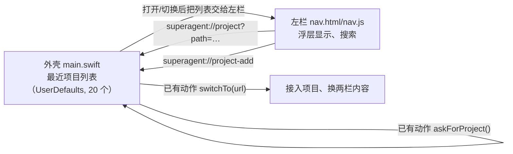

# 方案：左下角一键切换项目

> 2026-11-19 · 依据《需求共识.md》（用户 11-19 确认）· 状态：用户已批准（11-19）

## 用户会看到什么

1. 左栏左下角：项目名后面多一个向下小箭头，鼠标移上去整块变亮，提示能点。右边“团队”按钮不变。
2. 点它：从左下角往上弹出浮层，宽度和左栏差不多：
   - 顶部“搜索项目”框，弹出时光标已在里面，打字即筛（不分大小写，名字里含这几个字就算）；
   - 项目列表：文件夹图标＋项目名，最近用的在最上面；当前项目高亮、右边打勾；超过约 7 个时可以滚；
   - 搜不到时列表处显示“没有匹配的项目”；
   - 分隔线下面“＋ 添加项目”。
3. 点列表里某个项目：浮层关掉，整个窗口切到那个项目（和现在顶部菜单切换效果完全一样）。点当前项目只是关掉浮层。
4. 点“＋ 添加项目”：浮层关掉，弹出系统选文件夹窗口；选好就导入并切过去，它出现在列表最上面；点取消什么都不变。
5. 点浮层外面、按 Esc，浮层关掉。
6. 顶部菜单“文件 → 打开项目… / 最近打开”照旧，和左下角是同一份列表（最多 20 个）。
7. **切回一个项目，回到离开时的地方**：那段对话或那张卡、输入框里没发的字都还在。等 1～2 秒加载（用户选 A，不做常驻内存）。关掉应用再打开也记得（每个项目记一份）。

## 切走时正在进行的事

- **跑着的卡**：本来就在后台单独跑，切项目不停它；切回来右栏照常显示进度或结果。不弹提醒（用户选 A）。
- **行政正在回话**：查过，回话在后台写完并存下来，切走只是页面暂时不看；切回来能看到完整回复。
- **预览**：沿用现在的规矩，切走时关掉旧项目的预览（不改）。

以上两条“不丢”要在真实窗口里实测确认，写进验收。

## 泼冷水

- **左栏浮层是网页做的，Mac 菜单那种“毛玻璃”效果做不出来**，会是深色圆角卡片，样子接近 Codex 截图，但不会一模一样。
- **自动测试管不到“点了真的切过去”**：卡片里的测试只能检查列表怎么排、怎么筛、点了发出什么指令、外壳收到后调用哪个动作；真正切过去要 Claude 重装后在真实窗口里走查，最后用户亲手点。
- **要退出一次开发助手**：外壳要重新生成应用才生效。
- **切项目本身要 1～2 秒**（重新接入、加载两栏），这次不优化（用户选 A）。
- **“没发的字”只记文字**，粘进去的图片、附件不记。

## 施工中定下的取舍（11-20）

- 停用了行政的项目切回来停在团队设置页、不恢复卡（配好行政后再恢复）；看卡时点“团队”右栏照旧收起。
- 看卡时主对话没发的字单独保管（不是丢掉）：回主对话放回，切走/退出时记下的也是它。

## 不做

项目管理页（改名、排序、钉住、移出列表）、同时开两个项目窗口、改团队配置存法。

## 技术设计（给下一个 AI 看，用户可跳过）

- **复用现有机制，不另造**：切换一律走外壳现有 `switchTo`；选文件夹走现有 `askForProject`；列表沿用 `recentProjectsKey`，上限 10 → 20，顶部菜单同一份。
- **左栏 ↔ 外壳通信沿用现有 `superagent://` 地址**（“团队”按钮就是这样）。新增两个：`project?path=`（切换）、`project-add`（添加）。
- **外壳把列表交给左栏**：左栏页面加载完、以及每次 `remember` 后，外壳把 `[{name, path, current}]` 交给左栏（具体用页面地址参数还是调用页面函数，由施工单定）。只给存在的文件夹。
- **外壳收到 `project?path=` 必须核对**：路径在最近列表里、且文件夹存在，才切；否则忽略。左栏页面不能借这个入口打开任意文件夹。
- **排序、筛选、“当前项目打勾”这些纯逻辑放进 `NavCore`**，用 `tests/nav_page_check.js` 测。
- **自测打开（带 `--project`）不记进列表**，规矩不变。
- **记住上次停在哪**：外壳按项目路径记 `{对话编号或卡号, 草稿}`（UserDefaults，键里带项目路径）。切走前（`switchTo` 开头）向左栏/聊天页要当前对话、选中卡、草稿并存下；切回后打开时先按记录恢复，记录里的对话或卡已不存在就照旧接最近一段。草稿只存文字、有长度上限。
