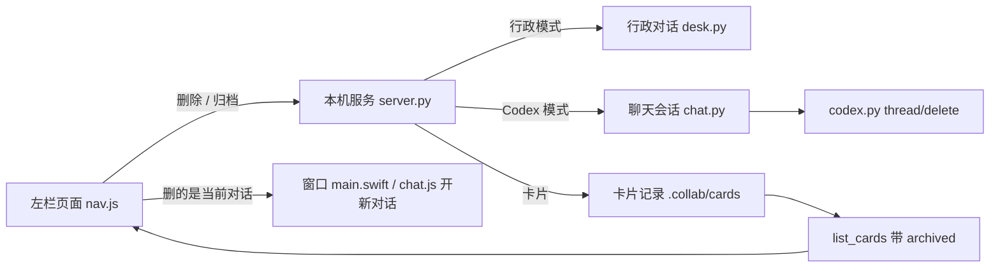

# 方案：左栏列表的删除和归档

状态：2026-11-07 ✅ 用户批准（“开搞”）。

## 用户会看到什么

### 主对话：删除

1. 鼠标移到一段对话上，右边的时间换成删除图标。
2. 点图标，弹出确认：“删除这段对话？删除后找不回来，已提出的任务不受影响。”
   - 用 Codex 时加一句：“Codex 里的这段记录也会一起删除。”
   - 这段对话里有没确认的提议时加一句：“里面还有一个没确认的提议，会一起作废。”
3. 确认后，这段对话从列表消失，重开软件也不会回来。
4. 删的是正在看的那段：中间换成一段新的空白对话。删的是别的对话：中间不动。

不让删的情况：

- 这段对话正在回复：没有删除图标，先停止或等它说完。
- 用 Codex 但还没连上、连接断了或取不到列表：显示上次记住的列表，没有删除图标。
- 不是超级助手开的 Codex 对话：能看，但没有删除图标。从超级助手的终端视图开的对话也算这种，Codex 把它们记成终端来源。这是往安全方向的误判。
- 只用终端的调度员：本来就没有这个列表，不涉及。

### 等待处理：归档

1. 鼠标移到“已完成”组里的卡上，右边出现归档图标。这组里的卡都能归档，包括“已完成”“不做了”，以及状态读不出来的卡，免得它们永远赖在列表里；等你处理、进行中的卡没有。
2. 点一下就归档，不用确认，因为能找回。
3. 卡片收进列表最下面的“已归档 N”，默认折叠，点开能看，也能点进去看记录。
4. 已归档的卡，移上去出现“取消归档”，点一下回到原来的组。
5. 搜索也搜已归档的卡，免得用户以为卡丢了。
6. 正在看的卡被归档：中间回到主对话。打开软件时也不会默认显示已归档的卡。
7. 行政还能查到已归档的卡，用户问“之前那个做过没有”时不会答错。

### 改词

用户能看到的“记录已归档到 docs/…”改成“记录已存入项目文档 docs/…”，包括流程记录、台账和验收记录。老记录不改，命令行的 `archive` 命令也不改。

## 系统会记住什么

- 主对话删除：删掉这段对话的聊天记录和它在列表里的条目。还没确认的提议标记为作废，已确认的提议记录保留，因为卡片可能用到。
- Codex 模式：让 Codex 删掉这段对话，它派生出的子对话也会一起删（官方文档写明）。只有 Codex 标明是超级助手开的对话才能删。内容提到超级助手的外来对话可能也会显示在列表里，甚至被自动接上，但能看不能删，没有删除图标，服务也会拒绝。真实 Codex 0.167.0 已确认列表带这个来源。
- 卡片归档：在卡片记录里记一个“已归档”标记。不移动、不删除任何东西，也不算卡片有新动静，排序不变。

## 放弃时一起删改好的版本

卡片放进项目时会删掉施工副本，点“放弃这个需求”原来不会。用户同意放弃时一起删，确认框写明“改好的版本也会删除”。删除失败只记一条，卡片仍算放弃。老卡留下的副本不动。试验实现已验证。

## 泼冷水

1. **删除真的不可恢复。** 讨论完没写成卡片的结论，删了就没了。这是这次选“主对话删除”接受的代价。
2. **删除来源对话后，卡片照常施工，但不再往那段对话发进度。** 卡片结果仍显示在等待处理里，数字角标照常。用户要自己去那边看。
3. **删除只管本机记录。** 行政已经发给模型服务的内容不受影响。Codex 本机文件确认删掉了，它的云端有没有副本没验证过。
4. **Codex 的这个能力官方标着“试验中”。** 2026-11-07 用 0.167.0 实测通过，以后升级可能变；Codex 版本太旧或删除失败时，只提示失败，列表不动。
5. **归档只是让列表变干净，不省硬盘空间。**
6. **鼠标移上去才看得到图标。** 不够显眼，但不会让每一行都多个危险按钮。键盘切到这一行时也会显示。

## 借鉴主流工具的分析（2026-11-07）

用户要求：先看最火的 AI 工具怎么做，逐条判断直接采纳、调整还是不采纳，不照抄。

### 各家做法

| 工具 | 列表里的东西 | 做法 | 依据 |
|---|---|---|---|
| ChatGPT | 聊天 | 删除和归档都有。删除要确认、不可恢复；归档不用确认、可搜索，在设置里找回 | [官方帮助](https://help.openai.com/en/articles/8809935-deleting-and-archiving-chats-in-chatgpt) |
| Claude | 聊天 / 项目 | 聊天：帮助页只写了删除，要确认。项目才有归档 | [聊天](https://support.claude.com/en/articles/8230524-delete-or-rename-a-conversation)、[项目](https://support.claude.com/en/articles/9519177-how-can-i-create-and-manage-projects) |
| Gemini | 聊天 | 帮助页写的是删除 | [官方社区指南](https://support.google.com/gemini/community-guide/309962068/delete-your-gemini-chats-in-just-a-few-clicks?hl=en) |
| Cursor | 带施工的 AI 任务 | Agents 窗口特意用归档替换删除，防止误删；用户持续要求加回删除 | [官方回复](https://forum.cursor.com/t/how-to-delete-a-chat-in-agent-window/163380)、[用户反馈](https://forum.cursor.com/t/allow-single-click-deleting-chats-from-chat-history-panel-and-agent-side-bar/153562) |
| Codex | 带施工的 AI 任务 | 归档为主，归档时清施工副本并存快照；用户要求删除后，现在也能永久删除 | [副本说明](https://developers.openai.com/codex/environments/git-worktrees)、[接口文档](https://developers.openai.com/codex/app-server)、[用户要求](https://github.com/openai/codex/issues/24417) |
| VS Code | 带施工的 AI 任务 | 鼠标移上直接归档，右键删除并警告；归档时先保存改动再清副本，恢复时重建 | [官方文档](https://code.visualstudio.com/docs/agents/run/sessions/manage-sessions) |
| GitHub Copilot | 云端 AI 任务 | 云端只能归档不能删，且只能归档已停止的；本地的能删 | [官方文档](https://docs.github.com/en/copilot/how-tos/copilot-on-github/use-copilot-agents/manage-and-track-agents)、[用户反馈](https://github.com/github/copilot-cli/issues/3072) |

规律：**纯聊天工具以删除为主；带施工的 AI 工具以归档为主，而且只给归档的工具都被用户要求加删除。** 超级助手正好两种都有：主对话是聊天，卡片连着施工。

### 别人踩过的坑

- 删了又回来：[Cursor](https://forum.cursor.com/t/deleted-past-chats-will-appear-again-after-the-new-recent-update/156588) 用户多次报告，[Codex](https://github.com/openai/codex/issues/28095) 也有删除按钮没真删的报告（用户反馈已修）。
- 只能归档：Cursor、Copilot、Codex 都有用户抱怨“只是藏起来”；Cursor 还因为两个界面规则不同被批评。
- 卡死的任务收不掉：[Copilot](https://github.com/orgs/community/discussions/192855) 有任务卡在排队两个月，打不开所以也归档不了。
- 归档不可靠：[Codex](https://github.com/openai/codex/issues/12166) 有取消归档后对话丢失的报告。

### 判断

**直接采纳**

- 删除要确认、归档不用确认（ChatGPT）。
- 已归档的能搜到、能取消归档（ChatGPT）。
- 只有结束了的才能归档（Copilot）。
- 删除不做回收站（ChatGPT、Claude 都不能恢复）。

**调整后采纳**

- 入口：他们常藏在 ⋯ 菜单里，因为每行有多个操作。我们每行只有一个操作，移上去直接显示图标（接近 VS Code）。
- 已归档的位置：ChatGPT 放在设置深处。我们放列表底部折叠，点开就看到。
- 用词：VS Code 的 Agents 窗口叫“标记完成”。我们已有“已完成”组，再这样叫会撞名，所以用“归档”。
- 清施工副本：Codex、VS Code 在归档时清，因为它们能恢复继续做。我们的卡结束后不能接着做，所以应该在卡结束时清，放进项目时已经这么做了。

**这次新增**

- 验收专门测“删了不回来”：删完后继续聊别的对话、等卡片发通知、重开软件，都不能回来。
- “已完成”组里的卡都能归档，包括状态读不出来的卡。
- 检查没有任何按钮的状态（等待写方案、准备开工等）会不会卡死。查出问题先报告，不在这批顺手改。

**暂不采纳**

| 做法 | 为什么现在不做 | 什么时候再做 |
|---|---|---|
| 主对话也归档 | Claude、Gemini 只讲删除也能服务大量用户，主对话又没有施工 | 用户发现自己常舍不得删 |
| 卡片彻底删除 | 现阶段自用、卡不多；卡片和项目文档、台账有关联 | 已归档堆多了，加在“已归档”里（ChatGPT 的做法） |
| 批量操作 | 现在只有几条 | 单条清理嫌慢 |
| 自动归档 | 没数据判断该隔多久，Slack Code 的做法也只看到二手介绍 | 卡片多到经常手动归档 |
| 右键菜单 | 要多做一个小菜单；Cursor 用户确实会先右键，这里有取舍 | 用户找不到图标 |
| 临时对话 | 和这次要解决的问题无关 | 另提需求 |

### 这份分析的局限

- 看的是官方文档和用户论坛，没有逐个打开各家产品操作，各家界面也可能已经变了。
- 论坛上抱怨的人不代表多数用户，浏览量也不等于支持人数。
- 这些工具的用户多是开发者，超级助手现阶段只有用户本人。
- “Miros”没查到对应的产品和做法，所以没有列入。

## 实测记录（2026-11-07）

在临时文件夹用真实 Codex 0.167.0 开一段一次性对话：能列出 → 删除成功 → 列表、已归档列表都没有了，本机对话文件也没了 → 再读这段对话报错。删除不存在的对话会报错。没碰用户的旧对话。

## 技术设计（给下一个会话的 AI，用户可跳过）

约定：

- `thread/delete` 文档说对话文件不存在时算已删除，实测从没存在过的 id 会报错。服务端先核对列表，两种情况都不会误报成功。
- 新增地址沿用现有的本机口令校验。Codex 模式下，服务端先核对 id 在列表结果里、`deletable` 为真（`originator` 等于 `super-agent`，当前对话也不例外），再删除；删完同步更新记住的列表文件。取列表失败或取回来是空都不可信：只取最新 30 段，可能全被外来对话占满。这些情况都回记住的列表，不给删除，也不改记住的文件。
- 行政模式删除要从内存里移除已打开的对话，否则之后的通知会把文件写回来。这是必须覆盖的坑。`notify` 已经支持对话不存在时跳过。
- `busy` 的对话服务端也要拒绝，不能只靠页面藏按钮。
- 没确认的提议走 `decide` 的取消逻辑。
- 归档标记放独立文件，不写 `状态.json`，也不写 `流转.jsonl`，因为 `_updated` 看这两个文件的修改时间。卡片状态不增加新值。
- 能否归档由服务端按 `phase.tone == "done"` 且 `needs_you` 为假判断，和左栏“已完成”组的分组规则一致。
- `card_view` 选默认卡时跳过已归档。已归档的卡照常能点开，`keepSelected` 不改；归档正在看的卡时由左栏跳回主对话。行政的 `list_cards` 工具不过滤。
- 列表空了也要写记住的文件，否则重开软件删掉的会回来。左栏用已删除名单过滤迟到的旧回答。
- 左栏每行变成并排两个按钮；列表内容没变就不重画，否则 1.5 秒一次的刷新会让图标点空。
- 列表行现在是按钮，里面不能再放按钮，要调整结构。左栏页面没用过确认框，真实窗口要验证能弹出来。
- 这是大活（预计 250–350 行含测试，跨 6 个模块），按分工由 Claude 写施工单和验收测试、Cursor 施工。
