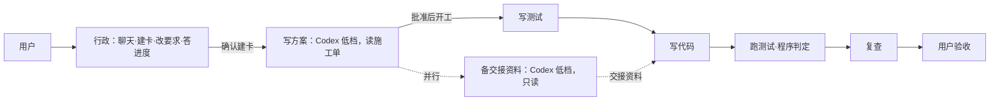

# 方案：开发助手去掉“调度员”这一行

> 依据 [需求共识](需求共识.md)。施工：Claude 亲自做（动的是正在用的开发助手）。**待用户批准。**

## 1. 你会看到什么

1. **团队页**：四行，从上到下是行政、写测试、写代码、复查。调度员那一行和它的“自定义命令”输入框、提示语都没了。
2. **窗口标题**：`开发助手 · 项目名`，不再有“调度员：Codex / 还没选调度员”。
3. **建一张卡后右栏**：原来第二站叫“调度”，现在叫“**写方案**”，右上角写 `Codex · GPT-6.1-Sol（低）`，旁边有用时。其余六站不变。
4. **老项目**：打开照常，团队页显示“已配置”，不用重配。
5. **没配行政时**：窗口停在团队页，提示先配行政（以前还能退回去和调度员聊，现在没有这条路）。
6. **非 git 文件夹**：团队页只剩行政一行。

后台两件事照旧：卡建好立刻写方案；开工后和写测试同时备交接资料。区别只有一点：它们不再读“调度员那一岗”的设置，改成固定 Codex、强度“低”。

## 2. 泼冷水

- **改动面不小**：配置、团队检测、服务端、团队页、右栏、行政、外壳，再加测试。估计一天上下，**这是推测**。
- **老测试要跟着改**：现有 67 个测试文件里出现了“调度员”，多数是别的功能顺带提到，不会坏；但检查团队页、右栏站名的那批（`test_desktop_view`、`test_flowfix2_display`、`test_desktop_team`、团队页的三个 js 检查等）必然要改。**估计 10–15 个文件**，动手后才知道准数，每处改动我会写进验收记录，不删测试。
- **外壳要重装**：开发助手是冻结的，改了窗口标题要重装才生效，重装会退出应用。**动手前我会先确认你没有卡在跑**。
- **旧聊天代码留着，但没有入口**：外壳不再读老配置里的调度员，老项目没配行政时也一样停在团队页（复查第 1 轮发现原稿这里前后矛盾，以第 1 节第 5 点为准）。旧聊天代码本身这次不清理。
- **“调度员”三个字不会彻底消失**：卡片状态里“需要调度员看看”这类话（二十多处）这次不改，原因见共识第 3 节。
- **固定“低”档没单独实测**：你现在给调度员设的就是“低”，所以施工单齐全时和现在一样；没有施工单的卡，方案质量也不会比现在差，但我没单独跑过对照。
- **停用行政后没有聊天对象**：窗口会停在团队页，这是“不再有退路”的直接结果，不是 bug。

## 3. 做法一览

| 区域 | 改什么 | 不改什么 |
|---|---|---|
| 配置（`collab/config.py`） | 团队只有三个岗位；读到老配置里的 `dispatcher` 直接忽略；“已配置”的判断改成：三位执行员都存过，或老配置里留着调度员；新增一个“写方案/备资料用的模型”（Codex，强度固定低，模型跟写测试） | 各家工具的模型名单、默认值 |
| 写方案 / 备资料（`collab/planner.py`、`collab/cli.py`） | 都改用上面那个新函数 | 提示语、流程、失败不挡流程的规矩 |
| 团队检测（`collab/check.py`） | 检测岗位去掉调度员 | 其余检测逻辑 |
| 服务端（`desktop/server.py`） | 团队选项去掉调度员；读不出配置时的兜底值、右栏取数里 `team["dispatcher"]` 改成容错读取（不改会直接报错，这是最容易漏的一处） | `/api/dsh/*` 一整套（超级玩家用） |
| 行政（`desktop/clerk/tools.py`、`tasks.py`） | 改团队的工具里岗位清单去掉调度员 | 建卡、改要求、进度回答 |
| 团队页（`team.html`、`team.js`） | 去掉那一行；“能不能保存”不再要求选了调度员；非 git 文件夹只显示行政；提示语改写 | 行政那一行、检测、模型选择、草稿暂存 |
| 右栏（`desktop/view.py`） | “调度”站改名“写方案”，名字固定 Codex，模型和用时取写方案记录里的，没有就取新函数的 | 七站的顺序、状态、转圈、打勾逻辑；`deferred_plan` 等待逻辑（只有超级玩家用） |
| 外壳（`main.swift`） | 窗口标题；两处占位文字、停用行政的确认框（任务清单 S2、S3）；不再读老配置/老设置里的调度员（S4） | 聊天、终端、“选调度员”的老代码本身 |
| 文档 | README 里团队配置一段、台账、本任务验收记录 | — |

## 4. 技术设计（写给下一个会话的 AI，可跳过）

- 原来的“调度员岗”拆成两个后台作业（写方案、备交接资料），都不再对应配置里的一个岗位，统一走 `collab/config.py` 里的新函数取模型（工作名 `plan_models`，旧位置 `planner.plan_models` 改成转调，避免两份）。
- 关键约定：**没有“调度员”岗之后，`models_for(project, "dispatcher", ...)` 会落到整体默认（强度“极高”）。** 所有原先走这条的地方必须改走新函数，否则写方案会悄悄变慢变贵。验收里有一条测试专门锁住“强度一定是低”。
- 兼容：`load_team` 不再返回 `dispatcher` 键，下游凡是 `team["dispatcher"]` 的读取（`view.py` 取数）一律改 `.get`；老配置文件里的 `team.dispatcher`、`role_models.dispatcher` 保存团队、保存岗位模型时都原样留着（超级玩家那套“接调度员”检测还在读，团队读写看不到它），不主动改文件。
- 外壳 `Dispatcher.forProject` 不再读 `team.dispatcher` 和窗口自己存的旧选择，只剩走查脚本用的 `--dispatcher`；所以“没配行政”一律停在团队页。
- 老配置里残留的调度员只留一对出口：`collab/config.py` 的 `legacy_dispatcher` / `save_legacy_dispatcher`，给开发助手仓库里还留着的那份超级玩家“接调度员”检测（`desktop/dsh_dispatcher.py`、`dsh_settings.py`）用；团队读写本身一律看不到它。
- 站位键 `disp` 不改名（前端、测试、记录里都在用），只改显示用的文字。
- 超级玩家不受影响：`/api/dsh/*`、`deferred_plan`、`dsh-plugin/` 都不碰。建卡的默认路径（行政确认）本来就立刻写方案，不会因为没有调度员而卡住（已核对 `create_card` 默认 `start_plan=True`，只有超级玩家的新界面会传推迟）。

## 5. 怎么验证

- 每个任务先写会失败的测试，再改代码（任务清单逐项写明）。
- 改共用文件（配置、view、server），按“测试节奏”：全量一遍；只改团队页那类相关改动时只跑相关。
- Codex 复查，最多 3 轮；Claude 最终验收。
- 重装后在干净环境（`env -i open -n`）真窗口走查三种项目：全新、老项目、非 git，各截图。
