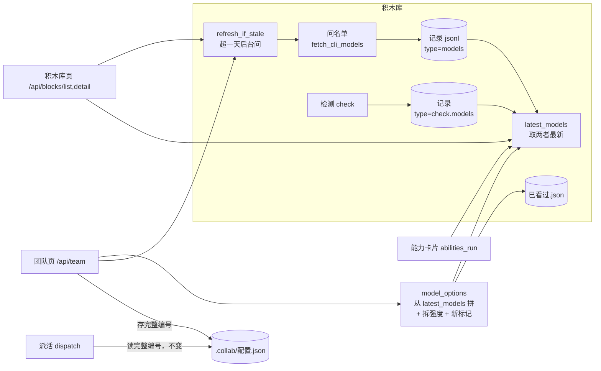

# 团队模型名单接积木库 · 方案

**状态：** 📝 初稿，待用户批准（2026-11-14）
**依据：** [需求共识](需求共识.md)（1A 2B 3A 4B，第 2 题最终口径：拆出思考强度框）
**已提前做的部分（2026-11-14 用户要求）：** agy 拆出思考强度框、内置名单加 Gemini 4 Hydrogen 四档（团队页 `renderEffortSplitBox`、`TeamCore.splitEfforts`），名单仍读内置的。整份方案做时把它改成读积木库名单、并扩到 Cursor。

## 一、你会看到什么

### 1. 团队页

- **Codex**：和现在一样，左边选模型，右边选思考强度。
- **Cursor、agy**：左边下拉框只列模型（Cursor 约 59 个，按 Cursor 自己的顺序，主推的在前；agy 约 6 个），右边新加“思考强度”框，只列这个模型有的档位：
  - 例：选“Claude Opus 5.5”，右边是 低 / 低 · 快速 / 中 / 中 · 快速 / 高 / 高 · 快速 / 极高 / 极高 · 快速 / 最大 / 最大 · 快速
  - 例：agy 选“Gemini 4 Hydrogen”，右边是 低 / 中 / 高 / 极高
  - 换模型时，右边尽量保持原来的档位（原来是“高”，新模型也有“高”就还是“高”；没有就选它最接近的一档）
  - 少数拆不开的老名字（如 `claude-4.6-opus-high-thinking`）单独一项，右边显示“—”
- **千问**：照旧（固定名单，这次不动）。
- **行政（腾讯云）**：照旧。
- **新模型标“新”**：下拉框里写成“Gemini 4 Hydrogen · 新”；某个老模型新加了一档，就在那一档后面标“新”。这一页显示过一次，下次打开就不再标。第一次用这个功能时，现有的全部算“看过”，不会满屏都是“新”。
- **你当前选着的模型从名单里消失了**：照样显示，写“（名单里已没有）”，照样能保存；点“检测”时如果真不能用，会照常报错。
- **积木库里没接这家**（比如你把 agy 从积木库移出了）：团队页用现在的内置名单，下拉框下面一行小字“去积木库接上这家，名单会自动更新”。

### 2. 积木库

- Codex、Cursor、agy 的模型名单，打开积木库或团队页时，距上次问到超过一天，就在后台自动再问一次。只问名单，不试模型，不花额度。
- 页面先显示上次的名单，问完自动换成新的，不用等也不用刷新。
- 积木块详情里的模型名单也标“新”，和团队页共用“看过”的记录（在哪一页看过都算）。
- 你点“检测”照旧会立刻拿一次最新名单（不用等一天）。
- 修掉“Tip:”被当成 Cursor 模型的小毛病。

### 3. 能力卡片

- 能力卡片选模型时读的也是积木库的名单，自动刷新后它也跟着更新。卡片本身的逻辑不改。

## 二、系统记住什么

- 每家每次问到的名单都记下来（问的时间、每个模型的编号和显示名，Codex 另记每个模型能选的强度），存在积木库的记录里，和“检测”的记录放一起。
- 一份“看过的模型”名单，存在积木库资料夹里，团队页和积木库共用。
- 团队页保存的东西**格式不变**：Cursor、agy 存的还是完整编号（如 `claude-opus-5-5-high-fast`），只是页面上拆成两个框显示。所以派活、复查、卡片右上角的“工具 · 模型”都不用改，老项目的配置读进来照样认。

## 三、泼冷水

1. **阿里百炼、火山这类 API 平台做不了自动刷新。** 它们问名单要密钥，密钥在钥匙串里，只有你打开积木库窗口时才交进来，后台拿不到。这次只自动刷新 Codex、Cursor、agy（团队页要用的正是这三家）；API 平台照旧点“检测”时更新。
2. **拆强度靠认编号结尾**（`-low`、`-high`、`-fast` 这些）。Cursor 或 agy 哪天改了命名规则会拆错——拆错时最多是某一项没拆开、单独显示，不会把你的选择存错（存的仍是完整编号）。
3. **Cursor 拆完仍有 59 个模型**，下拉框还是长。按你选的 2B 口径不再另挑“常用”；以后嫌长再加打字筛选。
4. **最多晚一天看到新模型。** 想马上看到就去积木库点那家的“检测”。
5. agy 自己也有单独的强度参数（`--effort`），这次**不用它**，照旧把完整编号交给 agy（它名单里列的就是这种编号，实测能跑），不改派活方式。
6. 改动会碰到积木库检测、积木库页面、团队页、能力卡片读名单这几处，老测试里凡是“读检测记录里的名单”的地方要跟着改，测试工作量比功能本身大。

## 四、不做

- 不加“刷新”按钮（积木库的“检测”就是）。
- 不接腾讯云、千问 Token Plan 进积木库。
- 不改团队页的角色、布局（除了 Cursor、agy 多一个强度框）、检测方式。
- 不做打字筛选。
- 不清理老项目里存的配置（格式没变，不用清）。

## 五、技术设计（给下一个会话的 AI 看，用户可跳过）

- **唯一来源**：新增 `latest_models(card_id)`，取 `check` 记录的 `models` 和新的 `models` 记录里较新的一份。现在直接读 `last_record(..., type="check")["models"]` 的地方全部改走它：`desktop/server.py`（约 605、742、990、1179 行）、`desktop/clerk/blocks_tools.py`（305、432）、`collab/abilities_run.py`（333）；积木库页面读的是服务端给的 `last_check.models`，由服务端在详情和列表里换成最新名单，页面脚本少改。
- **问名单**：`fetch_cli_models` 除编号外带回显示名（agy 第二列、Cursor “ - ” 后面、Codex `display_name`），Codex 带每个模型的强度；Cursor 只认带 “ - ” 的行（修 “Tip:”）。旧调用方只要编号的照旧能用。
- **自动刷新**：`refresh_if_stale(root, max_age=1 天)`，对积木库里存在的预置 Codex、Cursor、agy 积木块，各起一个后台线程问名单；同一家同时只问一次；问失败不写记录（沿用上次）。打开团队页、积木库列表时触发；接口返回“正在刷新哪几家”，页面每 2 秒问一次，问完重画下拉框，**保留用户当前选择和未保存的改动**。
- **拆强度**：只对 Cursor、agy。编号去掉结尾 `-fast`，再去掉结尾 `-(none|minimal|low|medium|high|xhigh|max)`，剩下的是模型；显示名同样去掉强度词和 Fast。拆完按首次出现顺序排。拆不开的单独一项。页面存回时拼回完整编号——**保存格式不变**，`collab/config.py` 的 `clean_role_models`、`model_label`、派活都不动（`model_label` 的显示名改从同一份名单取）。
- **“新”标记**：`积木库/模型名单-已看过.json`，按家记看过的编号。文件不存在时用当前名单初始化（不标新）。页面显示后调接口登记“已看过”。
- **兜底**：积木库没这家或从没问到 → `collab/config.py` 的 `MODEL_OPTIONS` 内置名单（保留，不再是主来源）。
- **测试**：全部用假 agy / 假 cursor-agent / 假 Codex 缓存，不起真工具；验收时 Claude 用真工具走一遍。
