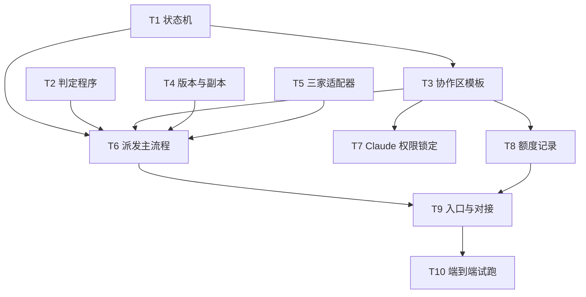

# 任务拆分：多 agent 协作包（super-agent 本体）

> 阶段：③ 拆任务（2026-11-04）　状态：⏳ 待用户审查（阶段 ④）　依据：[方案](方案.md)
> 本文件只拆"协作包本体"（super-agent 项目）。sp2 的代码改动（CARD-001）不在此列，它是协作包的测试对象。

## 0. 区分两件事

- **协作包本体**：`super-agent` 项目里要搭建的东西（派发程序、协作区模板、三家调用适配器、判定与返工规则）。**要先建、要测试。**
- **试跑对象**：sp2 的 CARD-001。用协作包去跑它，验证协作包能不能用。

## 1. 原子任务

每个任务都有：输入（依赖）、输出（交付物）、验收（可自动判断）。测试先写，实现后写。

### T1 状态机（纯逻辑，无外部调用）
- **输出**：`collab/state.py`，定义卡片状态流转：`待对齐 → 待派发 → 开发中 → 待测试 → 测试中 → 开发中（返工，最多 3 轮）→ 待验收 → 已合并`；超时或第 3 轮没过 → `需 Claude 介入`。
- **验收**：非法流转被拒绝；返工第 4 次自动转 `需 Claude 介入`；状态持久化到文件，重启后能接上。
- **依赖**：无。

### T2 判定程序（退出码）
- **输出**：`collab/judge.py`，执行 `项目档案.md` 里登记的测试命令，**只看退出码**，输出 过 / 没过 / 环境错误 / 超时。
- **验收**：退出码 0 → 过；非 0 → 没过；命令不存在 → 环境错误（不计返工轮数）；超时 → 超时。
- **依赖**：无。

### T3 协作区模板与任务板
- **输出**：`collab/workspace.py` + `templates/`：生成 `.collab/README.md`、`项目档案.md`、`任务板.md`、`cards/CARD-xxx/` 四个文件（需求卡、汇报、测试结果、返工记录）。任务板由程序更新状态。
- **验收**：生成的文件结构与方案第 3 节一致；任务板能反映 T1 的状态。
- **依赖**：T1。

### T4 版本备份与副本
- **输出**：`collab/vcs.py`：动手前打 tag（写入 `备份记录.md`）；为每张卡建 `git worktree`，分支 `card/CARD-xxx`；非 git 项目直接拒绝启动。
- **验收**：tag 存在且指向开工前的提交；副本的 `git status` 与主工作区互不影响；非 git 目录被拒绝。
- **依赖**：无。

### T5 三家调用适配器
- **输出**：`collab/agents.py`，三个函数：
  - `ask_cursor(prompt, cwd)` → `agent -p --trust --model auto --output-format json`
  - `ask_codex(prompt, cwd)` → `codex exec -s workspace-write -m gpt-6.1-sol -c model_reasoning_effort="xhigh"`
  - `ask_agy(prompt, cwd)` → `agy -p "..." --model gemini-4-argon-high --output-format json`
  - 每次调用后**检查目标文件是否真的落盘**，失败重试一次（Cursor 偶发不落盘）。
- **验收**：用假命令（fake 可执行文件）测试：参数拼接正确；文件未落盘时重试；提示词紧跟 `-p`。
- **依赖**：无。真实调用放到 T8 验证。

### T6 派发主流程
- **输出**：`collab/dispatch.py`：串起 T1–T5。开发 → 判定 → 没过则退回开发（带上测试结果原文）→ 满 3 轮转 `需 Claude 介入`。
- **验收**：用 fake 适配器跑通三种路径：一次通过；一次没过后修好；三次没过转人工。每条路径都检查状态、返工记录、轮数。
- **依赖**：T1、T2、T3、T4、T5。

### T7 Claude 权限锁定
- **输出**：被试项目里的 `.claude/settings.json` deny 规则：禁止 Edit/Write 产品代码，只允许 `.collab/` 下的需求卡路径。
- **验收**：在被试项目里尝试改产品文件，被拒绝；改需求卡，允许。
- **依赖**：T3。

### T8 额度记录
- **输出**：`collab/usage.py`：读取 Claude 会话 JSONL，汇总 input + cache_creation + cache_read + output，按卡号写 `额度记录.md`。
- **验收**：用一份样例 JSONL 测试汇总正确（四项都计入）。
- **依赖**：T3。

### T9 入口与对接（最后做）
- **输出**：`collab/cli.py` 命令：`init`（生成协作区，入口文件追加一句指向 `.collab/README.md`）、`run <卡号>`（启动派发）、`status`（看任务板）。
- **验收**：在一个临时 git 仓库里 `init` → `run` 能跑完 fake 流程。
- **依赖**：T6、T8。

### T10 端到端试跑（测试协作包本身）
- **输出**：用协作包跑 CARD-001（sp2 的建图 Zep 重试）。另外做两件事：
  - 让 Codex 写测试（写与测分开）；
  - 故意注入一次测试失败，观察返工流程是否自动完成、是否全程不经过 Claude。
- **验收**：卡片进入 `已合并` 或正确转 `需 Claude 介入`；任务板与返工记录完整；额度记录生成。
- **依赖**：T9。注意：合并进 sp2 main 仍由用户决定。

## 2. 依赖图

可并行的一组：T1、T2、T4、T5 互不依赖，可同时做。

## 3. 施工约定
- 项目：`super-agent`（协作包本体）。代码放在 `super-agent/collab/`，测试放在 `super-agent/tests/`。
- 语言：Python 标准库（D4）。测试框架用 `unittest`（标准库，不加依赖）。
- 每个任务完成后：运行该任务的测试，退出码为 0 才算完成；然后更新 `开发进度跟踪.md`。
- 不做 git commit，除非用户要求。

## 4. 待你审查
1. 任务拆得是否合理？T1–T5 可以并行，T6 是核心。
2. T10 的两件事（Codex 写测试、故意失败）是否要保留？
3. 确认后，我从 T1、T2、T4、T5 开始，每完成一组给你看一次。

## 5. 完成情况（2026-11-04 更新）

| 任务 | 状态 | 说明 |
|---|---|---|
| T1 状态机 | ✅ | 含返工上限、持久化 |
| T2 判定程序 | ✅ | 只看退出码；环境错误/超时不计返工 |
| T3 协作区模板与任务板 | ✅ | 另加：方案模板、空白检查 |
| T4 版本与副本 | ✅ | 另加：自动接依赖、自动复制 `.env` / `.env.local` |
| T5 三家适配器 | ✅ | 另加：看门人（15 分钟无文件变化即停止，不重试） |
| T6 派发主流程 | ✅ | 测试先行、范围控制、同样报错两次提前叫停、页面检查、独立复查 |
| T7 Claude 权限锁定 | ⚠️ 改为规则约束 | 用户选择“不往项目里加文件”，故未写项目权限设置；改为调度手册铁律“Claude 不直接改产品代码” |
| T8 额度记录 | ✅ | 支持 `--session-jsonl auto` 自动找会话记录 |
| T9 入口与对接 | ✅ | install / init / confirm-profile / new-card / approve / run / watch / status / archive |
| T10 端到端试跑 | ✅ | 临时仓库两条路径 + 视频项目 CARD-002 真实施工、合并、Codex 实测 |
| 追加：调度手册 + 全局技能 | ✅ | `collab/README.md`；`~/.claude/skills/super-agent/`（源文件在 `skill/super-agent/`） |
| 追加：按功能名归档 | ✅ | `archive --feature` → `docs/功能名/` |

未做：多张卡并行施工；真实页面检查的全自动化（目前靠 Codex 实测或人工登录）。
