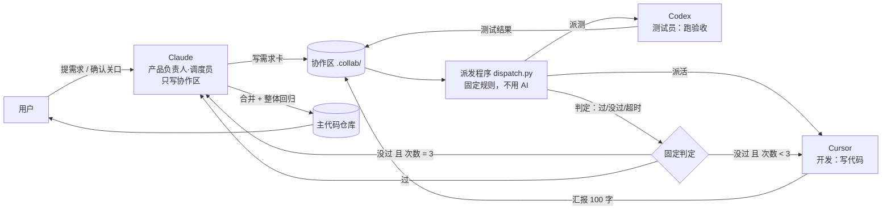
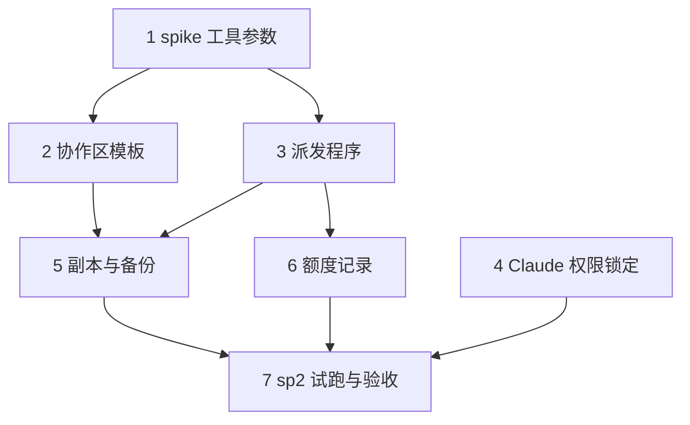

# 方案：多 agent 协作包 第一版（DESIGN）

> 阶段：② 方案（2026-11-03 起草，**待用户确认**）　依据：[需求共识](需求共识.md)、[前期讨论交接](前期讨论交接.md)
> 状态：草案。未确认前不拆任务清单、不写代码。

---

## 1. 一句话流程（用户视角）

1. 你说一个需求。
2. Claude 和你对齐，写成一张**需求卡**，你确认（关口 1）。
3. 程序把卡派给 Cursor 去写代码，写在一个单独的副本里，不动你的主代码。
4. Cursor 写完交一份 100 字内的**汇报**。
5. Codex 按验收标准测试，**由一段固定程序判定过没过**。
6. 没过：自动退回 Cursor 修，最多 3 轮，全程不叫 Claude。
7. 过了：Claude 看汇报和测试结论做最终验收，合并进主代码，整体再测一遍。
8. 你看实际效果（关口 2）。是否上线由你决定。

你在任务板上能看到每张卡处于哪一步、谁在做、返工了几次。

---

## 2. 整体架构



### 角色与权限（沿用共识第 1 条：权限上锁死，不靠提示词）

| 角色 | 能写的地方 | 不能碰 |
|---|---|---|
| Claude（调度员） | `.collab/` 下的需求卡、任务板、合并动作 | 产品代码（靠 Claude Code 权限规则在被试项目里 deny 掉） |
| Cursor（开发） | 自己的副本里的产品代码；`汇报.md` | 主代码仓库、其他卡的文件夹、需求卡 |
| Codex（测试员） | `测试结果.md`、测试产物 | 产品代码、需求卡 |
| 派发程序 | 任务板状态、`返工记录.md`、超时计时 | 不做任何"判断对错"的事 |

---

### 2.1 工具职责分工（用户 2026-11-04 指定）

| 任务 | 负责工具 | 理由 / 验证 |
|---|---|---|
| 打开网页、读网页内容 | **Codex**（`codex exec -s read-only`，模型 gpt-6.1-sol） | 实测能打开 example.com 并读出标题和正文 |
| 按关键词搜资料、找来源 | **Tavily**（`mcp__tavily*` 系列，按 CLAUDE.md 的顺序自动切换 key） | 实测返回 3 条带来源链接的结果 |
| 写代码 | Cursor（`agent`，模型 auto） | 联调已通过，偶发不落盘，派发后必须检查文件 |
| 写测试与跑验收 | Codex | 同上 |
| 备选写代码 | agy（gemini-4-argon-high） | 联调已通过 |
| 需求对齐、拆卡、验收、合并 | Claude（只写协作区，不写产品代码） | 沿用共识第 1 条 |

规则：
- 任何"看网页内容"的动作不用 Tavily 直接抓正文，统一交给 Codex。
- 任何"找哪里有相关内容"的动作不用 Codex 去全网乱搜，统一用 Tavily。
- Claude 自己需要查资料时，同样走上面两条路，不自己在对话里凭记忆回答。

---

## 3. 协作区结构（放在被试项目里）

```
<被试项目>/
├── AGENTS.md / CLAUDE.md / .cursor/rules/   ← 入口文件：只写一句"先读 .collab/README.md"
└── .collab/
    ├── README.md            协作规则（各家工具进门先读这一个）
    ├── 项目档案.md          怎么启动、怎么测、禁区、用了什么技术（Claude 读完项目起草，用户确认）
    ├── 任务板.md            总览：每张卡的编号、标题、状态、谁在做、返工几次
    ├── 备份记录.md          每次动手前的版本号（用于一键恢复）
    └── cards/
        └── CARD-001/
            ├── 需求卡.md     Claude 写；验收标准必须可自动检查
            ├── 汇报.md       Cursor 写；100 字内
            ├── 测试结果.md   Codex 写；附测试命令的原始退出码
            └── 返工记录.md   程序写；每轮退回的原因
```

**状态流转**（由程序更新任务板）：`待对齐 → 待派发 → 开发中 → 待测试 → 测试中 → (没过→开发中，最多 3 轮) → 待验收 → 已合并`；超时或第 3 轮没过 → `需 Claude 介入`。

---

## 4. 关键机制

### 4.1 每个开发在自己的副本里干活
- 项目是 git 仓库时：每张卡用一个 `git worktree`，分支名 `card/CARD-001`。
- 动手前自动记一个版本（打 tag，如 `pre-CARD-001-<时间>`），写进 `备份记录.md`，出事可一键回到该版本。
- 验收通过后由 Claude 合并进主分支；两张卡改到同一文件的，在任务板上排先后，不并行。
- 项目不是 git 仓库：第一版**不支持**，直接拒绝启动并提示用户先 `git init`（见待决策 D3）。

### 4.2 "过没过"由固定程序判定
派发程序执行 `项目档案.md` 里登记的测试命令，**只看退出码**（0 = 过）。
Codex 负责把验收标准翻译成测试用例并跑，但**最终结论以退出码为准**，AI 写的"我觉得通过了"不算数。
这要求每条验收标准都能落到一条可执行的检查上，这是第一版最难的一环（见风险 R1）。

### 4.3 返工
- 没过 → 程序把 `测试结果.md` 原文交给 Cursor，直接派回，`返工记录.md` 追加一条。
- 最多 3 轮。第 3 轮仍没过 → 状态改为 `需 Claude 介入`，叫醒 Claude。
- 返工期间 Claude 不参与。

### 4.4 叫醒 Claude 的 5 种情况（沿用共识第 6 条）
1. 返工超过 3 轮
2. 开发或测试员在汇报/测试结果里说需求卡看不懂
3. 合并后冲突
4. 超时（每个环节有固定时限，待定具体数字，见 D5）
5. 中途发现需求本身要改（回来问用户）

### 4.5 汇报与上下文
- 汇报只写摘要（100 字内），详细改动留在副本的 git 记录里。
- Claude 只读：需求卡、汇报、测试结论。不读产品代码全文。
- 每张卡有编号，任何文件里引用都用编号，换新会话也能顺着编号接上进度。

### 4.6 调用方式（2026-11-04 spike 实测结果）

| 工具 | 对话 | 写文件 | 备注 |
|---|---|---|---|
| Codex `codex exec` | ✅ 通过 | ✅ 通过（`-s workspace-write`，文件内容正确） | 启动时打印 Supabase MCP 认证报错，不影响结果，但输出很吵，需过滤 |
| agy `agy -p "提示词" --output-format json` | ✅ 通过 | ✅ 通过（`--mode auto` 被拒，回落默认模式，仍写入成功） | 提示词必须紧跟 `-p`，否则报错；默认模式下有一次被中断（status=ERROR），需再验证稳定性 |
| Cursor `agent -p --trust --output-format json` | ✅ 通过 | ✅ 通过（**无需 `--force`**，文件内容正确） | 之前用的 `cursor-agent` 命令有问题，作废；Cursor CLI 的正确命令是 `agent` |

- 模型实测（2026-11-04）：
  - Codex：`codex exec -m gpt-6.1-sol -c model_reasoning_effort="xhigh" ...` ✅ 写文件成功
  - agy：`agy -p "..." --model gemini-4-argon-high --output-format json` ✅ 写文件成功（档位 high 为我的选择，用户未指定 low/medium/high，待确认）
  - Cursor：`agent -p --trust --model auto --output-format json` ✅ 第二次写文件成功；**第一次回复"已创建"但文件未落盘**，属偶发不稳定，需多跑几次统计
- 注意：agy 的 `--dangerously-skip-permissions` 被权限分类器拒绝，未使用；默认模式下测试通过。
- 完整调用方法、踩坑记录和复现步骤见 [联调手册](联调手册.md)；一键验证见 [联调冒烟测试.sh](联调冒烟测试.sh)。
- 结论：三家（Cursor `agent`、Codex、agy）都能连上、生成内容、写文件。
- 更正：此前"Cursor 写文件不通过、需要 `--force`"的结论是用错命令导致的，已作废。
- 方案中的调用方式要改为 `agent -p --trust --output-format json`，不再使用 `cursor-agent`。

---

## 5. 与现有内容的冲突处理（需你定，见 D1）

被试项目里可能已经有 `AGENTS.md` / `CLAUDE.md`（sp2 就有，且很长）。
入口文件**只追加一段**指向 `.collab/README.md`，不改动原有内容。
（sp2 的 `CLAUDE.md` 约 22KB，里面已有大量规则；追加不影响原规则，但 Cursor/Codex 读到的规则会变多。）

---

## 6. Claude 额度怎么量（待决策 D2）

目标：对比"同一需求，Claude 直接干"与"走协作包"，Claude 消耗差多少。

**提议的做法**：
1. 每张卡开始前后，记录当前 Claude 会话的 token 用量。Claude Code 把每条消息的用量写在本地会话记录里（`~/.claude/projects/` 下的 JSONL，读取 `usage` 字段），**这一点需要先实测确认**。
2. 程序按卡号汇总 Claude 侧的输入/输出 token，写进 `额度记录.md`。
3. 对照组：同一个试跑需求，让 Claude 直接做一次，记录同样指标。
4. 两组都用同一个指标（Claude token 数），不比较"总消耗"（共识已说明总消耗会变多）。

**不确定**：Claude 订阅的"额度"与 token 数不是一一对应的，这里的对比是**相对值**，只能说明"Claude 那部分少了多少"，不能直接换算成额度百分比。

---

## 7. 错误处理

| 情况 | 处理 |
|---|---|
| 工具命令不存在 / 未登录 | 启动前自检，失败即停，提示用户 |
| 某环节超时 | 程序杀掉进程，状态改 `需 Claude 介入` |
| 测试命令本身跑不起来（不是测试失败） | 视为环境问题，不计入返工轮数，直接叫 Claude |
| 派发程序崩溃 | 任务板保留最后状态，重启后从该状态继续；不自动重跑已完成的步骤 |
| 副本合并冲突 | 不自动解决，叫 Claude |

---

## 8. 验收标准（沿用共识"怎么算验收通过"，细化为可检查项）

- [ ] A1 试跑需求在 sp2 上从"需求卡"到"已合并"全程跑通
- [ ] A2 全程 Claude 没有修改产品代码（用 Claude 的权限规则 + 合并记录核对）
- [ ] A3 至少一次"测试没过 → 程序自动退回 → 修好"，且不经过 Claude
- [ ] A4 任务板能看出每张卡的状态、负责方、返工次数
- [ ] A5 有一份 Claude token 对照记录（方法见第 6 节）
- [ ] A6 3 轮返工上限能触发（用一个故意做不对的测试样例验证）

---

## 9. 任务拆分（草案，**未确认前不展开为正式 TASK**）

1. spike：验证 agent / codex exec / agy 的无交互写文件与权限参数（第一轮已通过，见 4.6）
2. 协作区模板与任务板格式（含入口文件追加逻辑）
3. 派发程序：状态机 + 退出码判定 + 超时 + 3 轮上限（先写测试）
4. Claude 权限锁定（被试项目的权限规则）
5. 副本与版本备份（git worktree + tag）
6. 额度记录（token 汇总脚本）
7. sp2 试跑 + 验收 A1–A6

依赖：1 → 2、3、4 并行 → 5 → 6 → 7。



---

## 10. 风险（提前说）

- **R1 验收标准难自动化**（最大风险）：用户说的"看起来对"要翻译成可执行检查。第一版只接受能写成测试的需求，写不成的直接退回让用户重述。
- **R2 磨合期 Claude 会频繁被叫醒**：省额度要几轮之后才看得出，第一个试跑不代表长期效果。
- **R3 额度节省是推测**：必须以第 6 节的实测为准。
- **R4 工具参数**：第一轮 spike 已验证三家能无人值守写文件；但 agy 默认模式有一次被中断，稳定性还需多跑几次。
- **R5 大改动不适合拆出去**：探索性需求、架构调整会导致返工增多，第一版不接。

---

## 11. 待决策（需你确认后才进入拆任务）

| # | 问题 | 我的建议 |
|---|---|---|
| D1 | 入口文件（sp2 已有 AGENTS.md / CLAUDE.md）：追加一句指向协作区，还是另建一个专用入口？ | **已修正：不追加**（2026-11-04 用户确认）。派发流程每次把任务卡路径和规则写进提示词，自动流程不依赖入口文件；入口文件只对手动在项目里交互有用，等真有需要时再加。项目文件不做改动 |
| D2 | Claude 额度的测量方式 | **已确认：采用会话记录 token 数做相对对比**。2026-11-04 已验证：会话记录 JSONL 每条消息都有 `usage` 字段（含 input / cache_creation / cache_read / output）。汇总时四项都要算，只看 output 会严重低估 |
| D3 | 非 git 项目是否第一版就不支持？ | **已确认：不支持**，先 `git init` 再用。原因：副本与一键恢复都依赖 git |
| D4 | 派发程序用什么语言写？ | **已确认：Python 标准库**，无第三方依赖，便于以后打包给别人 |
| D5 | 超时时限 | **已确认：开发 30 分钟、测试 15 分钟**，试跑后按真实耗时调整 |
| D6 | 第一个试跑需求选哪个？ | 候选见下表，请你选一个 |

**D6 候选（2026-11-04 从 sp2 台账筛出，已排除已完成项）**

| 候选 | 内容 | 可自动验收的方式 | 注意 |
|---|---|---|---|
| **C1（推荐）** | 建图环节一次瞬时网络错误就整步失败，补上选择性重试（台账"遗留"项） | 后端 pytest：模拟一次瞬时错误，断言重试后成功；模拟永久错误，断言不无限重试 | 代码里已有 `llm_retry.call_with_retry`，可复用；需先确认建图环节是否真的没接入 |
| C2 | 登录验证每次请求都实时过 Supabase，加短时缓存（台账"审计遗留"项） | pytest：同一 token 短时间内只调用一次 Supabase（打桩计数）；过期后重新校验 | 涉及安全边界，缓存时长和失效规则需你拍板 |
| C3 | CLAUDE.md 与代码脱节，逐条校对（台账"审计遗留"项） | 脚本：检查文件里提到的每个路径是否存在，不存在的列出来 | 只改文档，不改代码；"是否与代码一致"部分仍需人判断 |

排除项：加 CI（`.github/workflows/ci.yml` 已存在）、删项目清理 Zep 图谱（`services/project_reset.py` 已有）。

---

## 12. 下一步

- 你确认 D1–D6（或修改），本文件定稿。
- 定稿后进入阶段 ③ 拆任务（`TASK_多agent协作包.md`），并先做第 9 节第 1 项 spike。
- 在 spike 结果出来前，任何对协作区的实际写入都不做。


## 13. 补充决定（2026-11-04）
- **需求以外改动的处理（D7）**：三种模式 A / B / C，含义见第 11 节之后的对话记录。项目默认 A；每次需求可临时切换，仅对该次生效；C 模式下结果必须提醒用户。
