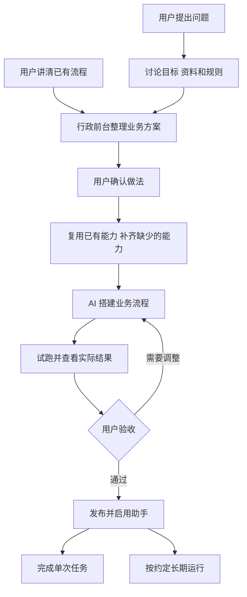

# 超级助手定位 使用流程与 DSH 复用评估

整理日期：2026 年 11 月 14 日。产品定位和使用过程来自本轮讨论；复用判断依据本地 DeepSeek Harness（DSH）0.2.2-rc.2 与超级助手当前源码。产品共识、已有实现和后续建议分别说明，本文不替代具体施工方案。

核心方向是：面向普通人，通过自然语言把业务问题或既有做法变成可试跑、可验收、可重复使用的助手。DSH 的工作台和执行基础设施值得大量复用；超级助手自己的重点是需求澄清、能力卡、业务流程和助手管理。

## 一 产品定位

超级助手帮助普通人完成一项任务，或按约定长期替用户处理某类事情。用户主要交代目标、提供必要资料、确认做法和验收结果；AI 负责把要求转成能力组合，搭建、试跑并调整。

使用门槛要体现在交互全过程：用户能够理解助手准备做什么、需要自己提供什么、做到哪里、结果在哪里，以及遇到什么事情需要自己决定。API、CLI、MCP、插件包和模型参数属于配置与执行细节，按需要展示。

用户最终托付的是助手。助手内部用业务流程组织工作，业务流程由能力卡组成，能力卡调用基础资源。基础层、能力层和流程层可以向有需要的用户展开，但不要求每个人先学会这些概念。

### 两种使用起点

| 用户的起点 | 行政前台的职责 | 搭建前交给用户确认什么 |
|---|---|---|
| 知道业务流程，例如“先查库存，再核价格，最后给报价” | 承接已有做法，检查必要信息和遗漏，整理成可执行方案 | 步骤、输入资料、交付结果和例外处理 |
| 只知道问题，例如“老客户越来越少，想帮我维护” | 了解现状、目标和限制，帮助用户梳理处理办法 | 准备采用什么做法，以及怎样判断有帮助 |

这是两种起点，同一个人在不同业务上可能处于不同情况。已有做法讲清楚就直接承接，模糊的部分再继续讨论。

### 两种工作方式

| 工作方式 | 用户得到什么 | 需要保存什么 |
|---|---|---|
| 单次任务 | 完成这次询价、调研、整理或报告 | 本次输入、处理过程和交付结果 |
| 长期助手 | 按约定持续关注和处理某类业务，遇到例外请用户决定 | 工作目标、规则、触发方式、业务资料、已处理记录和运行状态 |

长期助手可以由定时或业务事件触发。它需要知道已经处理过什么、下一步做什么，不能只依赖一段不断增长的聊天记录。

## 二 使用流程

有两个不同的确认点：搭建前确认“做法是不是我要的”，试跑后确认“实际结果是不是满足业务需要”。对于已经验收启用的助手，日常使用直接运行；新增或修改做法时，再走相应的搭建和验收过程。

流程制作中，AI 可以在用户约定的范围内自行检查、修改和重试。需要新增账号、补充资料，或遇到业务上拿不准的选择时，再请用户处理。程序检查运行和输出是否符合要求，用户确认业务效果。

### 两个业务例子

水果店客服助手可以组合“读取商品和库存、理解顾客询问、按店铺规则生成回复、记录客户需求、按约定跟进”等能力。前台先确认商品资料、配送规则、回复范围和老客户维护方式，再搭建试跑。

出海选品助手可以组合“收集商品信息、比较采购价和售价、整理需求与竞争资料、计算成本、形成候选清单”等能力。前台先确认市场、预算、品类和判断标准，再用实际样例检查结果。

这些是待实现的业务示例；每项能力仍要有对应的数据来源、账号或工具接法。

## 三 产品内部的组织方式

| 部分 | 负责什么 | 与其他部分的关系 |
|---|---|---|
| 行政前台 | 接待、澄清、整理方案、解释进度与结果 | 按用户需要发起搭建或调用已有助手 |
| 基础层 | 接入和检测 CLI、模型 API、搜索及后续业务服务 | 提供真实可调用的资源 |
| 能力卡 | 把某种用途整理成明确输入、执行方式、输出和检查要求 | 可以被不同业务流程复用 |
| 业务流程 | 组合能力卡，规定步骤衔接、判断、例外和人工确认 | 完成一项业务任务 |
| 助手 | 保存业务目标、使用规则和运行方式，交付结果 | 运行已验收的流程，管理单次或长期工作 |

助手目标、能力卡、流程定义和每次运行记录需要分别管理。例如，修改一张能力卡后，应能明确哪些已启用流程受到影响。这部分版本与引用规则属于后续设计建议，尚未确定具体格式。

## 四 我们已有的实现可以保留

当前项目已经有真实可用的能力层资产，不需要重新从空白制作。

| 已有资产 | 当前实际范围 | 后续用途 |
|---|---|---|
| 基础资源管理 | 支持 CLI、大模型 API 和搜索三类，尚未提供任意业务 API 或 MCP 的通用接入 | 保留连接定义、检测和凭证接入，按业务需要扩展适配器 |
| 能力卡格式和校验 | 有输入、固定交代、模型、输出与检查规则；输入项目前主要是文字和整数 | 保留并扩展结构化数据、版本和步骤间的数据交接 |
| 能力卡运行器 | 正式运行和草稿试做共用执行入口，检查输出、保存成果和记录 | 作为流程中单项能力的执行单元 |
| 起草与试做入库 | 管家出草稿，用户试做，成功后才能保存到能力层 | 将已有验收方式扩展到完整业务流程 |
| 能力详情和结果页面 | 已有表单、用一次、历史结果和草稿发布交互 | 保留业务规则与数据，决定界面迁移时怎样映射 |

源码依据：[基础层类别](/Users/rs/Desktop/project/super-agent/collab/blocks.py:324)、[能力卡字段](/Users/rs/Desktop/project/super-agent/collab/abilities.py:51)、[当前输入限制](/Users/rs/Desktop/project/super-agent/collab/abilities.py:187)、[运行入口](/Users/rs/Desktop/project/super-agent/collab/abilities_run.py:168)、[草稿校验](/Users/rs/Desktop/project/super-agent/desktop/clerk/tasks.py:599)、[试做后保存](/Users/rs/Desktop/project/super-agent/desktop/server.py:1249)。

当前还没有把这些资产连成通用业务助手：管家可以列能力卡和起草卡片，工具集中没有直接运行已发布能力卡的统一入口；现有调度主要是“写测试、写代码、复查”的开发过程。`collab/flow.py` 负责记流转日志，不承担业务流程编排。

源码依据：[管家能力工具](/Users/rs/Desktop/project/super-agent/desktop/clerk/blocks_tools.py:129)、[开发调度](/Users/rs/Desktop/project/super-agent/collab/dispatch.py:1)、[流转记录职责](/Users/rs/Desktop/project/super-agent/collab/flow.py:1)。

## 五 DSH 哪些可以直接复用改造

这里的“直接复用”指沿用现成模块及其必要依赖，再接入我们的配置和业务；不表示把一个源码文件复制过来就能独立运行。

| 现成部分 | 可以沿用什么 | 我们需要调整什么 |
|---|---|---|
| 基础界面组件 | 按钮、输入框、弹窗、菜单、Markdown、终端和结果渲染 | 使用 React 和对应主题样式，提供我们的标签和文案 |
| 工作台界面 | 布局、侧栏、会话、任务进度、后台任务、执行详情等交互 | 面向普通人的导航、默认展示内容和业务入口 |
| Agent 执行循环 | 模型调用工具、接收结果、继续下一步、取消与过程事件 | 让它使用我们的业务工具，并交付可检查的能力卡或流程 |
| 创造模式的工具组合 | 文件读写、命令执行、手册、任务记录、运行时检查、插件安装 | 把制作目标从扩展 DSH 调整为制作我们的能力与流程 |
| MCP 与插件机制 | 发现工具、读取说明和参数、注册、调用、安装与启停 | 建立插件工具与能力卡之间的映射，区分安装成功、工具可用与业务验收通过 |
| 模型与凭证基础设施 | 模型路由、多提供方、设置和凭证输入 | 映射我们的基础层配置与已有账号，整理默认选项 |
| 日志与交互基础设施 | 会话记录、进度、提问和审批等机制 | 转换成普通人能理解的业务动作与需要确认的事项 |

基础界面库明确不导入 Cordis 运行时，适合按组件复用；完整轨迹页则注入会话、状态、国际化和远程工具结果等服务。若沿用 DSH 工作台和运行时，完整页面能保留更多逻辑；如果只接现有 Python 后端，就要适配这些数据接口。

源码依据：[基础组件库](/Users/rs/Desktop/deepseek-harness/packages/client/ui-primitives/README.md:12)、[完整客户端模块目录](/Users/rs/Desktop/deepseek-harness/packages/client/README.md:30)、[轨迹页依赖](/Users/rs/Desktop/deepseek-harness/packages/client/ui-trajectory/src/client/index.ts:41)、[创造模式配置](/Users/rs/Desktop/deepseek-harness/packages/bundle/web-app/presets/cordis.patch.yml:10)、[Agent 工具执行](/Users/rs/Desktop/deepseek-harness/packages/core/agent-loop/src/agent.ts:592)、[MCP 工具注册](/Users/rs/Desktop/deepseek-harness/packages/mcp/mcp-client/src/tools.ts:132)、[多提供方模型适配](/Users/rs/Desktop/deepseek-harness/packages/llm/llm-pi-ai/README.md:26)。

创造模式入口本身会新开或复用一个选择了 `cordis` 预设的会话。截图中的开发清单来自待办工具，记录本次制作的任务和进度；生成、执行和调试依靠模型、工具、手册与运行循环共同完成。

源码依据：[创造模式入口](/Users/rs/Desktop/deepseek-harness/packages/client/ui-agent-preset/src/client/index.ts:216)、[待办工具的职责](/Users/rs/Desktop/deepseek-harness/packages/todo/tool-todo/README.md:30)。

## 六 DSH 有基础机制 但需要业务适配

| DSH 机制 | 源码已经提供 | 超级助手仍需补齐 |
|---|---|---|
| workflow | 用 JavaScript 组织子 Agent，可串行、并行、校验结构化结果；阶段标签用于进度展示 | 能力卡节点、数据交接、业务判断、人工确认、可保存发布的流程版本 |
| schedule | 保存定时任务，并按时间向目标会话投递任务文本 | 把触发关联到已启用的助手和流程，业务事件接入、重复处理识别和结果跟踪 |
| goal | 在同一会话中连续推进目标，有状态与轮次限制 | 长期助手的职责、启停、业务记忆、触发器和运行记录；恢复时如何重新启用 |
| session 恢复 | 恢复聊天与工具事件，补齐中断的生命周期记录 | 判断订单、消息等外部动作是否真的完成，决定业务步骤从哪里继续 |

DSH 的 workflow 工具描述明确面向 JavaScript 子 Agent 编排；`phase` 是进度分组，不规定执行结构。因此它适合承担部分底层编排工作，但不能直接等同于普通人已经确认、发布并可反复运行的业务流程。

源码依据：[workflow 的脚本接口](/Users/rs/Desktop/deepseek-harness/packages/workflow/tool-workflow/src/index.ts:158)、[阶段标签的含义](/Users/rs/Desktop/deepseek-harness/packages/workflow/workflow/src/types.ts:24)。

定时任务的投递收据不代表业务完成；会话日志恢复也可能把某次工具调用标记为“结果未知”。长期助手要能识别已处理事项，避免把重试误当成新的业务请求。Goal 的自动继续激活状态在进程内管理，Agent 创建时默认停用，不能据此承诺重启后自动持续工作。

源码依据：[定时投递收据](/Users/rs/Desktop/deepseek-harness/packages/schedule/schedule/src/types.ts:396)、[中断工具结果](/Users/rs/Desktop/deepseek-harness/packages/core/session/src/repair.ts:14)、[目标激活状态](/Users/rs/Desktop/deepseek-harness/packages/goal/goal/src/types.ts:71)、[Agent 创建时的激活处理](/Users/rs/Desktop/deepseek-harness/packages/goal/goal/src/index.ts:255)。

## 七 超级助手需要自己定义和完成的部分

这些工作可以调用 DSH 的模型、组件和执行机制，但业务规则与数据仍由超级助手负责。

1. **行政前台的业务澄清。** 承接两种起点，整理目标、步骤、资料、结果和例外，形成普通人看得懂的方案，提交用户确认。
2. **能力卡到工具的接法。** 把现有卡运行器、MCP 工具和新增接头统一到可发现、可调用、可校验的能力接口。需要补聊天中调用已发布能力卡的入口。
3. **可复用的业务流程。** 定义步骤使用哪张卡、数据怎样传递、怎样判断分支、哪里请用户确认，以及草稿、试跑、发布和修改之间的关系。
4. **业务验收。** 验证完整流程，而非只检查插件加载或某个工具返回成功；让用户看实际输入、实际结果和需要调整的地方。
5. **助手管理。** 保存助手目标、规则、单次或长期工作方式，管理启动、暂停、修改和停用。长期工作要有独立的业务状态和每次运行记录。
6. **具体业务接入。** 水果店的商品库存、客户资料和消息渠道，出海选品的数据来源、价格和成本资料，都要逐项接通，不能由聊天界面替代。
7. **面向普通人的产品界面。** 把现成工作台组织成“交代事情、确认做法、看试跑、看结果、管理助手”的体验，按需要展开技术详情。

## 八 复用路线建议

本轮需求同时重视现成界面和 Agent 制作能力，建议优先验证“DSH 工作台与运行时作为底座，增加超级助手业务模块”的路线。DSH 本身支持通过插件和配置扩展，可以先增加业务模块和适配层，再决定是否有必要修改核心。

| 路线 | 主要收益 | 主要工作 |
|---|---|---|
| 优先评估 DSH 工作台与运行时整体定制 | 同时沿用界面交互、执行事件和制作机制 | 新增行政前台、能力卡、流程与助手模块；桥接现有 Python 业务资产；简化导航和配置 |
| 保留现有工作台 通过 Python SDK 调用 DSH | 保留当前页面和服务，较容易单独验证制作后端 | 自己适配任务进度、结果和交互；SDK 不会自动带来 DSH 的工作台界面 |
| 抽取组件和部分源码逐步移植 | 能按现有架构逐项迁入 | 需自行维护状态、接口、框架差异和模块依赖，复用完整交互的成本可能上升 |

DSH 前端使用 React 与 Cordis 插件服务，我们现有页面主要是 HTML 和普通 JavaScript；核心执行包也依赖会话、工具、提示词等多个服务。因而“直接复用”通常应以一组能共同工作的模块为单位。Python SDK 是独立运行时的 JSON-RPC 客户端，不是前端组件包。

源码依据：[DSH 架构与配置扩展](/Users/rs/Desktop/deepseek-harness/docs/architecture.md:7)、[核心执行包依赖](/Users/rs/Desktop/deepseek-harness/packages/core/agent-loop/package.json:33)、[当前聊天页](/Users/rs/Desktop/project/super-agent/desktop/static/chat.html:1)、[Python SDK 启动与恢复](/Users/rs/Desktop/deepseek-harness/python/sdk/README.md:29)。

还有两点需要修正前面讨论中的简化说法：DSH 已经支持 shell 命令和多个模型提供方，差异不只是“我们多了 CLI”；我们的重点是把 CLI/API 明确整理为基础资源，再封装成能力卡和业务流程。DSH 的插件管理页也不能仅改名就当能力层，插件包与业务能力卡的定义、粒度和验收不同。

本地 DSH 主项目使用 MIT 许可证，复用相关代码时保留版权和许可声明，分发时保留所用依赖的许可材料。产品品牌有独立的界面扩展位置，可替换成超级助手自己的名称与图形。[许可证](/Users/rs/Desktop/deepseek-harness/LICENSE:1)、[品牌扩展位置](/Users/rs/Desktop/deepseek-harness/packages/client/ui-brand-official/src/client/index.ts:16)。

## 九 先用一个完整业务验证复用路线

建议以“读取商品表并回答水果店询价”为最小接入验证：一位用户直接描述步骤，另一位用户只提出客服问题，两条入口都由行政前台整理为可确认的方案。方案确认后，复用现有能力卡或补接必要能力，搭成流程，展示真实试跑结果，再由用户验收启用。

验证应看完整链路：普通人是否能交代和确认业务、DSH 是否能交付符合我们规则的产物、现有卡运行器是否能接上、执行过程能否在界面正确展示、失败能否修改重试、启用后能否重复处理新的输入。

单次链路打通后，再验证一个定时运行的例子，检查暂停、重启后状态、重复处理识别和结果记录。完成这两类验证后，再据实际改动范围决定采用整体定制还是 SDK 集成，不预先承诺只需少量修改。
