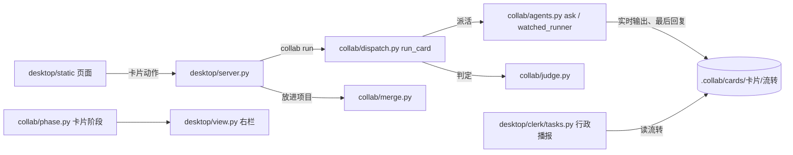

# 流程修理：方案

依据：[需求共识](需求共识.md)。用户外出，授权 Claude 自定方案直接施工；本方案里 Claude 替用户定的地方都在第五节列出，回来可逐条改。

## 一、修完以后一张卡怎么走（用户看到的）

1. 批准方案 → 开工。写测试的先写测试，**只跑这张卡的测试**，不跑全部。
2. 写代码的照着测试改；**能自己跑这张卡的测试**，改对了再交活。
3. 程序检查改动范围、跑测试；没过就带着测试输出退回（最多 3 次，和现在一样）。
4. 测试过了交复查。复查员只跑这张卡的测试、只读检查，写结论。
5. 复查不通过：**自动**把复查员最后写的那几条结论交给写代码的去改（不算返工），改完再跑测试、再复查；**自动退回最多 2 次**，第 3 次还不通过才停下，卡片显示“卡住了”，原因里列出剩下的问题。
6. 卡住时你可以：点“接着跑”（再来一轮）、“不满意，继续改”（写新要求）、**“接受剩下的问题，进入待确认”**（新按钮，点之前列出剩下的问题，点了记进卡片），或“放弃这个需求”。
7. 点“不满意，继续改”：写测试的**只为新要求补测试**（不整个重写），然后交写代码的。
8. 干活的人 5 分钟、10 分钟没有任何动静（文件没变、输出也没涨）时，**行政在卡片对话里主动说一句**发生了什么、建议点什么。只读的复查员只要输出还在涨就不算没动静。
9. 你在卡片里问行政进度，行政读的是**此刻**的状态，卡住时说清原因和下一步点什么。
10. 施工单已经写好的需求，调度员写方案时**只摘允许改的文件和测试命令**，不重新设计。

## 二、团队配置（第二批）

- 每个岗位（调度员、写测试、写代码、复查）**各自**选模型和思考强度，改一行不影响别的行。同一家工具当几个岗位也各存各的。
- 有一行没测通时点保存：不再悄悄丢掉，提示“团队还没存：某某还没测通”。
- 点“检测”到时间一定给结果（通了 / 没通 + 原话），不会一直转圈。
- 改过没保存就要离开时，先问“还没保存，要离开吗”。

## 三、体验（第三批）

- 卡片标题下面一行大白话写“此刻在干什么”（例：“写代码的 Cursor 正在改 desk.py · 已干 6 分钟 · 1 分钟前有动静”），跟着实时输出更新。
- 项目窗口的行政说了“点确认”却没出确认框时，和积木库管家一样提醒它补出或改口。
- 代理设置（⑩）：先实测超级助手启动的工具和终端出口是否不同，有影响再带上终端的代理设置。

## 四、泼冷水

- **放行测试命令的范围比字面大**：Cursor 只能按“命令名”放行（比如放行 python3），不能只放某一条完整命令。所以实际是“这张卡的测试命令用到的那个程序”都能跑。配合 Cursor 自带的沙箱（只能写这张卡的施工副本），风险可控；做不到沙箱就退回“只在交代里说清”。施工时先实测。
- **agy 能不能跑命令没实测过**：本单只改交代和配置的通用部分，agy 接通（③）和它能否跑测试要你回来在真实窗口里点“检测”验证。
- **复查员还是会挑**：自动退回 2 次后仍会停下。对“没有标准答案”的规则，最终还是要你点“接受剩下的问题”。
- **⑲ 只做第一步**：行政只会报“多久没动静、谁没完成”，不会自己判断“它在绕圈子”；那是第二步（调度员诊断）的事。
- **这些改动只在超级助手的程序里，没装进你电脑上的 App**：网页和 Python 部分重开超级助手就生效；本单不改 Mac 窗口外壳，不用重装。

## 五、Claude 替你定的（回来可改）

1. 写测试的在“继续改”时只为新要求补测试，不整个重写；它改到测试目录以外的文件，程序撤掉并记一笔。
2. 判断“测试文件”的规则：在 `tests/`、`test/`、`__tests__/`、`spec/` 目录里，或文件名形如 `test_*.py`、`*_test.*`、`*.test.*`、`*.spec.*`、`*_check.js`。
3. 交给写代码的复查意见只取复查员**最后一条回复**，最长 8000 字。
4. 干活的人退出码正常但一个字都没回：算“没完成”，自动再试一次，再不行转卡住。
5. 行政主动提醒的时机：5 分钟、10 分钟没动静各一次；看门人 15 分钟停下时程序本来就会转卡住，行政照常报。
6. “接受剩下的问题”只在“复查不通过而卡住”时出现；测试没过、环境出错时不出现（测试都没过不能放行）。
7. 放进项目时，卡片提交里那些内容已经和项目一模一样的文件不算这张卡的改动（解决 ㉔）。
8. 写方案时认“已有施工单”：任务卡片里写了项目里存在的 `施工单` 文件路径，就让调度员只摘范围和测试命令。
9. 每个岗位的模型：老配置（每家工具一份）读进来时，自动分给用这家工具的每个岗位，用户不用重配。

## 六、技术设计（写给下一个会话的 AI）

- **最后回复**：`ask()` 返回 `AgentResult.final`（Codex 用 `-o 文件` 拿最后一条回复；Cursor/agy 的 JSON 里本来就只有最后结果）。流转里“回复”存最后回复；完整过程只在实时输出文件里。复查结论只从最后回复里认；最后回复里只要有一行“结论：不通过”就算不通过（宁可多退回一次，也不错放；复查第 1 轮指出和“取最后一行”的写法不一致，Claude 定保留这条更稳的规矩）。
- **自动退回**：`run_card` 复查不通过时，数这次开工（最后一条追加要求之后）复查不通过的次数，少于 2 次就把最后回复当意见回到开发循环，不加返工次数；否则转“需Claude介入”，原因里带意见前几条。
- **只动测试**：测试员交活后，测试目录以外的改动用 `revert_paths` 撤掉，记“范围”。
- **继续改**：`revise_card` 不再删 `测试前改动.json`；`run_card` 看到追加要求后派测试员“补测试”模式（提示词不同），以前的测试文件保留。
- **能跑测试**：派活提示里写明本卡测试命令；Cursor 派活前在施工副本写 `.cursor/cli.json`（放行测试命令的程序、关掉 MCP 插件），这个文件不算改动、不进项目。
- **看门人**：`watched_runner` 把实时输出文件的变化也算动静；另外在 5、10 分钟没动静时回调一次，`run_card` 记一条“提醒”到流转，行政播报认“提醒”。
- **接受问题**：状态机加“需Claude介入 → 待验收”；本机服务新动作 `accept_issues`，只在阶段为“复查不通过而卡住”时可用，记“接受”到流转；右栏加按钮。
- **放进项目**：`_commit_work` 的越界检查只看“卡片版本和项目当前版本不同”的文件。
- **每岗位模型**：`.collab/配置.json` 加 `role_models: {角色: {model, effort}}`；`load_role_models(项目, 角色)` 给出该岗位用的模型；派活按岗位传。

## 七、复查后的已知取舍（2026-11-12）

- Codex 没生成“最后回复”文件时：Codex 结尾会把最后回复印两遍，程序只认两份完全对得上的那段当结论，对不上就当没回话（宁可算没完成，不能错放）。复查第 3 轮指出原先读整段会把复述要求时的“结论：通过”误认；第 4、5 轮指出回复里引用的日志会骗过截取——改成取两份对得上的最长那段，第 6 轮复查通过。对照 7 份真实 Codex 记录，取出来的和它自己写的最后回复文件一字不差。
- agy 卡片标题下那一行暂时只显示“正在写代码”和计时。复查第 3 轮指出 agy 其实支持边干边吐（和 Cursor 一样），但 11-12 早上 Claude 这边调 agy 时一个模型报额度不够、Flash 发出请求后几分钟没回音（用户窗口里检测 44 秒通了，差别原因没查清），没看到它吐的格式，以后 Claude 这边能调通再实测接上。
- agy 在后台能写电脑上任何地方（它自带的“沙箱”也挡不住，Claude 实测）；Cursor 已关进沙箱。用户知情后仍选 agy 写 69。
- “离开团队设置前问一句”不做：要改 Mac 窗口外壳并重装；用户习惯先保存，“回来自动恢复”保留。
- 团队设置页：改了两次设置、第一次的暂存还没回来就立刻关掉重开，恢复出来的可能是第一次的值（复查第 3 轮）。本机暂存通常几毫秒就回来，几乎碰不到，不修。

## 八、补修 ㉙：agy 干活看得见（2026-11-12 用户已批）

**用户看到的变化**
- agy 写代码时，卡片标题下那一行和 Codex、Cursor 一样能看到它此刻在干什么（正在看某个文件、正在改某个文件、正在查找、正在跑命令）。
- agy 读代码、想改法的那十几分钟不再被当成“没动静”：5、10 分钟的提醒和 15 分钟停掉，只在它真的一步都没走时才发生。
- 交出来的结论、复查意见照旧只认它最后那句回复。

**实测（11-12 Claude 用 Flash 跑一个小活）**：换成边干边吐后，agy 每走一步吐一行（开始想 / 开始用工具 / 用完工具 / 回话），一行几百字，最后一行是结果（带这一趟用了多少 token）；模型名不对时退出码 1、最后一行写“出错”。每一步之间最长约 26 秒（模型想事情时不吐，想完吐一行）。

**改法（写给 AI）**
- `collab/agents.py` `agy_command`：`--output-format json` → `stream-json`。只改派活用的命令；积木库检测和能力卡片运行（`collab/blocks.py` 里 agy 的 `run` 模板）不动。
- 最后回复：`readable()` 认 agy 最后一行 `{"event":"result","result":{"status":..,"response":..}}`——`status` 是 `SUCCESS` 取 `response`；不是 `SUCCESS` 就当没回话（宁可算没完成，不能把报错当结论）。Cursor（`result` 是字符串）和旧的 agy JSON（顶层 `response`）照旧。
- 标题那一行：`desktop/view.py` `_stream_hint` 认 agy 的 `{"event":"step_update","step_update":{state:"ACTIVE", step_type:"tool", tool_name, tool_info.parameters}}`：看文件类（read_file、view_file）→“正在看 X”；改写类（edit_file、write_file、write_to_file、replace_file_content、multi_replace_file_content、sed_file）→“正在改 X”；grep_search →“正在查找”；find_by_name、list_dir →“正在找文件”；run_command →“正在跑：命令”（参数名取不到就“正在跑命令”）；其他工具 →“正在用 工具名”。回话的 `text_delta` 只是碎片，不拿来显示。
- 看门人不用改：输出一直在涨就算有动静（流程修理已有）。
- 测试：用实测抓下来的真实几行做样本，守住①命令带 stream-json；②成功取 response、出错当没回话、Cursor 和旧格式不变；③标题行几种翻译；④看门人：只吐行、不改文件的 agy 不被停。
- 改完 Claude 自己在临时副本里用真 agy（Flash）跑一个小活，看标题行和最后回复；再交 Codex 复查。

**不在这次**：㉘ agy 带上全部插件（要查 agy 关插件的开关，和交接资料那轮一起）；用量 token 记下来给 ㊱ 按整卡累计花费用（最后一行已经带了，这次先不存）。
