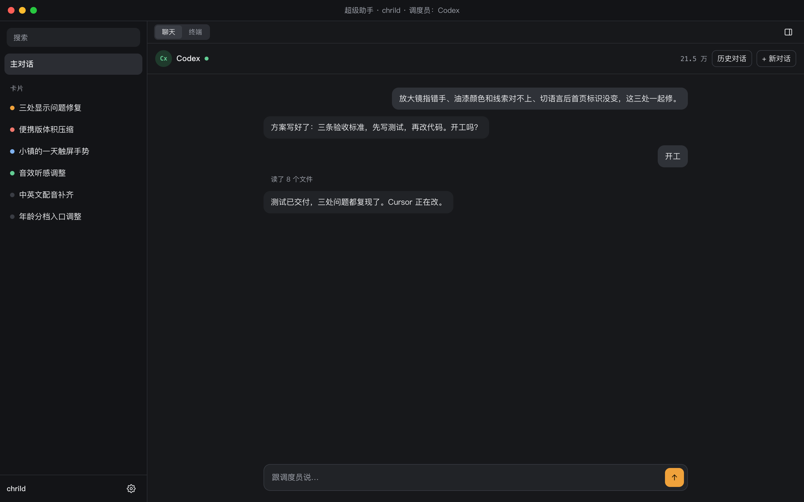
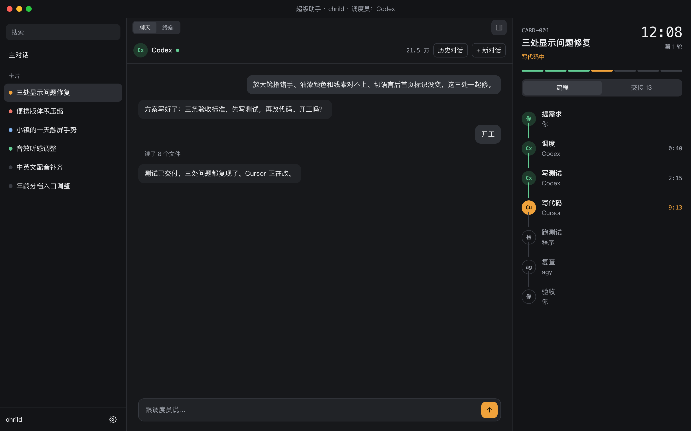
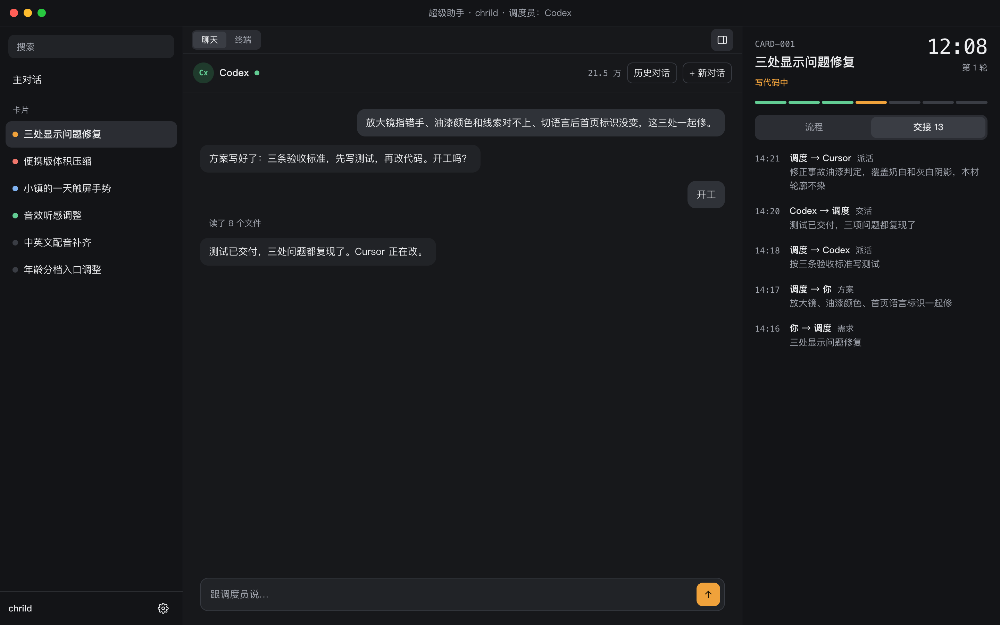
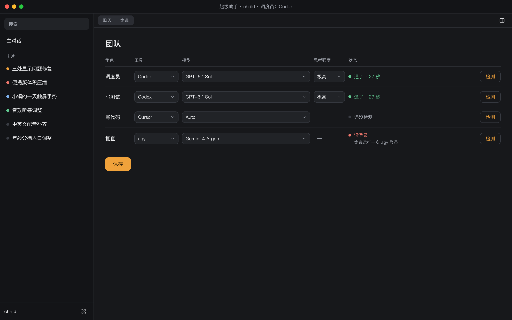
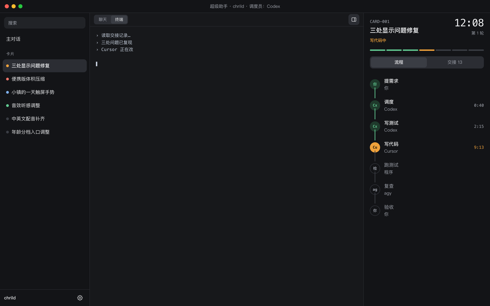

# 超级助手界面改版：开发交接文档

给接手写代码的模型。读完本文就能动工，不需要之前的聊天记录。

配套文件：[需求共识](需求共识.md)、[方案](方案.md)、[任务清单](任务清单.md)。文档有冲突时，以本文为准。

## 0. 开工前必读

**用户是产品经理，不看代码。** 汇报只说用户能看到的变化，不贴代码，不用技术词。

**规矩：**

1. 只做第 1 节的范围。发现范围外的问题，记下来告诉用户，不要顺手改。
2. 不改派活流程、记录格式和本机服务的接口。例外只有第 7 节列出的一处文案。
3. 测试时不要启动 Claude，调度员用 Codex。不要改用户自己的调度员设置，自测用窗口的一次性启动参数。
4. 先写测试再写代码。每张卡做完跑全量测试，更新 `docs/界面改版/任务清单.md` 和 `docs/开发进度跟踪.md`。
5. 不要提交、推送或发版，除非用户明确要求。
6. 遇到和本文冲突或不确定的地方，停下来问用户。
7. 卡 1 和卡 5 完成后，各给用户看一次，等确认再继续。

**当前代码状态：** 工作区有未提交的改动，包括“设置”入口、模型选择、本机模型自动读取、思考强度联动和每个角色单独检测，这些都要保留。不要用 `git checkout` 或 `git stash` 清掉它们。

## 1. 范围

**做：**

1. 窗口改成三段：左栏、中间、右栏，右栏可收起。
2. 新增左栏：搜索、主对话、卡片列表、项目名、设置。
3. 右栏只放一张卡的内容，去掉“卡片”标签。
4. 聊天、终端、右栏、设置统一成一套深色。
5. 删掉操作提示和解释句。
6. 设置页改成每个角色一行。

**不做（设计稿里画了也不做）：**

- “变成任务？”确认框和“确认，开工”按钮。
- 每张卡自己的对话。这次点卡片，中间仍是主对话。
- 多张卡同时跑。
- 新增卡片状态、改派活流程。

## 2. 设计图

**以下 5 张图是这次的目标样子。** 图里的卡片名、聊天内容、计时都是示例，真实窗口显示项目的实际记录。

线上设计稿：[超级助手界面改版](https://claude.ai/artifact/H1qGrSFcdQMWmAeX3pvqPM)。线上 E 那一行含后续功能，和本文不一致时以本文的图为准。

### 图 1：主对话，右栏收起



### 图 2：选中卡片，右栏看流程



### 图 3：选中卡片，右栏看交接



### 图 4：设置



### 图 5：终端视图



## 3. 现有代码地图

| 文件 | 现在做什么 | 这次怎么改 |
|---|---|---|
| `desktop/mac/Sources/SuperAgent/main.swift` | Mac 窗口。`buildWindow` 建两段分隔，`buildLeft` 建顶部切换和内容区，`showLeft` 切聊天/终端/设置，`loadPanel` 加载右边页面，`decidePolicyFor` 接住 `superagent://` | 改三段，加细栏、收起、联动 |
| `desktop/static/panel.{html,css,js}` | 右边面板，每 1.5 秒取 `/api/view`。`selected` 是手动选中的卡，`null` 表示跟随最新 | 去掉卡片标签，加七段进度和 `show` 方法 |
| `desktop/static/chat.{html,css,js}` | 聊天页。`window.SuperAgentChat` 有 `pause`、`resume`、`startFresh` | 换色、删提示、精简顶部 |
| `desktop/static/team.{html,css,js}` | 设置页。规则在 `TeamCore` | 改版面，规则不动 |
| `desktop/static/nav.{html,css,js}` | 不存在 | 新建左栏 |
| `desktop/static/theme.css` | 不存在 | 新建统一配色 |
| `desktop/server.py` | 本机服务。`/` 返回 `panel.html`，`/static/*` 返回页面 | 不改 |
| `desktop/view.py` | 整理右栏数据 | 只改一处文案，见第 7 节 |

`/api/view?project=&dispatcher=&card=` 返回的主要内容：

- `installed`：项目有没有接入。
- `project`：项目名。
- `cards`：卡片列表，每项有 `id`、`title`、`state`、`rework`、`updated`，最近有动静的在前。
- `card`：当前卡，有 `id`、`title`、`state`、`rework`、`round`。没建卡但调度员在干活时，`id` 是 `调度中`。
- `stations`：七站，有 `key`、`role`、`who`、`face`、`state`、`detail`、`elapsed`、`quiet`、`live`。
- `handoffs`：交接记录。
- `now`：当前状态文字 `text` 和色调 `tone`。
- `elapsed`、`back`、`stale`：计时、退回线、长时间没动静。

## 4. 视觉规范

新建 `desktop/static/theme.css`，四个页面都先引入它，再删掉各自 `:root` 里的颜色。

| 名称 | 色值 | 用途 |
|---|---|---|
| `--bg` | `#17181b` | 中间背景、终端背景 |
| `--bg-side` | `#131417` | 左栏、右栏 |
| `--surface` | `#212327` | 对方气泡、输入框、下拉框 |
| `--surface-2` | `#2b2d33` | 选中行、悬停 |
| `--surface-3` | `#3a3d44` | 未完成进度段、分段选中 |
| `--me` | `#2f3238` | 我发的气泡 |
| `--line` | `#2a2c31` | 分隔线 |
| `--line-2` | `#373a41` | 控件描边 |
| `--text` | `#ecedef` | 正文 |
| `--dim` | `#a0a4ad` | 次要文字 |
| `--accent` | `#f0a23b` | 正在进行、主按钮 |
| `--on-accent` | `#1d1403` | 主按钮上的文字 |
| `--wait` | `#7fb2f0` | 等你处理 |
| `--ok` | `#62cc93` | 完成、通过 |
| `--ok-bg` | `#1f3a2c` | 已完成头像底色 |
| `--bad` | `#f0776c` | 失败、要人工 |

- **字体：** 正文 `-apple-system, "PingFang SC", "Hiragino Sans GB", "Noto Sans SC", sans-serif`，14px，行高 1.55。编号、计时、用量用 `ui-monospace, "SF Mono", Menlo, monospace`，计时用等宽数字。
- **字号：** 页面标题 22，卡片标题 18，正文 14，次要 13，标签 12。
- **圆角：** 控件 8，列表行 9，气泡和输入框 12。
- **不要：** 渐变、发光、左边框色条、emoji 图标。图标用线条 SVG。

Swift 里也要换：

- `panelBackground`、`chatBackground`、`terminalBackground`。
- `makeWeb`、`message` 和所有写死的 `#0d1524`、`#101a2b`。
- 加载前的占位页也要是深色，不能闪出蓝色或白色。

## 5. 逐区规格

### 5.1 窗口

| 区域 | 默认宽 | 最小 | 最大 |
|---|---|---|---|
| 左栏 | 264 | 220 | 340 |
| 中间 | 占满剩余 | 440 | 不限 |
| 右栏 | 372 | 320 | 520 |

- 三段之间可以拖动，记住宽度。分隔的 `autosaveName` 换新名字，比如 `SuperAgentSplit3`，否则旧的两段记录会把位置算错。
- 窗口最小尺寸保持 760×480。
- 改变窗口大小时，左栏和右栏宽度不变，中间伸缩。

### 5.2 顶部细栏（中间最上方，原生控件）

- 高 40，下边一条分隔线。
- 左边：`聊天 | 终端` 切换，替换现在的 `聊天 | 终端 | 设置`。设置入口移到左栏。
- 右边：收起/展开右栏按钮，右栏开着时按钮有底色。
- 打开设置时，两个切换都不选中。
- 现有规则保留：不能聊天的调度员禁用“聊天”，没选调度员禁用“终端”。

### 5.3 左栏（`nav` 页面，新建）

从上到下：搜索框、主对话、`卡片` 小标题、卡片列表、底部项目名和齿轮。

- 数据：每 1.5 秒取 `/api/view?project=&dispatcher=`，用其中的 `cards` 和 `project`。不带 `card` 参数。
- 列表每行：状态圆点 + 标题，一行放不下用省略号。
- 排序：沿用 `cards` 的顺序。
- 搜索：在页面里按标题和编号过滤，不区分大小写。没有结果显示“没有找到”。
- 没有卡片：只显示主对话和“还没有卡片”。
- 没接入的文件夹（`installed` 为否）：隐藏卡片区。
- 轮询刷新时不要打断搜索框输入，也不要改变列表滚动位置。

状态圆点：

| `state` | 圆点 | 给用户看的文字 |
|---|---|---|
| 待对齐、待派发 | `--wait` | 等你确认 |
| 开发中、待测试、测试中 | `--accent` | 进行中 |
| 待验收 | `--ok` | 等你验收 |
| 需Claude介入 | `--bad` | 需要你处理 |
| 已合并 | `--surface-3` | 已完成 |
| 其他 | `--surface-3` | 原样显示 |

右栏显示的状态文字继续用 `now.text`，不要自己推算。

### 5.4 中间

- 聊天页顶部：头像、调度员名、连接圆点、用量数字、`历史对话`、`+ 新对话`。
- 用量只显示数字，比如 `21.5 万`。
- 对话内容最宽 760，居中。输入框跟内容同宽。
- 删掉输入框下的提示。
- 允许/拒绝卡片、图片、动作折叠、自动交代条都要保留，只换颜色。

### 5.5 右栏（`panel` 页面）

从上到下：

1. 编号（小字等宽）和计时（右上角，30px）。
2. 标题和状态文字（`now.text`）。
3. 第几轮、返工次数，放在计时下面。
4. 七段进度。
5. `流程 / 交接 N` 分段切换。
6. 流程或交接内容。

七段进度由 `stations` 算出来：

- `done`：`--ok`。
- `active`：`--accent`。
- `wait`：`--wait`。
- `fail`：`--bad`。
- `idle`：`--surface-3`。

如果 `stations` 里还有其他状态值，当作 `idle` 显示，并告诉用户。

流程和交接保留现有行为：头像点击过滤交接、退回线、移动的小圆点、交接点开看全文、长时间没动静的提示。

空状态：

- 没有卡片：标题“还没有卡片”，不显示计时和进度。
- 没接入：标题“这个文件夹还没接入”。
- `调度中`：照常显示，这时左栏没有选中的卡。

### 5.6 设置（`team` 页面）

每个角色一行，列为：角色、工具、模型、思考强度、状态、检测。

- 标题改成“团队”。
- 没有思考强度的工具显示 `—`。
- 失败时，状态下方显示“怎么办”。
- 自定义调度员命令框、自定义模型名框出现在这一行下面。
- 选“不复查”时隐藏这一行的模型、强度和检测。
- 保存按钮文字沿用现有逻辑：“保存并返回对话”或“保存并开始”。图 4 里的“保存”只是示意。
- 中间宽度小于 700 时，每行折成两行，不能出现横向滚动条。
- 警告保留：写代码和复查同一家、没有版本管理。

**不能动的部分：**

- `TeamCore` 的三个规则函数。
- `tests/team_page_check.js`。
- `class="member"`、`class="check-one"` 各 4 个，`tests/test_desktop_team.py` 会检查。
- 同一家工具一起检测、改了谁只清谁、检测中改选择旧结果作废。
- 按钮文字改成“检测”，无障碍标签保留“检测生效”。

## 6. 交互规则

### 选中状态由窗口管理

窗口记一个 `selectedCard`，`nil` 表示主对话。

| 操作 | 结果 |
|---|---|
| 点左栏卡片 | 选中这张卡；右栏展开并显示它；中间不变 |
| 点主对话 | 取消选中；右栏跟随最新；开关不变 |
| 再点已选中的卡 | 不变 |
| 点齿轮 | 中间换成设置，右栏临时收起 |
| 保存设置 | 回到对话，右栏恢复原来的开关 |
| 点“聊天”或“终端” | 离开设置，右栏恢复 |
| 切换项目 | 选中清空，左栏和右栏重新加载 |
| 选中的卡不在列表里 | 自动回到主对话 |

### 页面和窗口的通信

沿用现有方式，不要新增通信机制。

左栏通知窗口，用 `location.href`，由 `decidePolicyFor` 接住（给左栏网页视图设置 `navigationDelegate`）：

- `superagent://card?id=CARD-001`
- `superagent://main`
- `superagent://settings`

注意：现有处理里有 `guard url.host == "saved"`，要改成按 host 分发，`saved` 的逻辑不能变。

窗口通知页面，用 `evaluateJavaScript`：

- `window.SuperAgentPanel.show(id 或 null)`：设置 `selected`、重置 `prevActive` 和 `filterWho`、切到流程、马上取一次数据。
- `window.SuperAgentNav.select(id, "main" 或 "settings")`：更新高亮。

页面可能还没加载好，所以 `loadPanel` 加载地址时也要带上 `card=` 参数，`nav` 带上 `selected=` 参数。

建议把左栏的加载放进 `loadPanel` 或它旁边的 `loadSide`，确保所有调用 `loadPanel` 的地方都能一起刷新。

### 右栏收起

- 第一次打开：项目有卡片就展开，没有就收起。之后按用户上次的选择，记在本机设置里。
- 窗口宽度小于 1000 时自动收起。这不算用户的选择，宽度恢复后要还原。
- 窗口太窄时点卡片：屏幕放得下就把窗口加宽到 1000 再展开，放不下就保持收起。
- 收起时右栏页面继续运行，不要重新加载。

### 聊天和终端

切换逻辑沿用 `showLeft`，不要改先让出对话、再接着对话的顺序。这段修过多次：

- 聊天画面切走时不清空。
- 切回来不重刷。
- 同一段对话不能同时被聊天和终端占用。

## 7. 文案删改

**删除：**

| 位置 | 文字 |
|---|---|
| `chat.html` | `Enter 发送，Shift + Enter 换行 · 调度员干活时按钮变成“停止”` |
| `panel.js` | `点头像，看这个人的全部交接。` |
| `panel.js` | 另外三句 `flowFoot`（没接入、没卡片、调度中的说明） |
| `team.html` | 页面说明（`lead`） |
| `team.html` | 每个角色下的小字 |
| `team.html` | “执行员只能选……”说明 |
| `team.html` | 两个小标题“调度员 · …”“执行员 · …” |
| `team.js` | 底部提示里的长句，只保留失败和“全部通了” |
| `team.js` | `dispNote` 里的说明，只保留“自定义调度员检测只能查装没装” |

**修改：**

| 位置 | 原文 | 新文 |
|---|---|---|
| `desktop/view.py:328` | 等你在左边提需求 | 等你提需求 |
| `team.html` | 团队与模型设置 | 团队 |
| 输入框 | 跟调度员说…… | 跟调度员说… |

**保留：** 错误信息、断线提示、“写代码和复查是同一家”、“没有版本管理”、失败时的“怎么办”。

搜一遍页面文字里的“左边”“右边”。现在位置变了，用户看得到的地方要改掉。代码注释不用改。

## 8. 施工顺序

| 卡 | 内容 | 主要文件 | 给用户看 |
|---|---|---|---|
| 1 | 统一深色和文字清理 | `theme.css`、三组页面、`view.py` 一处文案、Swift 颜色 | 是 |
| 2 | 设置页一行一角色 | `team.*` | 否 |
| 3 | 右栏改造 | `panel.*` | 否 |
| 4 | 左栏 | `nav.*` | 否 |
| 5 | 窗口三段 | `main.swift` | 是 |
| 6 | 收尾 | 打包、走查、文档 | 是 |

卡 1 里的 Swift 颜色要重新打包才看得到；只改网页的部分，用户重开窗口就能看到。

## 9. 测试和验收

**命令：**

```bash
python3 -m unittest discover -s tests -p 'test_*.py'
python3.15 -m unittest discover -s tests -p 'test_*.py'
bash desktop/mac/build.sh
bash desktop/mac/build.sh --install
```

- 全量测试现在是 250 项，Python 3.9 和 3.15 都要过。
- `--install` 会覆盖 `~/Applications/超级助手.app`，先确认用户已经关掉应用。
- 窗口优先用源目录里的页面。只改网页时，关掉窗口重开即可；改了 Swift 才要重新打包。

**要新增的测试：**

- 状态到圆点的对应关系。参考 `TeamCore`，把规则写成不碰页面的函数，用 node 检查。
- 七段进度的计算。
- 搜索过滤。
- 选中的卡不存在时回到主对话。

**真实窗口走查：**

- 必须用干净环境打开：`env -i HOME=$HOME USER=$USER PATH=/usr/bin:/bin:/usr/sbin:/sbin /usr/bin/open -n -a ~/Applications/超级助手.app --args --project <测试项目>`。从终端直接启动会带上终端环境，掩盖“找不到命令”的问题。
- 自测参数见 `main.swift` 开头，比如 `--dispatcher codex`、`--left chat`、`--snapshot <文件夹>`。`--snapshot` 现有逻辑只截左右两张图，要改成支持三段。
- 不要用用户的真实项目做会改动文件的测试。
- 用 `-n` 开新窗口，不要碰用户自己开着的那个；测完只关自己开的进程。

**验收清单：**

- [ ] 打开窗口看到三段，四个页面配色一致，没有蓝色残留。
- [ ] 加载中、切换时不闪白、不闪蓝。
- [ ] 点卡片，右栏显示这张卡；点主对话，右栏跟随最新。
- [ ] 搜索能过滤，刷新时不打断输入。
- [ ] 右栏能收起、展开，重开后记得状态和宽度。
- [ ] 窗口缩到 1000 以下自动收起，放大后恢复。
- [ ] 聊天 ↔ 终端来回切换不卡、不报占用、不重刷。
- [ ] 历史对话、新对话、允许/拒绝、停止、图片都能用。
- [ ] 切换项目后左栏、右栏都换成新项目。
- [ ] 第一次配置、已配置、标红、不复查四种设置场景规则不变。
- [ ] 施工中、待验收、转人工、调度中、没有卡片五种右栏状态都对。
- [ ] 没接入的文件夹能打开，左栏和右栏不报错。
- [ ] 全量测试通过，截图存进 `docs/界面改版/`。

## 10. 已知的坑

- **`.win p` 这类全局规则会盖掉气泡内边距。** 设计稿踩过，写样式时注意优先级。
- **后台标签页里自动化点击会卡住。** 用 Playwright 连用户的 Chrome 时，等待动画和点击可能不返回，改用页面内直接触发。
- **本机服务每次检测都留一小条记录。** 这是有意的，不用清理。
- **Claude 不是调度员选项。** 不要加回来。
- **`需Claude介入` 是内部状态名。** 界面上显示“需要你处理”，记录里不要改。

## 11. 完成后

更新这些文件：

- `docs/界面改版/任务清单.md`：勾掉完成的卡。
- `docs/界面改版/验收记录.md`：新建，写清测了什么、看到什么、没测什么。
- `docs/开发进度跟踪.md`：追加记录，只追加，不删历史。
- `README.md`：把“菜单改团队配置”的说明更新成现在的入口。

汇报时用大白话，说清做了什么、怎么验证的、哪些没测。失败和跳过的都要写。
