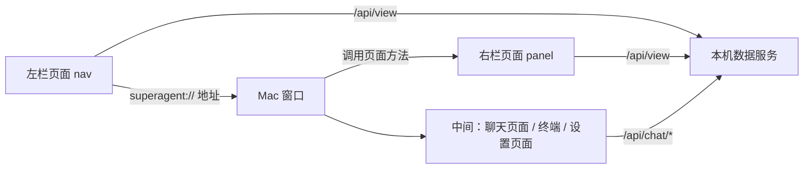

# 方案：界面改版（方向 E，深色）

## 1. 用户会看到什么

**打开窗口**

- 左栏：搜索框、主对话和历史对话、新对话按钮、任务卡片列表（圆点表示状态）、底部项目名和设置。
- 中间：和调度员的对话。
- 右栏：只属于任务卡片。主对话和新对话没有右栏，收起按钮也隐藏。

**点左栏**

- 点一张卡：右栏展开，显示这张卡。中间仍是主对话。
- 点主对话或历史对话：右栏收起，中间显示这段对话。
- 切换历史对话：点击后马上选中；最近 10 段内容提前读好，直接显示，后台再同步最新内容。
- 这段对话没连上时，再点一下这一行就重连。
- 打开软件和点新对话都不发任何内容，等用户说第一句才开始；第一次接入的项目例外，要先起草项目说明。聊天视图和 Codex 终端都靠启动时的角色设置工作，不发话。Cursor、agy 的终端只有开场那一句能交代角色，所以这两家仍会发。
- 用户一句话都没说过的对话不进列表。打开软件时接着用户真正聊过的最新一段。
- 时间：今天显示时分，昨天显示“昨天 时分”，更早显示日期。
- 左栏列表存一份在项目 `.collab/对话列表.json`，只留在本机。打开软件先显示它和上次的选中，连上后马上换成最新的。
- 对话标题现在用用户说的话；自动起名以后交给行政人员。
- 搜索：按卡片标题和编号过滤列表。

**右栏**

- 只有“流程 / 交接”两个标签，上面不放编号、标题、状态、计时和进度条。原来的“卡片”标签去掉，卡片都在左栏。
- 流程和交接的内容不变，交接仍可点开看全文。

**中间顶部一条细栏**

- 左边切换聊天和终端，右边是收起和展开右栏的按钮。
- 设置打开时占中间，保存后回到对话。打开设置不断开调度员，它继续干活。从设置回来不重连，消息不会重复。保存后，调度员空闲就马上重连生效；在干活就不打断，下次连接生效。保存时换成只能用终端的调度员，算切到终端，也先提示。
- 切到终端要让出对话。调度员回复中或等确认时，先提示“切到终端会中断这一轮”，确认后才切。所有去终端的入口都一样。

**设置**

- 每个角色一行：工具、模型、思考强度、状态、检测。
- 检测和保存规则不变。

> 设计图是改版初稿。右栏内容和历史对话的位置，以本方案和用户验收时的决定为准。

## 2. 要删的文字

- 聊天：输入框下的 Enter 提示。
- 右栏：“点头像，看这个人的全部交接”。
- 设置：页面说明、每个角色的小字、底部解释句。警告和失败时的“怎么办”保留。

## 3. 记住的信息

- 右栏开还是关、三段的宽度，存在这台电脑上。
- 卡片、流程、交接的记录方式都不变。

## 4. 泼冷水

- **这阶段点卡片，中间的对话不会换。** 设计稿里卡片有自己的对话，这要等“每卡一段对话”阶段。现在只有主对话一段。
- **这阶段看不到“变成任务？”确认框。** 流程还是和调度员在聊天里确认。
- **设计稿里的聊天内容和卡片是示例**，真实窗口里按你项目的真实记录显示。
- **窗口程序要重新打包安装。** 只改页面不够，装的时候需要关掉超级助手。
- **窗口最小宽度会变大。** 三段同时开要约 1000 宽，更窄时右栏自动收起。
- **真实窗口测试会花一点 Codex 额度。** 只用 Codex，不启动 Claude。

## 5. 技术设计

写给后续开发，可跳过。

- 窗口从两段分隔改成三段，左栏新增一个网页视图，右栏用分隔视图的折叠能力。
- 左栏点击沿用已有的 `superagent://` 地址拦截，不新增通信方式。
- 窗口通过调用页面方法让右栏切卡，沿用聊天页已有的做法。
- 左栏数据用现有 `/api/view`，本机服务不改。
- 四个页面共用一份 `theme.css` 配色，不再各写一份。
- 顶部细栏用原生控件，因为终端不是网页。
- 选中卡片的状态放在窗口，左栏和右栏都听窗口的。
