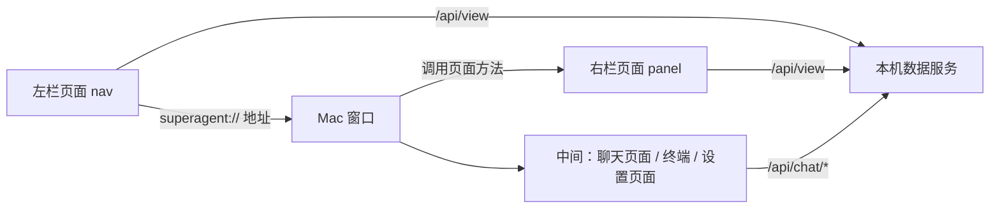

# 方案：界面改版（方向 E，深色）

## 1. 用户会看到什么

**打开窗口**

- 左栏：搜索框、主对话、卡片列表（圆点表示状态）、底部项目名和设置。
- 中间：和调度员的对话。
- 右栏：第一次打开时，项目里有卡片就展开，没有就收起。之后记住上次的状态。

**点左栏**

- 点一张卡：右栏展开，显示这张卡。中间仍是主对话。
- 点主对话：右栏回到跟随最新进度，也就是现在“回到最新的一张”的效果。
- 搜索：按卡片标题和编号过滤列表。

**右栏**

- 上面是编号、标题、状态、计时、第几轮和返工次数、七段进度。
- 下面切换“流程 / 交接”，原来的“卡片”标签去掉，卡片都在左栏。
- 流程和交接的内容不变，交接仍可点开看全文。

**中间顶部一条细栏**

- 左边切换聊天和终端，右边是收起和展开右栏的按钮。
- 设置打开时占中间，保存后回到对话。

**设置**

- 每个角色一行：工具、模型、思考强度、状态、检测。
- 检测和保存规则不变。

## 2. 要删的文字

- 聊天：输入框下的 Enter 提示。
- 右栏：“点头像，看这个人的全部交接”。
- 设置：页面说明、每个角色的小字、底部解释句。警告和失败时的“怎么办”保留。

## 3. 记住的信息

- 右栏开还是关、三段的宽度，存在这台电脑上。
- 卡片、流程、交接的记录方式都不变。

## 4. 泼冷水

- **这阶段点卡片，中间的对话不会换。** 设计稿里卡片有自己的对话，这要等“每卡一段对话”阶段。现在只有主对话一段。
- **这阶段看不到“变成任务？”确认框。** 流程还是和调度员在聊天里确认。
- **设计稿里的聊天内容和卡片是示例**，真实窗口里按你项目的真实记录显示。
- **窗口程序要重新打包安装。** 只改页面不够，装的时候需要关掉超级助手。
- **窗口最小宽度会变大。** 三段同时开要约 1000 宽，更窄时右栏自动收起。
- **真实窗口测试会花一点 Codex 额度。** 只用 Codex，不启动 Claude。

## 5. 技术设计

写给后续开发，可跳过。

- 窗口从两段分隔改成三段，左栏新增一个网页视图，右栏用分隔视图的折叠能力。
- 左栏点击沿用已有的 `superagent://` 地址拦截，不新增通信方式。
- 窗口通过调用页面方法让右栏切卡，沿用聊天页已有的做法。
- 左栏数据用现有 `/api/view`，本机服务不改。
- 四个页面共用一份 `theme.css` 配色，不再各写一份。
- 顶部细栏用原生控件，因为终端不是网页。
- 选中卡片的状态放在窗口，左栏和右栏都听窗口的。
