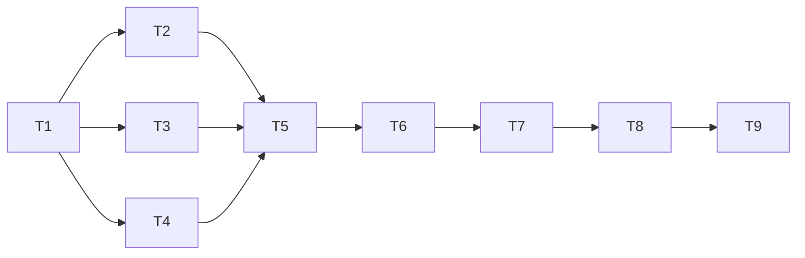

# 任务清单：积木库 · 第一个功能

**状态：** ✅ 2026-11-08 用户批准（“可以，开始写第一张施工单”）。依据：[需求共识](需求共识.md)、[方案](方案.md)（用户 2026-11-08 批准：“写”）。
**分工（沿用前几批）：** Claude 先写验收测试和施工单，Cursor 施工，Claude 验收、真实走查、派独立复查。
**阶段展示：** 做完第 3 项、第 7 项、第 8 项时，各给你看一次。

| # | 做什么 | 怎么验收 | 依赖 |
|---|---|---|---|
| 1 | **积木库资料夹和接法卡。** 整台电脑一份资料夹；接法卡能存、能读、格式不对能报错；预置 Codex、Cursor、agy 三张；检测和安装都留记录 | 自动测试用临时资料夹：存了能读回、坏卡报错说得清、三张预置卡格式合法；不碰真实资料夹 | 无 |
| 2 | **环境体检。** 查 Node、npm、Homebrew、git，以及各 CLI 的版本和登录状态；终端和超级助手各查一遍，标出“装了但找不到”；每项限时 5 秒，全程只看不跑任务 | 自动测试用假的可执行文件，覆盖有、没有、超时、两边不一致；本机真实体检一次，列出的结果和终端里手查一致 | 1 |
| 3 | **按接法卡检测。** CLI 在临时文件夹里干一件小事，以文件为准；大模型 API 发一句话，再测会不会用工具；结果写进记录；同一块同时只跑一个 | 假 CLI 通过和不通过两种；接法卡写错一项时，失败原因说得清；真实检测 Codex 通过一次（只用 Codex，不启动 Claude）。**这一步做完给你看一次体检和检测的结果** | 1 |
| 4 | **核实名单和安装执行。** 名单写在程序里，每条附官方来源（施工前核对 Cursor、Node 的官方原文）；按参数执行，不经过 shell；先查前提工具；输出实时可取；限时 10 分钟；要管理员权限就停 | 假安装程序覆盖成功、失败、超时、缺前提、要权限；名单外的编号被拒绝；真实走一次：把 Codex 装进临时目录，不动全局 | 1 |
| 5 | **积木库行政。** 说明存成单独文件；按资料夹切换成积木库专用工具（体检、查安装、查登录、读帮助、提议安装、提议接入 CLI、提议接入 API）；两种新提议（安装、接入）；读帮助只允许固定命令；聊天里出现密钥时提醒作废 | 用假模型按剧本对话：装 Codex、接通义、名单外工具、接法写错后改对、连续 3 次失败停下；行政拿不到运行任意命令的路；项目窗口的行政行为不变（原有测试全过） | 2、3、4 |
| 6 | **本机服务接口。** 绑定（含会不会用工具）、体检、基础层列表和详情、检测、安装进度、移出基础层；耗时的都走后台、可查进度 | 接口测试覆盖每条路径和出错情况；密钥不出现在任何返回内容里 | 1–5 |
| 7 | **积木库页面。** 绑定页；左栏（聊天 + 基础层）；聊天和提议卡（安装输出区、密钥框）；体检卡；基础层详情 | 浏览器里用假模型走完：绑定 → 体检卡 → 装 Codex 的提议 → 检测通过 → 出现在基础层 → 详情 → 移出。**做完给你看一次页面** | 6 |
| 8 | **Mac 窗口。** 菜单“窗口 → 积木库”和左栏底部入口；单独的窗口，和项目窗口可以同时开；项目窗口行为不变 | 编译打包通过；用干净环境打开真实窗口，两个窗口同时开着互不影响。**做完给你看真实窗口** | 7 |
| 9 | **整体验收。** 按需求共识的“怎么算做完”逐条在真实窗口走：全新资料夹绑定真实密钥；Codex、Cursor、agy 接入；接一个大模型 API；接法写错后改对；临时环境真实安装；项目窗口照常跑一张卡 | 全量测试在 Python 3.9 / 3.15 通过；真实走查记录写进验收记录；独立复查做过；README 和设计规范同步；台账登记 | 1–8 |

## 依赖顺序

## 施工中的规矩

- 动手顺序：先写会失败的验收测试，再交 Cursor 施工。
- 发现和方案对不上：停下来问你，不自己改方案。
- 测试和走查都不启动 Claude，不碰你真实的钥匙串和资料夹；走查用的临时资料、测试对话做完就清理。
