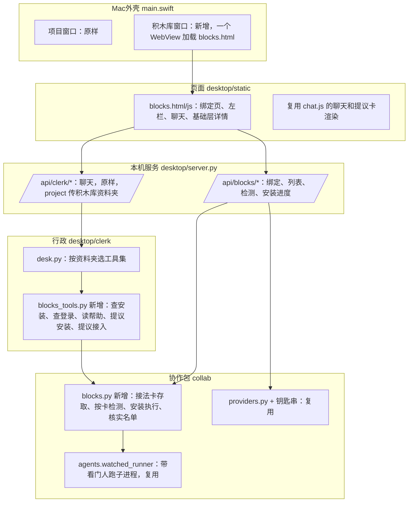

# 方案：积木库 · 第一个功能：行政安装 CLI 和大模型 API

**状态：** ✅ 2026-11-08 用户批准（“写”）。依据：[需求共识第三版](需求共识.md)。（之前那版方案含能力层和出图，已作废，被本文替换。）

## 一、你会看到什么

### 1. 怎么打开

- 菜单栏“窗口 → 积木库”。左栏底部也加一个入口。
- 积木库是一个单独的窗口，和项目窗口可以同时开着。它不用先选项目，没有团队设置，也没有右边的施工面板。（打开超级助手本身照旧先选项目，再从菜单或左栏打开积木库，用户 2026-11-09 定。）
- 积木库开着时关项目窗口：项目窗口只是藏起来，菜单“窗口 → 项目窗口”叫回来；两个窗口都关了才退出（用户 2026-11-09 定）。

### 2. 第一次打开：绑定行政

- 窗口中间只有一张卡：“先绑定一个大模型，它会当你的行政”。
- 内容：选服务商（腾讯云、阿里百炼、其他同类），填模型名，填密钥，点“检测”。
- 检测时发一句很短的话，几秒内出结果：
  - 通过：卡片变成“绑定好了”，自动进入聊天（行政不主动打招呼，等你开口；2026-11-09 整体验收时用户定，省一句额度）；
  - 不通过：卡片上用大白话说原因（密钥不对、额度用完、模型名写错、地址不对），改了再测。
- 这一家的密钥如果之前在项目窗口填过，直接显示“已保存的密钥”和“换一把”，不用再填（用户 2026-11-09 定显示方式）。存的那把没通过时说原因并展开输入框。
- 以后再打开，直接进聊天。要换行政或看环境体检，点窗口右上角的“设置”（用户 2026-11-09 改：原来叫“行政设置”，体检条原来固定在聊天上方，现在都并进“设置”）。

### 2.5 环境体检（用户 2026-11-07 提出）

**位置（2026-11-09 用户改）：** 体检不再固定在聊天上方，放进“设置”页：一页两块，上面是“行政”（服务商、模型、密钥），下面是“环境体检”（体检列表默认展开，带“重新检查”）。窗口顶部平时干干净净；体检发现问题（有工具要处理）时，右上角“设置”按钮带小红点，点进去看是哪个工具、怎么处理。绑定页（第一次绑定、重新连上）里没有体检。

- **什么时候查：**
  - 第一次绑定行政成功后，自动体检一次；
  - 以后每次打开窗口，快速查一遍；
  - 体检卡上有“重新检查”按钮。
- **只看，不真跑：** 体检只查装没装、什么版本、登没登录，几秒钟完成，不花额度。让工具真干一件小事的检测，只在接入时或你手动点“检测”时才跑。
- **查什么：**

| 项 | 为什么查 |
|---|---|
| Node、npm | 用 npm 装 Codex 要用 |
| Homebrew | 用 brew 装 Codex、Node 要用 |
| git | 很多工具和项目窗口要用 |
| Codex、Cursor、agy | 装没装、版本、登没登录（能查的才查） |
| 已经接入基础层的 | 命令还在不在、版本有没有变 |
| 装了但超级助手找不到 | ~~终端里能用、从桌面打开的超级助手找不到的，单独标出来，并说明怎么办~~ 55 号单验收后改（2026-11-09 用户确认保留）：体检、检测、安装前先把终端的路径补进超级助手，这种工具直接就能找到 |

- **你会看到：** ~~聊天里出现一张“环境体检”卡~~（2026-11-09 用户改：聊天区上方固定一张“环境体检”卡，不进聊天记录；每次打开刷新，全都正常时收成一行，缺东西或没登录时自动展开，可以手动收起），每项打勾或打叉，缺的写明是做什么用的。（58 号单，用户 2026-11-09 定：只有基础层里接的工具没了、没登录、查版本出错才自动展开；Node、Homebrew、git 和没接的工具照样列出打叉，但不逼着展开。）行政接着按缺的内容主动建议，例如“你的电脑缺 Node，要装 Codex 得先装它，要我帮你装吗？”
- **帮你装前提工具：**
  - Node：已有 Homebrew 时，`brew install node` 放进核实名单，由程序执行，你确认；
  - Homebrew 本身：要在终端里输入电脑密码，程序替不了，由行政一步步带你在终端里装。

### 2.6 行政不依赖哪个模型（用户 2026-11-07 提出）

用户原意：现在接的是 DeepSeek，以后可能换成 ChatGPT 等；底层应该有一份说明和一套流程，接哪个大模型都照这套规则办。

| 层 | 内容 | 换模型后 |
|---|---|---|
| 程序定死的规矩 | 安装命令只来自核实名单（沙盒接入后：或来自程序核对过的官网原文）；执行前必须你确认；检测不通过进不了基础层（只是额度不足的算接上了，可以放进，标黄“额度不足”，用户 2026-11-09 定）；密钥只能填在密钥框；连续 3 次失败就停 | 完全一样，模型绕不过去 |
| 一份固定的说明和流程 | 行政是谁、按什么顺序办事（体检 → 查装没装 → 提议 → 检测 → 请你确认）、怎么说话 | 一样，存成单独一份文件，所有模型读同一份；第一批不能在界面上改 |
| 一组固定的工具 | 查环境、读帮助、提议安装、提议接入 | 一样，模型只能通过工具做事 |
| 模型自己的发挥 | 聊天说得好不好，起草的接法卡准不准 | 有差别：强的一次就对，弱的可能要改几次 |

- **绑定检测加一项“会不会用工具”。** 行政办事全靠调用工具，有的模型不支持。绑定时发一句要求调用工具的话：不会用的，直接提示“这个模型当不了行政”。
- **订阅和 API 是两回事。** 行政要的是 API 密钥（按用量付费）。ChatGPT 会员不能直接当行政，要用 ChatGPT 的模型，得在 OpenAI 平台另外申请 API 密钥。绑定页上写明这一点。

### 3. 窗口布局

- **左栏：** 上面是“聊天”，可以有多段对话，能删除，和项目窗口一样；下面是“基础层”，列出已经接进来的每一块。
- **中间：** 和行政的聊天，或者某一块的详情。

### 4. 让行政装一个 CLI（以 Codex 为例）

1. 你说“我想装 Codex”。
2. 行政先查本机。
   - **已经装了：** 说出版本，问要不要接进基础层。
   - **没装，而且在核实名单里：** 聊天里出现“安装提议卡”，写明：
     - 装什么；
     - 来源（官方页面链接）；
     - 会执行的那一行命令，原样显示；
     - 大概要多久；
     - 需要什么前提，比如 npm 方式要先有 Node。

     你点“确认安装”后，卡片下面实时滚动安装输出，装完显示成功或失败原因。
   - **没装，也不在名单里：** 行政给出官网和安装步骤，让你自己装，装好跟它说一声。（2026-11-09 沙盒接入改：名单外的由行政上网找官网、程序核对后你确认再装，见 [沙盒接入/方案](沙盒接入/方案.md)）
3. 查登录：行政让程序查登录状态。没登录的，行政告诉你在终端里输入哪个命令、浏览器里会弹出什么，你亲手登录完回来说一声。
4. 起草接法：行政让程序读这个工具自带的帮助说明（只读，不运行别的），起草一张“接法卡”：
   - 用什么命令启动；
   - 怎么把交代交给它；
   - 怎么选模型；
   - 怎么查登录；
   - 怎么算干完活。
5. 检测：程序按接法卡，在一个临时文件夹里让它干一件小事（新建一个文件，写一个字），看结果。
6. 结果出现在“接入提议卡”上：
   - 通过：显示“检测通过”和用时，你点“放进基础层”；
   - 不通过：显示失败原因，行政照着原因改接法卡再测。最多连续改 3 次，还不行就停下来，说明卡在哪。同一段对话里行政起草的卡算在一起，换个名字也算；Codex、Cursor、agy 这种现成接法不受这条限制（比如没登录导致不通过，登录好了随时能再接）。
7. 放进去之后，左栏“基础层”出现 Codex。

**核实名单**，第一批只放已经查到官方安装说明的：

| 工具 | 官方安装方式 | 状态 |
|---|---|---|
| Codex | `npm install -g @openai/codex`（要 Node）或 `brew install --cask codex`（要 Homebrew） | 已查到官方说明 |
| Node | `brew install node`（要 Homebrew） | 施工前核对 Homebrew 官方说明 |
| Cursor 命令行 | 官网给的一行安装命令 | 施工前再核对一次官网原文 |
| agy | 还没查到官方安装说明 | 先不进名单，只做“已安装的接入” |

名单写在程序里，每条附官方来源链接。行政只能从名单里选，不能自己编安装命令。

### 5. 让行政接一个大模型 API（以通义为例）

1. 你说“我想接通义”。
2. 行政说明去哪申请密钥，申请时选什么。
3. 聊天里出现“接入提议卡”：服务商、模型名、地址，加一个密钥框。密钥只填在这个框里，不在聊天里贴，因为聊天内容会发给行政所用的服务商。行政如果发现你在聊天里贴了密钥，会提醒你去对应平台作废并重新申请。
4. 点“检测”，程序发一句话，通过后点“放进基础层”。

### 6. 基础层页面

点左栏基础层里的一块，中间显示它的详情：

| 显示 | 说明 |
|---|---|
| 名字、类型（CLI 或大模型 API）、用的是哪家订阅或账号 | |
| 状态 | 能用 / 不能用（原因和怎么修）/ 没检测过 |
| 版本（CLI）或模型名（API） | |
| 上次检测时间和用时 | |
| “检测”按钮 | 再测一次。没核实的 CLI 先亮完整命令再确认；大模型 API 在详情里填一次密钥（用户 2026-11-09 定，第 8 项接好钥匙串后 Mac 窗口里改成自动取），检测通过后把这把密钥交给 Mac 窗口存进钥匙串 |
| “移出基础层” | 只是不再列出，不卸载工具，不删密钥。先弹一句确认（用户 2026-11-09 定） |
| 接法卡全文 | 可以展开看，第一批不能手改。要改就跟行政说 |

打开窗口不会自动检测，免得每次都花额度。第二个功能做好以前，这里不会出现“抽取能力”。

**额度不足（2026-11-09 整体验收时用户定）：** 基础层只管工具接进来、能跑起来；检测时工具能连上、只是所选模型没额度，也算接上了，可以放进基础层，状态标黄“额度不足”。用哪个模型、额度不够时换哪个，归第二个功能（能力层）。绑定行政例外：行政要真能说话，额度不足不能绑定。

## 二、系统会记住什么

- **一个积木库资料夹，整台电脑一份**（放在系统给应用的资料夹里），里面有：
  - 行政的设置：哪家服务商、哪个模型（密钥不在这里，在钥匙串）；
  - 和行政的聊天记录；
  - 基础层里每一块的接法卡；
  - 每次检测和安装的记录：时间、结果、原因。
- **密钥：** 每家一把，存在钥匙串，和项目窗口共用。钥匙串是唯一的来源：积木库窗口打开时、钥匙串变了时，Mac 窗口把整份交给本机服务，只记在内存里，关应用就没了（用户 2026-11-09 定，60 号单）。
- **项目里的任何东西都不动。**

## 三、借鉴主流工具（逐条判断）

| 别人的做法 | 判断 | 怎么用 |
|---|---|---|
| Claude 桌面版扩展：一键装，密钥存钥匙串 | 采用一半 | 密钥存钥匙串；“一键装”只对核实名单开放 |
| Cursor、Trae 添加工具插头时要粘贴一段配置 | 不采用 | 普通人看不懂。改成行政起草、程序检测 |
| Agent Skills 等标准 | 第二个功能再用 | 抽取能力时用 |
| AI 写安装命令的风险 | 防住 | AI 编出不存在的包名，会被人抢注成恶意包，业内已有真实案例。所以安装命令只能来自核实名单 |

## 四、泼冷水

1. **安装要求电脑上有前提工具。** 用 npm 方式装 Codex 要先有 Node，用 brew 方式要先有 Homebrew。体检会先查出来；Node 能在有 Homebrew 时帮你装，Homebrew 要输入电脑密码，只能带着你在终端里装。
2. **程序执行安装，等于在你电脑上跑别人的安装程序。** 只跑名单里官方来源的命令，执行前你确认，过程全显示，但风险没法降到零。npm 全局安装有时还要求管理员权限，遇到这种情况会停下来告诉你，不会自动提权。
3. **“接法卡”通用化有边界。** 交代任务、看结果这种一问一答的用法能通用。每家的特殊功能（Codex 出图、会话续接这些）要到第二个功能里单独处理。
4. **行政是便宜模型，起草的接法可能要改好几次。** 每次检测都要真让那个工具干一件小事，花一点那家的额度。连续 3 次不通过就停。
5. **登录状态有的查得准，有的查不准。** Codex、Cursor 有专门查登录的命令；agy 没找到，只能靠真跑一次小任务来判断。
6. **项目窗口那边的行政设置不受影响，但现在有两处行政设置。** 积木库一份，每个项目一份。以后要不要合并，等用顺了再定。
7. **工作量。** 新窗口、绑定页、环境体检、行政的新工具、安装执行、接法卡和检测、基础层页面，估计要 6 到 7 张施工单。

## 五、不做

从基础层抽取能力；服务类插头（高德等）；拖拽画布；接进项目团队；Claude；网页或 App 订阅；替你装 Homebrew（只带着你装）；自动提权；定时检测；花费统计；手工编辑接法卡。

---

## 技术设计（写给下一个会话的 AI，用户可跳过）

### 模块关系

### 约定

- **积木库资料夹：** `~/Library/Application Support/超级助手/积木库/`。复用现有行政：把这个资料夹当作 `ClerkDesk` 的“项目”传进去，对话照旧存在 `<资料夹>/.collab/行政对话/`；行政设置存在 `<资料夹>/.collab/配置.json` 的 `clerk` 段。凡是现有代码要求“项目已接入”（有 `.collab/cards`）的检查，积木库资料夹都要能绕过，并且不能因此在这里建卡片目录。测试用临时目录替换这个根，不碰用户真实资料夹。
- **行政说明是文件：** 积木库行政的说明放在 `desktop/clerk/roles/积木库.md`，运行时读入，不写在代码里。换模型不换说明。
- **绑定检测：** 在现有“发一句话”的基础上，再发一次带一个假工具的请求，要求模型调用它。没有返回工具调用就判为“当不了行政”，提示里说明原因。
- **工具集按资料夹切换：** `desk._tools_for` 判断当前资料夹是不是积木库。是，就只给积木库工具，不给建卡、改团队这些项目工具。行政的角色说明也换一份。
- **接法卡**（`基础层/<编号>.json`）字段：
  - `kind`：cli 或 llm_api；
  - `name`；
  - CLI：`command`（可执行文件名），`run`（参数模板，用 `{prompt}`、`{model}` 占位，按参数列表拼，**不经过 shell**），`version_args`，`login_check`（可选，参数列表加“已登录”的判断字样）；
  - API：`provider`、`base_url`、`model`、`key_account`（钥匙串账号名：腾讯云、百炼用服务商编号，其他的按地址分开，和项目窗口的规矩一样）；认得的服务商地址固定，行政改不了；
  - `done_when`：CLI 默认是“临时文件夹里出现指定文件”；
  - `source`：内置或行政起草；
  - 检测结果不写在卡里，写在 `记录/<编号>.jsonl`（50 号单实现）。
- **接法卡的安全规矩（50 号单复查后补，2026-11-08）：** 接法卡大多由行政起草，用户看不懂也就判断不了，所以由程序把关：
  - `command` 不能是 shell、脚本解释器、删改文件、联网下载、装软件的程序（禁用名单在 `collab/blocks.py`）；
  - 查版本只能是 `--version`、`-V`、`-v`、`version`；查登录只能是 `status`、`login status`、`auth status`、`whoami`；
  - 子项不许多写字段；常见密钥格式（OpenAI、Anthropic、Google、GitHub、Bearer）和带 key/token/secret 的字段名一律拒收。
  - 参数里不许写密钥开关（`--api-key`、`--token` 等），不许写关掉工具安全限制的开关（含 dangerously、yolo、bypass、danger-full-access）。
- **核实的放行，其余亮出来确认（用户 2026-11-08 拍板）：** 禁用名单堵不全，所以分两档：
  - **核实过：** 命令和所有参数都和预置卡（以及以后核实名单里的工具）一模一样，可以直接检测。
  - **没核实：** 行政起草的其他卡，检测前在提议卡上原样显示要运行的完整检测命令（含实际要运行的完整路径，交代写出原文，就是检测时真正交给工具的那句话），标“未核实，有风险”，用户再确认一次才运行。程序把用户确认时看到的那条命令和现在要跑的逐字对比，卡改过或换了程序就不算数。确认之后的体检只会跑这条命令的查版本、查登录固定写法。
  - 模型名只能用字母、数字和 . _ : / @ + -，不能以横线开头，所以“只换模型名仍算核实过”成立。
  - 算干完活的文件名只能用字母、数字、汉字和 . _ -（最长 60 个字），免得在文件名里夹带给 AI 的话。
  - **剩余风险（第四轮复查后写明）：** 程序对参数的拦截（关安全限制、写密钥、禁用名单）是第二道网，拦不全，复查每轮都能再找到新写法，不再逐条追补，只修真正的错误。`-y`、`--force` 这类在不同工具里意思不同的开关，程序不拦。确认只绑定命令的路径和参数，不绑定程序文件本身：同一路径的程序被替换（例如升级），确认仍有效。没核实的卡，真正兜底的是用户看过完整命令再确认。
  - 检测失败时，记录里会留工具输出的最后一行（最多 120 个字，邮箱和认得出的密钥已打码），用来说明原因；其余原始输出不存。
  - 老实说：没核实的那一档，用户大概率也判断不了，靠的是透明和提醒，不是保证。
- **读帮助：** 只允许运行 `<命令> --help`、`<命令> --version` 和接法卡里写好的 `login_check`。命令必须是 PATH 里真实存在的可执行文件，名字只能是字母、数字、点、下划线和横线（和接法卡的规则一致）。限时 10 秒，输出截断后交给行政。
- **检测：**
  - CLI：新建临时文件夹，按 `run` 模板拼参数，交代“新建 连通检测.txt，内容写 OK”，用 `agents.watched_runner` 跑，限时 3 分钟，以文件存在为准，和现有的 `check.py` 判断一致。
  - API：复用行政检测的那条路径发一句话。
  - 结果写进 `记录/<编号>.jsonl`。同一块同时只跑一个检测。
- **安装：** 核实名单是代码里的常量（工具、方式、参数列表、前提命令、来源链接），行政工具只能按名单编号提议。执行前查前提命令在不在；按参数列表执行（**不经过 shell**），输出写进临时文件，页面隔一会儿来取最后 50 行，像终端一样滚动（每行最多 2000 字，先打码再截断，截过的去掉结尾那串英文字符、标“…”；进度条原地刷新的只留最后一帧；还没写完的最后一行先不显示，免得露出半截密钥；装完后还能再取一次最后几行）。不把每一行推给页面：推得慢就得略过、补显示，还会拖长限时，第一到第四轮复查都在这上面出问题，第四轮后改成这样；记录只存结果和原因，不存原始输出；限时 10 分钟，超时先请安装程序自己退出，5 秒后还在才强行关掉；遇到权限不够就停下，不提权（npm、Homebrew 的说法分开认）。官方只给 `curl … | sh` 这种管道形式的，第一批不放进名单，只做引导。
  - **Homebrew（用户 2026-11-08 定）：** 安装时不自动更新软件目录、不顺手清理别的软件。代价：装上的版本可能稍旧；目录太旧装失败时，提示在终端里运行一次 `brew update`。老实说：要装的东西依赖的底层组件太旧时，Homebrew 仍会升级那个组件，这一点关不掉（硬关会让别的软件坏掉）。
  - **在空文件夹里跑：** 体检、读帮助、安装都在新建的空文件夹里运行工具，跑完就删：工具不会把文件写进别处，npm 也读不到别处的设置（能改下载来源）。后台小程序还在往里写、删不干净时，不报错、不影响结果，可能在系统临时文件夹留下一个文件夹。
  - **环境设置：** 安装不接受任何外来的环境设置（有些设置能借安装跑任意代码）。找命令的路径只能由程序给（超级助手自己的或终端的），行政和页面都不能传。走查要装进临时文件夹时，只能给一个完整路径（只对 npm）。
  - **剩余风险：** 安装程序自己另开一组的后台小程序，超时时关不掉；npm、brew 正常不会这样做。装完后留在后台、又不理会“请退出”的小程序，会让安装多等 5 秒才结束。安装程序疯狂刷屏时，临时记下的输出没有上限（npm、brew 不会这样）。
- **提议卡：** `tasks.py` 新增两种 kind：`install`（确认后执行安装）和 `connect`（确认后检测，检测通过再点“放进基础层”）。确认、作废走现有流程；页面复用 chat.js 的提议卡渲染，加安装输出区和密钥框。
- **环境体检：** 只运行固定的查版本命令（`node --version`、`npm --version`、`brew --version`、`git --version`、核实名单和基础层里各工具的版本命令和 `login_check`），每项限时 5 秒，并行跑。用 `desktop/shell_path.py` 取登录终端的 PATH，和应用自己的 PATH 各查一遍：两边结果不一样的，标成“装了但超级助手找不到”。（55 号单验收后改，2026-11-09 用户确认保留：体检前先把终端路径补进超级助手，这种工具直接显示“有”，不再单独标出。）体检结果交给行政作为对话开头的资料，不花模型额度以外的任何额度。
- **耗时操作**（检测、安装、读帮助）一律走后台，页面轮询进度，和 `/api/team/check` 同一种做法。
- **项目窗口：** 不改它的行为。只在菜单和左栏底部加入口。
- **测试纪律：** 自动测试用假 CLI（临时目录里放一个假的可执行文件）和假模型。真实走查只用 Codex、Cursor、agy，不启动 Claude。安装走查用临时前缀（例如 `npm --prefix <临时目录>`），不动用户全局装的工具。
