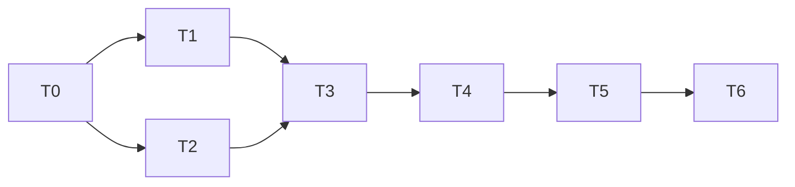

# 任务清单：积木库 · 行政上网装工具，基础层变成沙盒

**状态：** ✅ 2026-11-09 用户批准；同日用户改为“一口气做完”，61–65 由 Claude 直接施工（不经 Cursor、Codex），第 6 项整体验收要用户在场。原状态：初稿，等用户批准。依据：[需求共识](需求共识.md)（✅ 2026-11-09）、[方案](方案.md)（✅ 2026-11-09 用户批准：“可以，出任务清单”）。**未写代码。**

**分工（按 2026-11-09 定的新流程）：** Claude 写施工单和验收测试（开发不许改测试）→ Cursor 施工 → Codex（gpt-6.1-sol，推理 xhigh）对照需求和施工单复查 → Cursor 按复查修，最多 3 轮，过不了停下报 Claude → Claude 最终验收（全量测试、真实走查、给你看）。61 号单 Codex 和 Claude 的复查员各查一次做对比（Codex 当复查员还没考过），之后只用 Codex。
**单号：** 接着上一轮，从 61 起。
**给你看的节点：** 第 0 项做完（实测结果和方案对不上时）、第 5 项做完（页面）、第 6 项做完（整体验收）。

| # | 做什么 | 怎么验收 | 依赖 |
|---|---|---|---|
| 0 | **施工前实测（Claude 自己做，不写代码）。** ①把高德的工具真装进临时位置（不动你全局装的东西），记下用时和能不能装上；②试它的帮助说明、`searchPOI` 不先打开地图窗口能不能用、不填密钥时报什么错；③去 Tavily 官网核对注册步骤和密钥样子，写成行政说明里那一段的草稿；④用一把 Tavily 密钥试搜索接口的成功、密钥不对、额度用完各返回什么 | 实测结果写进方案的“实测记录”。和方案对不上的（比如高德检测必须先开窗口），停下来问你，不自己改方案 | 无 |
| 1 | **61 号单：接法卡扩展和“联网搜索”积木。** 接法卡加类别（AI 助手 / 普通工具）、普通工具的检测命令和判断字样、要哪几把密钥（只记名字）；新的积木种类“联网搜索”，预置 Tavily 一张；老卡原样能用 | 自动测试：新字段写错、密钥名字是 PATH 这类危险名字、检测命令里夹了密钥或关安全限制，都给中文原因拒收；Codex、Cursor、agy 三张老卡和你基础层里现有的卡读得回、检测照旧 | 0 |
| 2 | **62 号单：读网页、搜索、命令核对、安装包底细。** 程序读网页（只许 https，挡住本机和局域网地址，含跳转后的）；用搜索积木搜；核对命令在页面原文里；只认 npm、Homebrew 官方目录、`curl … \| sh` 三种写法；查 npm 和 Homebrew 的底细 | 自动测试全用假网页、假搜索、假目录，不真联网：命令对得上 / 对不上、包存在 / 不存在 / 刚发布、第三方仓库被拒、夹了 `sudo`、`&&` 被拒、读网页指向本机被挡（含跳转）、超时、超大页面 | 0 |
| 3 | **63 号单：网上安装执行和两种新检测。** 按核对过的参数执行安装（脚本先下载再运行、要电脑密码就停）；普通工具检测（跑那条命令、密钥作为环境变量交给工具、输出里的密钥打码）；搜索检测 | 假安装程序、假脚本、假工具覆盖成功、失败、超时、要管理员权限、要密码；密钥不出现在记录、失败原因、页面能取到的输出里；名单内的老安装照旧 | 1、2 |
| 4 | **64 号单：行政和本机服务。** 行政多四样工具（搜索、读网页、提议网上安装、提议接联网搜索）；接 CLI 的提议支持普通工具和多把密钥；两种新提议卡；行政说明改成新的办事顺序（缺搜索时只请用户填 Tavily 密钥，不带注册，用户 2026-11-09 定）；本机服务认新的钥匙串账号名、执行新提议 | 用假模型按剧本对话：没搜索积木时请用户填 Tavily 密钥 → 搜到官网 → 网上安装卡 → 判为普通工具 → 填两把密钥 → 检测 → 放进基础层；贴错链接不出卡；编一个不存在的包不出卡；连续 3 次失败停下；项目窗口的行政行为不变（原有测试全过） | 1、2、3 |
| 5 | **65 号单：页面和 Mac 窗口。** 两种新卡片（网上安装卡：黄色或红色提醒、来源域名、原文核对、包底细；接联网搜索卡）；接入卡多个密钥框；左栏和详情标类别；基础层列出体检认出、还没接入的 Codex、Cursor、agy，灰色“待接入”，点一下检测、通过自动放进去（用户 2026-11-09 选 A）；Mac 窗口钥匙串认新的账号名，重新打包安装 | 浏览器里用假模型走完第 4 项的剧本，再在干净环境打开真实窗口看一遍，存过的 Tavily 和高德密钥再次检测时免填。**做完给你看一次页面** | 4 |
| 6 | **整体验收。** 按需求共识“怎么算做完”逐条在真实窗口走：用你的 Tavily 密钥接入联网搜索；~~装高德~~（用户 2026-11-09 定高德以后再做）；用假官网和一个假的普通工具走“网上安装 → 普通工具 → 填密钥 → 检测 → 放进基础层”；贴错链接、假包名各一次；用假官网和假脚本走一遍脚本安装；Codex、Cursor、agy 和大模型 API 老流程照常；项目窗口照常跑一张卡 | 全量测试在 Python 3.9 / 3.15 通过；真实走查写进验收记录；独立复查做过；README、设计规范和上一轮方案里“名单外的你自己装”那几处同步改掉；台账登记 | 1–5 |

## 依赖顺序

## 施工中的规矩

- 先写会失败的验收测试，再交 Cursor 施工；测试只查“代码里有没有某几个字”不够，要加守住原有功能的检查（59 号单的教训）。
- Cursor 的回执每句都要核，不当真。
- 发现和方案对不上：停下来问你，不自己改方案。验收途中冒出的需求外问题先记下，单开一张单。
- 测试和走查都不启动 Claude，不碰你真实的钥匙串和资料夹，不在你电脑上全局装东西；走查用的临时资料、假页面、假脚本做完就清理。
- 第 6 项要用你自己注册的 Tavily 密钥和你的高德密钥，需要你在场。
