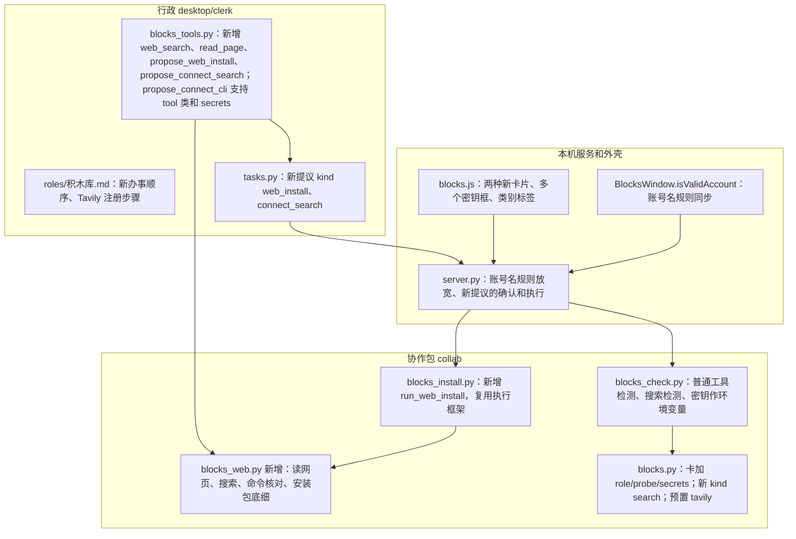

# 方案：积木库 · 行政上网装工具，基础层变成沙盒

**状态：** ✅ 2026-11-09 用户批准（“可以，出任务清单”）。已出 [任务清单](任务清单.md)。依据：[需求共识](需求共识.md)（用户 2026-11-09 回“开做”确认）。**未写代码。**

上一轮的 [方案](../方案.md) 照旧有效；本文只写这一轮新增和改动的部分。两边冲突时以本文为准。

## 一、你会看到什么

### 1. 第一次需要联网：请你给一把 Tavily 密钥

> 2026-11-09 用户改（第 0 项实测后）：“引导注册的东西就先不做了吧，反正是我自己用，你只要询问我把 key 给你就好了。”下面原来的第 2–3 步（带你注册）去掉；免注册用法也不用。行政只说明要一把 Tavily 密钥，出接入卡让你填。

以“我想装高德地图的 CLI”为例，基础层里还没有“联网搜索”：

1. 行政先查本机：没装，核实名单里也没有。
2. 行政说：“这个工具不在我事先查过的名单里，要上网找它的官网。我现在还上不了网，先帮你接一个‘联网搜索’积木，免费，大概 3 分钟。也可以你直接把官网链接贴给我。”
3. ~~你说好，行政一步一步带你注册 Tavily：~~（已去掉）
   - 打开哪个网址；
   - 用什么方式注册（邮箱或 Google 账号）；
   - 注册完页面上哪里有密钥、长什么样（`tvly-` 开头）。
   
   这几步写死在行政的说明里，施工前我去 Tavily 官网核对一遍。
4. 聊天里出现“接入联网搜索”卡片，带一个密钥框。你把密钥粘进去，点“检测”：程序真搜一次（花 1 次免费额度），几秒出结果。
5. 通过后点“放进基础层”，左栏基础层出现“联网搜索 · Tavily”。行政接着说“好了，我去搜高德的官网”。

以后再要联网，直接用这块积木，不再问。

### 2. 行政上网找官网

1. 行政搜“高德地图 CLI 官方 安装”，看搜索结果，挑出它认为是官网的那一页。
2. 程序替行政打开那一页、读出文字交给它（行政自己打不开网页）。
3. 行政告诉你：“我找到的是高德开放平台 lbs.amap.com，官方安装方式是用 npm 装 `@amap-lbs/amap-gui`。”
4. 拿不准是不是官网（比如只找到博客、论坛、第三方技能市场），行政直说，请你贴官网链接。

### 3. 安装提议卡（网上找来的）

和名单里的安装卡长得一样，多了这些：

| 卡上显示 | 说明 |
|---|---|
| 顶部一条黄色提醒 | “不在核实名单里，来自网上。请看清下面的网站是不是这个工具的官网” |
| 来源网站 | 网址全文，网站域名加粗，例如 **lbs.amap.com** |
| ✓ 命令在官网原文里 | 程序自己打开那一页核对，命令一字不差才打勾；对不上就根本不出卡 |
| 安装包底细（npm、Homebrew） | npm：第一次发布时间、发布者、最新版本；Homebrew：官方软件目录里有没有这一项。查不到这个包就不出卡。发布不到 30 天的，标“刚发布不久，多留个心” |
| 要运行的命令 | 原样显示 |
| 大概多久、需要什么前提 | 和名单里的一样 |

你点“确认安装”，过程照旧滚动显示，装完说成功或失败原因。

**官网只给“下载脚本直接运行”的（例如 Cursor 的 `curl … | sh`）：**

- 黄色提醒换成**红色**：“这种方式会运行厂商的安装脚本，脚本做什么程序管不住。只在你确定这是官网时确认”；
- 显示脚本来自哪个网站、有多大；
- 确认后程序先把脚本下载下来，再运行它；
- 脚本要你输电脑密码时停下，告诉你原因，不替你输。

### 4. 装好以后：判断是哪一类，按类办

行政读工具自带的帮助说明，判断它属于哪一类，接法卡上写明：

| 类别 | 例子 | 怎么交给它活 | 登录或密钥 | 怎么检测 |
|---|---|---|---|---|
| AI 助手 | Codex、Cursor、agy | 交代一句话，它自己干 | 浏览器登录，在终端里亲手做 | 照旧：让它新建一个文件 |
| 普通工具 | 高德地图 | 给它一条具体命令，它返回结果 | 有的要密钥：卡上出现密钥框，一把一格 | 行政挑一条只查不改的命令，你看过完整命令后确认，程序跑一次，看它正常结束 |
| 大模型 API | DeepSeek、通义 | 发一句话 | 密钥框 | 照旧：发一句话 |
| 联网搜索 | Tavily | 搜一个词 | 密钥框 | 真搜一次 |

**高德的例子（2026-11-09 用户定：高德先不管，以后再做；这一轮只把“普通工具”这一类做出来，高德不参与验收）：**

1. 行政说：“高德这个工具不用登录，要两把高德的密钥：Web 端（JS API）的 Key 和安全密钥，在高德开放平台控制台的‘应用管理’里创建。”
2. 接入卡上出现两个密钥框，分别标“Key”“安全密钥”。
3. 检测命令原样显示，例如 `amap-gui searchPOI --keyword 天安门 --city 北京 --pageSize 1`。
4. 你确认后程序跑一次，返回了搜索结果就算通过，放进基础层，显示“高德地图 · 普通工具”。

密钥只存在钥匙串里。用到时程序悄悄交给工具，聊天里、接法卡里、记录里都不出现。

### 5. 基础层页面

- 左栏每块名字后面标类别：AI 助手 / 普通工具 / 大模型 API / 联网搜索。
- 详情页“检测”照旧；要密钥的块显示“已保存的密钥”和“换一把”，和大模型 API 一样。
- **待接入（用户 2026-11-09 选 A）：** 体检认出已装好的现成工具（Codex、Cursor、agy），基础层里直接列出来，灰色标“待接入”。点一下就检测（照旧真跑一次小任务，花一点额度），通过自动变成正式的一块；不通过说原因。不点就不检测，不会偷偷花额度。体检没认出来的工具，照旧跟行政说。
- 基础层放什么不设限，你想接什么就让行政去接。这一轮能接的范围是：任何命令行工具、大模型 API、联网搜索；MCP 插头和其他网络服务下一轮。

### 6. 行政不依赖哪个模型（沿用上一轮）

搜索、读网页、核对命令、查安装包、安装、检测都由程序做，行政只能调用固定的几样工具。换成别家大模型当行政，规矩一样，只是起草得准不准有差别。

## 二、系统会记住什么

- **基础层多一种积木“联网搜索”**，接法由程序预置，行政改不了。
- **接法卡多几项：** 类别（AI 助手或普通工具）；普通工具的检测命令；要哪几把密钥、每把交给工具时叫什么名字。只记名字，不记密钥本身。
- **钥匙串多几把：** Tavily 一把；每个要密钥的工具，每把密钥各存一条。
- **安装记录多几样：** 来源网址、核对结果、安装包底细。照旧不存安装过程的原始输出。

## 三、借鉴主流工具（逐条判断）

| 别人的做法 | 判断 | 怎么用 |
|---|---|---|
| OpenClaw（2026 年流行的个人 AI 代理）：命令要同时过“规则、白名单、用户确认”三关才运行 | 采用 | 我们的三关：程序核对（官网原文、安装包真实存在）、只认几种安装写法、你确认 |
| 高德官方给 AI 的技能包里写着“命令不存在就先执行 npm 安装” | 调整采用 | 厂商默认 AI 会自己装。我们也装，但多了核对和确认，不做全自动 |
| 安全机构对“假包名”的建议：装之前先查这个包什么时候发布、谁发布的，查这些不用安装 | 采用 | 卡上的“安装包底细” |
| 2026 年多起 AI 代理自动装了假包的事故（AI 编出的包名被人抢先注册） | 防住 | 查不到的包不出卡；刚发布的标出来 |
| Claude Code、Codex：运行命令前问用户 | 已在用 | 沿用 |
| npm 今年 7 月出的新大版本默认禁止安装时跑脚本 | 先记下 | 你电脑上是 npm 10，不受影响。以后升级了，高德这类要下载窗口程序的工具可能装不上，到时再看 |

论坛声音没有逐条查，以上以官方文档和安全机构文章为准。

## 四、泼冷水

1. **“是不是官网”程序判断不了。** 程序只能保证“命令确实在这一页上”“包真实存在”。网站是不是厂商的，要你看域名。仿冒官网、被篡改的官网，这一层挡不住。
2. **“下载脚本直接运行”风险最大**（你选的 2B）。脚本能读你电脑上的任何文件，程序只能做到“确实是那一页写的那条”“要电脑密码就停”。
3. **有的官网页面程序读不出命令。** 有些官网的安装命令要点开“安装”才出现，或者是网页打开后才画出来的。程序先直接读，读不到再用 Tavily 读一次，还读不到就不出卡，请你贴写着安装命令的那一页，或者自己装。
4. **这一轮不支持 Homebrew 的第三方仓库**（写成 `brew install 某公司/某仓库/某工具` 的）。它们不在 Homebrew 官方目录里，查不了底细。行政会说明，带你自己装。pip、pipx 这类 Python 的装法也不在这一轮。
5. **“普通工具”的检测命令可能挑错、有副作用。** 一律要你看过完整命令再确认。高德的检测会花 1 次高德的免费调用额度。
6. **高德这个工具能不能顺利装上、检测命令要不要先打开地图窗口，都没试过。** 它安装时要下载一个一百多兆的地图窗口程序，国内网络可能慢甚至失败；`searchPOI` 是否要先运行 `amap-gui start` 才能用，官网写得不清楚。施工前我在临时位置真装一次试。
7. ~~Tavily 的注册步骤是写死的。~~（已去掉带注册，这条不再适用。）
8. **要改 Mac 窗口这一层**（钥匙串现在只认腾讯云、百炼和其他大模型这几种名字，要放进 Tavily 和工具的密钥），改完要重新打包安装。
9. **工作量：** 估计 6 张施工单，比上一轮小，但安全核对的细节多，复查轮数可能不少。

## 五、不做

MCP 插头和其他网络服务；Homebrew 第三方仓库、pip、pipx 的安装；借用厂商技能包、抽取能力（第二个功能）；替你注册 Tavily；替你输电脑密码；用行政大模型自带的搜索。

## 六、实测记录（任务清单第 0 项，2026-11-09）

**高德地图 CLI（装进临时位置，测完已删）：**
- 安装：`npm install -g @amap-lbs/amap-gui` 用时 34 秒，成功，占 239MB（含一个地图窗口程序）。本机网络下没遇到下载失败。
- 没有查版本的命令：`amap-gui --version` 报“Unknown command”，退出码 1。帮助说明用 `--help` 能读到。
- `amap-gui status` 不用密钥、不弹窗口，返回“没在运行”，退出码 0。
- `amap-gui searchPOI …` 不能单独用：报“Container not running. Run: amap-gui start”，必须先打开地图窗口。
- 不填密钥运行 `amap-gui start`：弹出地图窗口，等 25 秒报“没准备好”，退出码 1。有了密钥是否就能正常打开，没测（没有高德密钥）。
- `amap-gui stop` 返回“已关掉”，但地图窗口程序的几个后台进程还在，要另外关掉。
- 它会往 `~/Library/Application Support/Electron` 写文件（那是同类程序共用的文件夹），不只在临时文件夹里。

**Tavily：**
- 有密钥：搜索返回 200，2.3 秒；读 Cursor 安装页能读出 `curl … | bash` 那条命令。
- 密钥不对：返回 401，“missing or invalid API key”。官方文档：429 是太频繁，432 是超出套餐额度，433 是超出按量付费上限。
- **新发现：Tavily 有“免注册”用法。** 不带密钥、加一个请求头就能搜和读网页，免费但限次。实测：搜“高德地图 CLI 官方 安装”，前三条都是高德官网；连续搜 12 次，有 4 次被拒（“今天免注册的次数用完了”，几分钟后又能用），规律不稳定，具体上限官方没写。
- 注册页是网页打开后才画出来的，程序读不到具体按钮；只确认了注册入口是 app.tavily.com、能用 Google 账号登录、密钥 `tvly-` 开头、免费版每月 1000 次。注册步骤要在第 6 项你亲手注册时再对一遍。

**和方案对不上、等你拍板的：** 见台账 2026-11-09 第 0 项那一条。

---

## 技术设计（写给下一个会话的 AI，用户可跳过）

### 模块关系（只画新增和改动）

### 约定

- **读网页（`blocks_web.read_page`）：** 只许 https；主机名解析后拒绝本机、局域网、链路本地等私有地址（防止借读网页去碰本机服务 127.0.0.1，包括跳转后的地址，每一跳都查）；限时 15 秒，最多读 2MB，最多跳转 5 次；去掉标签、解码实体后得到正文。交给行政的正文截到 8000 字。直接读出来没有命令时，基础层里有搜索积木就用 Tavily 的读网页接口再读一次（同样只用于核对，不信行政的转述）。
- **搜索（`web_search`）：** 只走基础层里那块搜索积木，接法预置（`kind: "search"`，`provider: "tavily"`，`key_account: "tavily"`）。没有这块时，工具回话固定写“基础层里没有联网搜索，请按说明带用户接一个，或请用户贴官网链接”。每次最多 5 条结果，交给行政标题、网址、摘要。
- **命令核对（`propose_web_install`，参数：页面网址、命令原文、装好后的命令名）：** 程序重新读这一页，把命令和正文的空白都压成单个空格后逐字比对。只认这几种写法，解析成参数列表，**不经过 shell**：
  - `npm install -g <包名>` 或 `npm i -g <包名>`（可带 `@版本`）：查 `registry.npmjs.org/<包名>`，拿首次发布时间、发布者、最新版本、`bin` 里的命令名。查不到就拒绝。
  - `brew install [--cask] <名字>`：查 `formulae.brew.sh` 的官方目录。名字里带 `/`（第三方仓库）就拒绝。
  - `curl [-fsSL 这类开关] https://… | sh` 或 `| bash`：脚本地址必须是 https、过私有地址检查。确认后先下载（最多 1MB）到空临时文件夹，用 `/bin/sh` 或 `/bin/bash` 运行这个文件，输入关闭，环境变量只给 PATH 和 HOME。
  - 其他写法（带 `sudo`、`&&`、`;`、反引号、`$(`、重定向等）一律拒绝。
- **执行（`blocks_install.run_web_install`）：** 复用现有执行框架：同一时间只装一个、限时 10 分钟、先请退出再强关、按工具认“要管理员权限”的说法（脚本加认 `sudo`、`password`）、输出写临时文件给页面取、记录不存原始输出。确认时存的是解析好的参数列表，执行的就是它，执行前不再读网页。装完按命令名在程序 PATH 和终端 PATH（含 `~/.local/bin`）里找。
- **接法卡新增（`kind: "cli"`）：**
  - `role`：`agent`（默认，老卡不变）或 `tool`；
  - `probe`：`tool` 必填，检测用的参数列表，规则和 `run` 一样（禁用程序名单、不许写密钥开关、不许关安全限制）；
  - `ok_words`：可选，输出里要出现的字样；
  - `secrets`：可选，`[{"env": "AMAP_KEY", "label": "Key"}]`，最多 5 把。`env` 只许大写字母、数字、下划线，拒绝 `PATH`、`HOME`、`SHELL`、`NODE_OPTIONS`、`BASH_ENV`、`ENV`、`DYLD_*`、`LD_*`、`PYTHON*`、`npm_config_*`、`HOMEBREW_*`、`GIT_*`、`SSH_*` 这类能改程序行为的名字。钥匙串账号名 `cli:<卡编号>:<env>`。
  - `tool` 类的卡一律算“没核实”，检测前亮完整命令、用户确认（沿用“核实的放行，其余亮出来确认”）。
- **普通工具检测：** 空临时文件夹里跑 `probe`，限时 60 秒，环境变量里加上 `secrets` 对应的密钥；退出码 0、写了 `ok_words` 时输出里有这些字，才算通过。失败原因里的输出照旧打码，密钥原文也要打码。
- **搜索检测：** 用密钥向 Tavily 搜一次“超级助手 连通检测”，最多 1 条结果，HTTP 200 算通过；401、403 说密钥不对，429、432 说额度用完。
- **钥匙串账号名：** server.py 的 `_SAVED_ACCOUNT` 和 Mac 外壳的 `BlocksWindow.isValidAccount` 同步放宽，加上 `tavily` 和 `cli:<卡编号>:<env>` 两种。改 Swift 要 `build.sh --install`。
- **提议卡：** `tasks.py` 新增 kind `web_install`（确认后执行网上安装）、`connect_search`（确认后检测，通过再放进基础层）；`connect` 支持多个密钥框。同一段对话一次只能有一张没处理的卡，沿用。
- **行政说明：** 办事顺序改为“查本机 → 名单 → 没有就上网（没搜索积木先带接 Tavily，或请用户贴链接）→ 网上安装卡 → 判类别 → 登录或密钥 → 检测”。去掉“绝对不能让用户把命令复制到终端”这句的一刀切，改成“只能用 propose_ 工具出示，不在聊天里给命令让用户运行”。
- **实际落地（2026-11-09 施工后补，和上面冲突以这里为准）：**
  - 新文件 `collab/blocks_web.py`：`read_page`、`check_url`（私有地址检查，每跳都查）、`parse_install`、`verify_install`、`npm_info`、`brew_info`、`search`、`tavily_extract`；走查开关环境变量叫 `SUPER_AGENT_BLOCKS_ALLOW_LOCAL=1`（放行本机地址和 http）。
  - 行政拿 Tavily 密钥：本机服务启动时设 `desktop/clerk/tasks.key_source`（钥匙串交来的内存那份），`tasks.search_key()` 只在基础层里有 `web-search` 这块且有密钥时给。
  - 提议种类只在 `desktop/clerk/tasks.py` 的 `_BLOCK_KINDS` 定义一次，`desk.py` 和 `server.py` 都引用它（走查发现 desk 里原来写死三种，新卡确认后说成了“已生成卡片”）。
  - 检测：`blocks_check.check_cli` 遇到普通工具转 `_check_tool`（环境变量只给 PATH、HOME 和卡里写的密钥）；联网搜索用 `check_search`；网上安装是 `blocks_install.run_web_install`，执行前用 `command_text` 重新解析，不信存下来的参数。
  - 待接入：`GET /api/blocks/list` 多回 `pending`（按最近一次体检记录，预置三家里“有”且基础层没有的）；`POST /api/blocks/connect_builtin` 开检测任务，通过（含额度不足）自动保存。
  - 页面把几把工具密钥放在 `secret_keys`（账号 → 密钥）里发给本机服务；放进基础层或检测通过后逐把交给 Mac 窗口存钥匙串，钥匙串一变 Mac 窗口会把整份再交给本机服务。
  - 已知取舍：AI 助手类的卡也能写 `secrets`，但检测时这一类不把密钥交给工具（行政说明里只教普通工具写 secrets）；读网页解析域名和真正连接之间没防 DNS 重绑定。
- **测试纪律：** 自动测试里读网页、搜索、npm 和 Homebrew 目录全用假的（本机起一个假服务或替换取数的函数），不真联网；私有地址检查要有专门的测试。真实走查：高德装进临时 npm 位置；脚本安装用自己做的假官网页和假脚本，不在用户电脑上真装别的东西（假页面在本机，会被私有地址检查挡住，所以走查时用一个只能由启动环境设置的一次性开关放行本机地址，行政和页面都设不了，和 `SUPER_AGENT_BLOCKS_HOME` 同一种做法）；Tavily 用用户自己注册的密钥。不启动 Claude。
