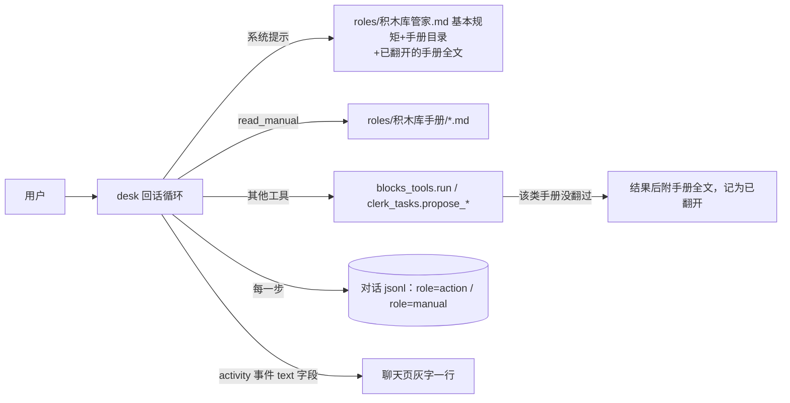

# 积木库管家 · 方案

> 2026-11-10。依据：[需求共识](需求共识.md)（4 题全选推荐）。用户授权一口气做完、做完请他亲自点，所以方案和任务清单不再单独等批准；下面“替你拍板的决定”一节列出 Claude 代定的每一处，供事后纠错。

## 一、你会看到什么

1. 积木库窗口里，聊天对象叫**积木库管家**，头像上是“管”字，输入框写“跟管家说…”。绑定页写“先绑定一个大模型，它会当你的积木库管家”。各处“跟行政说一声”都改成“跟管家说一声”。项目窗口里的“行政”保持不变。
2. 你说“帮我接进小红书 cli”，管家会：
   1. 查电脑上装没装、查核实名单
   2. 上网搜
   3. 回话**先说搜到了什么**：“小红书官方没有命令行工具。网上有这几个别人做的：…”每个写明谁做的、能干什么、风险（标 🔴）
   4. 推荐一个，附一句理由
   5. 你说“装 xhs-cli”，它出“从网上装”的卡
   6. 卡上多两行：
      - **“非官方 · 作者：xxx”**
      - **“风险：通过你的浏览器登录来用，可能封号”**（红字）
   7. 你确认，程序照旧核对后再装
3. 聊天里那一行灰字会写清做了什么，例如“查了电脑 · 搜了网上 1 次 · 读了 1 个网页 · 出了 1 张卡”，不再是“另有 3 个动作”。点开能看到每一步的大意，例如“搜网上：小红书 CLI 官方 安装 → 找到 5 条”。关掉窗口重开，这一行还在。
4. 管家每一步用了什么、查了什么、结果大意，都存进这段对话的记录。密钥一律打码。
5. （2026-11-10 用户看截图后定）**上面文字、下面卡，卡后不再说话**：出卡前管家只用两三句大白话说要接什么、要准备什么、去哪拿，没有要你选的就不写“推荐理由”；卡一出来这一轮就结束。会替换基础层里哪一块写在卡上，上面没点的旧卡自己变成“已换成新的提议”。卡没出成（被程序拦下）时管家照常说原因。接大模型 API 的卡不再有“服务商”一行（标题就是这家的名字），“地址”留着，密钥就发到这里。

## 二、管家怎么“翻手册”

- 管家平时只带一份**基本规矩**：说话方式、先体检、自己不能装、没确认不说装好、不编造产品里没有的设置，再加一张**手册目录**。
- 手册三本：
  - 《接命令行工具》：查装没装、核实名单、读帮助、起草接法卡、登录
  - 《接大模型 API》
  - 《联网搜索和网上安装》：搜官网、官方没有时列候选、读网页、从网上装、接 Tavily
- 翻手册有三种情况：
  - 管家自己判断要办哪类事，先翻开对应那本。
  - 它忘了翻，直接用了某类工具（比如直接上网搜）：程序把那本手册附在结果后面一起给它，不多花一轮。
  - 它没翻手册就直接出卡：卡照常出，手册附在结果后面，它接下来照着说。出卡要守的硬规矩（非官方必须写风险等）由程序检查，不靠手册。
- 翻过的手册，这段对话后面一直带着，不用每句话都重翻。重开窗口也记得。

## 三、“非官方”怎么定（问题 3 选 A：从严）

- 管家出“从网上装”的卡时，要说明这是不是官方的、谁做的、有什么风险。
- 程序再加一道：网址是代码托管站或个人主页（GitHub、Gitee、GitLab、npm 网站、各种 github.io 等），一律算非官方，不管管家怎么说。
- 管家没说清是不是官方的，也按非官方处理。
- 代价：有些厂商的官方页面就放在 GitHub 上，也会被标成“非官方”，你会多看到一次提醒。核实名单里的 Codex 等不走这条路，不受影响。

## 四、破解、蹭登录的工具（问题 2 选 A：标红照样能接）

- 管家必须在列候选和卡上写明风险。程序会检查：管家标了非官方却没写风险，就不让出卡，要它补上。
- 原来“只能在网页或 App 里用的订阅，不破解、不模拟点击”这条改为：**超级助手自己不去破解、不模拟点击**；别人做的这类工具，管家照实说明风险，你确认了可以接。

## 五、泼冷水

- **管家的模型偏弱**：积木库管家用的是你配的 DeepSeek Flash。手册拆开以后，它更容易照着做，但不保证每次都做对。最要紧的几处已经由程序把关：
  - 非官方的卡必须写风险
  - 代码托管站一律标非官方
  - 搜完的结果后面附一句“回话里先告诉用户搜到了什么”

  只靠规矩、程序管不住的是“列候选列得好不好”。
- **小红书这类工具接上后能不能用，这次不保证**：xhs-cli 要在浏览器里登录小红书，检测命令怎么写要等真装上才知道。这次验收只保证“能装上、卡上风险写清楚”。接进基础层能不能检测通过，留给你亲自点的时候看，不行再说。
- **老对话**：以前的记录里没有存动作，重开以后老对话那几行灰字不会出现。新对话才有。
- **多一点额度**：管家第一次翻手册时，手册内容会算进这一轮的用量。每本几百字，比原来整份规矩每句都带着要省。

## 六、借鉴主流做法（凭已知资料，这次没有专门查最新动态）

| 做法 | 谁这么做 | 我们怎么用 |
|---|---|---|
| 一个助手，说明书按需加载：平时只看目录，要用才打开全文 | Claude Code 和 Codex 的技能（Agent Skills） | **采纳**。手册就是这个思路 |
| 多个 AI 分工：主 AI 派活给子 AI | Anthropic 的多 AI 研究系统（官方说用量约为单 AI 的十几倍）；Cognition 公开写过《别做多 AI》，理由是传话丢上下文 | **暂不采纳**。等出现“要跑很久”“要换模型”“要同时做”再拆 |
| 动作可见、可展开 | Claude Code、Cursor 都把工具调用显示成可展开的一行 | **采纳**。照我们现有的“灰字一行、点开看”来做 |

## 七、替你拍板的决定（Claude 代定，可推翻）

1. 名字：“积木库管家”，头像字“管”，提示语里简称“管家”。
2. 手册分三本，名字见上。以后做能力层时再加《做能力》。
3. 管家没翻手册就用工具（包括出卡），一律不拦，把手册附在结果后面。原本想“没翻手册不让出卡”，施工前发现会让原有的出卡流程多绕一轮、旧测试大面积要改，而要紧的检查本来就由程序做，所以改成只附手册。
4. 代码托管站一律算非官方。名单：github.com、gitee.com、gitlab.com、npmjs.com、github.io、gitee.io、gitlab.io、bitbucket.org、sourceforge.net。
5. 非官方的卡必须写风险，不写不让出卡。
6. “动作”记录只存大意（结果前 200 字左右，打过码），不存网页全文。
7. 这次由 Claude 直接施工，复查交给 Codex（按 11-09 定的复查流程）；不另派 Cursor。理由：你要一口气做完、不来回转交。

## 八、技术设计（给下一个会话的 AI 看，用户可跳过）

- **手册**：`desktop/clerk/roles/积木库管家.md`（基本规矩 + 目录），`desktop/clerk/roles/积木库手册/{cli,api,web}.md`。
  - `blocks_tools.MANUAL_OF` 记录“工具 → 手册”的对应：
    - cli：check_installed、install_options、read_help、propose_install、propose_connect_cli
    - api：propose_connect_api
    - web：web_search、read_page、propose_web_install、propose_connect_search
    - scan_environment、list_blocks 不归任何手册。
  - 新工具 `read_manual(name)`。
- **翻过的手册**：存进对话 jsonl，一行 `{"role":"manual","name":"cli"}`，重开时读回 `conv.manuals`；`_prompt` 把翻过的手册全文接在系统提示后面。
- **动作**：每次工具调用都存一行 `{"role":"action","name","label","text","time"}`。`text` 是给人看的一句话，先打码、再截到 200 字。重开时读回来，变成 `activity` 事件（带 `history`）。
- **activity 事件新增 `text` 字段**：聊天页展开后，有 `text` 就显示 `text`，没有就照旧显示 `label`。积木库的动作标签改成不带空格的“查电脑 / 查安装 / 读帮助 / 看基础层 / 搜网上 / 读网页 / 翻手册 / 出卡”，chat.js 的 KINDS 为它们各加一类摘要；项目窗口的标签不变。
- **改名**：聊天页地址带 `butler=1` 时，显示“积木库管家 / 管”。积木库独有的提示语（blocks_check、blocks_env、blocks_install、server 里积木库那几处、blocks.html/js、chat.js 里积木卡相关的话）把“行政”改成“管家”。项目窗口共用的话不动。
- **propose_web_install**：新增参数：
  - `official`（是否官方，布尔）
  - `maker`（谁做的）
  - `risk`（风险，一句话）

  程序判定：网址在代码托管名单里，或者 `official` 不是 true，就算非官方；非官方而 `risk` 为空，就拒绝出卡。卡和事件多带 `official`、`maker`、`risk` 三项，页面加两行。
- **web_search 的结果**：末尾附一句“（回话里先告诉用户搜到了什么、各是谁做的，再问问题）”。
- **项目窗口的行政**：不进上面任何一处分支，因为全部挂在 `is_blocks_home` 下。
- **出卡后结束这一轮（2026-11-10）**：`_tool_loop` 每一轮记 `shown_now`（这一轮有 propose_ 工具回了 `_CARD_SHOWN`）；积木库里这一轮的工具都执行完后直接返回，不再问模型。出卡工具的回话（失效的旧卡、会替换哪块）因此不再交给模型，改由卡片显示（`replaces` 行、旧卡 `proposal_done: replaced`）；下一句话的系统提示照旧写明屏幕上有哪张没点的卡，翻过的手册照旧带着。`on_text.card_shown` 把这一轮记成“已回过话”，只出卡不说话时不补“这次没有得到回复”。出卡被拦（回话不以 `_CARD_SHOWN` 开头）照常继续。项目窗口不走这个分支。复查后补：同一批工具里出卡之后的不再执行；第一轮的标题用 `seal` 存下的卡前文字起（没文字就用“出了一张卡”），这一条两个窗口共用。
- **复查后补的机制（Codex 三轮复查，2026-11-10）**：
  - 积木库里模型交来的工具参数，先在原始文字上、解析后再对每一处文字，各去一遍已知密钥（搜索密钥、这次模型连接的密钥），通用写法的密钥由打码规则管。
  - 出卡函数拿到的是带“哪一轮”的对话（`_ThisTurn`），`_publish_block` 在 `_lock` 里再拿 `conv.cond` 确认这一轮没被停掉，才存卡、顶掉旧卡、发事件；锁的先后一律是先 `_lock` 后 `conv.cond`。
  - 工具回来后，“确认这一轮还在、翻手册、写动作、发事件”在 `conv.cond` 里一步完成。
  - 官方判定：网址先做 IDNA 规范化；核对后按最后到的那一页再判一次。
  - 已知取舍：删除对话的一瞬间，晚到的手册、动作记录可能把对话文件写回来（原有的写记录也是这样），留待以后让删除和写记录共用一把锁。
- **用户真实接高德后补的（2026-11-10）**：积木库一句话最多 8 步（`BLOCKS_TOOL_ROUNDS`，项目窗口仍 5）；最后一步追加系统提示不许再用工具；回话里模型吐出来的工具指令（`_TOOL_MARKUP`）一律截掉换成“跟管家说继续”，两个窗口共用；起草的接法卡由程序补 kind 和 id，出错时回话附 `CARD_EXAMPLE`。
  - 复查后补：边打字边显示也只发干净的部分（每轮分开判断，乱码只管到那一轮为止），确认这一轮还在、发字、存回话都在 `conv.cond` 里一步完成；邮箱打码用原来的规则，`mask_emails` 遇到“@版本号”不遮；自动编号撞号加尾号，-2 到 -9 都占了就交给管家自己起。
- **用户真实接腾讯云混元后补的（2026-11-10）**：模型名以平台为准——`blocks_check.fetch_models`（GET `<地址>/models`，不跟跳转）、管家工具 `list_models`（密钥只从钥匙串按账号取）、检测 400 时失败原因里列真名字；系统提示每轮带“屏幕上现在有没有待处理的卡”，认说法（`claims_card`、`points_at_card`）只当兜底；接入类卡确认后的回话不说“已接入”，卡片标题由页面按检测结果写（`blockDoneTitle(b, view)`）。
  - 复查三轮后收窄：`list_models` 只认 `providers` 里有固定地址的平台（腾讯云、百炼），不接受管家传地址；`fetch_models` 的下载放在后台线程里、整体 `MODELS_TIMEOUT` 秒截止，任何异常只回固定的话；名单正好 `MODELS_LIMIT` 个时按“没拿全”处理。已知取舍：屏幕上有别的待处理卡时，“说了新卡却没出”不提醒（只在系统提示里说明那张卡只管自己的事）。

