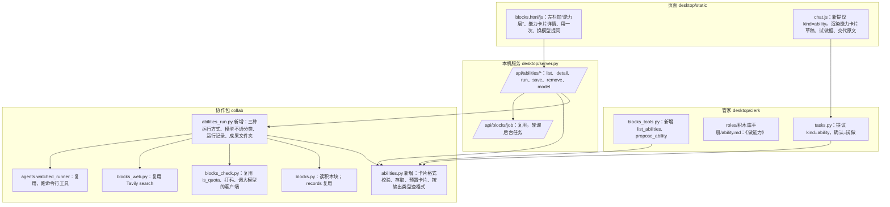

# 积木库能力层 · 方案

**状态：** ✅ 2026-11-10 用户批准（“可以的，那就按照你说的吧，然后咱们先把能力层的东西给开发出来”）：第六节 3 题都按推荐 A，另加第 4 题“卡片格式照 MCP 工具的写法”（见第六节）。依据：[需求共识](需求共识.md)（✅ 2026-11-10 确认）。

一句话：从基础层的积木块里提取能力卡片。第一张单先把卡片格式定死，用三张预置的能力卡片（搜资料、写文章、出图）验证格式；第二张单再让积木库管家照这个格式起草新卡片。

---

## 一、你会看到什么

### 1. 左栏多出“能力层”

基础层下面多一组“能力层”，每张能力卡片一行：

- 名字，比如“写文章”；
- 小字写用哪个积木块、哪个模型，比如“阿里百炼 · qwen3.7-plus”；
- 状态点：绿色“能用”，黄色“上次没成”，灰色“不能用”（它用的积木块被移出了，或者积木块本身检测不通）。

第一次打开就有三张预置的能力卡片，不用你做。

### 2. 点开一张能力卡片

详情页从上到下：

1. **一句话说明**：这张卡干什么、什么时候用。比如“按主题写一篇文章，适合写公众号、说明文”。
2. **用哪个积木块、哪个模型**：
   - 大模型 API 的积木块：模型是一个下拉框，内容来自这家的模型名单，可以换。
   - 备用模型：最多两个，也从名单里选。只在主模型不通时才用，而且要你点头（见第 4 点）。
   - 命令行工具（Codex 这类）：显示卡上写的模型，这一版不给下拉框（原因见“泼冷水”第 5 条）。
3. **你要填什么**：比如“主题”“大概字数”，每项带一个例子。
4. **交回什么**：文字、列表、图片、文件四种之一。
5. **怎么算干成了**：大白话写程序查什么，比如“有内容，字数在 300 到 3000 之间”。
6. **试做示例**：放进能力层那次的试做内容和结果。这是借鉴扣子“把调试结果存成使用示例”，以后调度员串流程时也拿它当参考。
7. **用一次**：按“你要填什么”填好，点“开始”。结果显示在下面：文字可以复制，列表一条一条列出（带链接），图片直接显示，旁边有“在访达里打开”。
8. **最近几次**：时间、成没成、用的哪个模型、没成的原因。
9. **交代原文**（折叠）：程序实际交给它的那句话。AI 型的卡片才有。
10. **移出能力层**。

### 3. 用一次的结果

- **成了**：显示结果，写“用了 qwen3.7-plus · 12 秒”。
- **格式不对**：比如文章只有 20 个字、搜资料一条都没有、图片没存出来，写“没成：……”，并写明程序查到的情况。
- **模型不通**（额度用完、没开通、模型名不对）：写平台的原话，然后问你：
  - 有备用模型：“要换成 qwen3.6-plus 再试一次吗？”两个按钮，“换这个试”和“先不试”。点了才换，只管这一次。要长期换，在下拉框里改主模型。
  - 没有备用模型：“可以在上面的模型下拉框换一个再试。”
- **积木块本身坏了**（没登录、密钥失效）：告诉你去基础层点那个积木块的“检测”，不在这里重试。

### 4. 让管家提取新的能力卡片（第二张单）

1. 在基础层点一个积木块，详情里多一个按钮“提取能力卡片”，点了进入一段新对话，管家知道你说的是哪个积木块。
2. 管家先看这个积木块的帮助说明和模型名单，告诉你它能提取哪几张能力卡片，做不到的直说。比如“火山引擎能写文章、翻译、出图；出图这一版还接不了”。
3. 你挑一张，管家在聊天里出“能力卡片（草稿）”：内容和上面详情页一样，还有一个“试做”框，按“你要填什么”填好例子。
4. 你点“试做”，程序真跑一次，结果显示在草稿下面。
5. 程序先查格式。格式对了，你看一眼结果：满意点“放进能力层”；不满意跟管家说哪里不对，管家改了重新出草稿。
6. 格式不对时，管家照原因改。同一段对话里连续 3 次不行，就停下说明卡在哪。
7. AI 型的草稿会把“交代原文”直接亮出来，你试做前能看到程序要交给它什么话。

### 5. 统一叫法（需求共识第二节，第一张单一起改）

积木库窗口和项目窗口里你看得见的字，以及管家、行政说话时的叫法，都按需求共识第二节的表改：只有“能力卡片”“任务卡片”带“卡”字；安装卡、接入卡、提议卡改叫“提议”，接法卡改叫“接法说明”，体检卡改叫“体检结果”，项目窗口的“需求卡”改叫“任务卡片”，“那一块”改叫“积木块”。

---

## 二、第一批三张预置能力卡片

| 能力卡片 | 积木块 | 模型 | 你要填什么 | 交回 | 怎么算干成了 |
|---|---|---|---|---|---|
| 搜资料 | 联网搜索 · Tavily | 不涉及 | 关键词；条数（默认 8）；时间范围（不限 / 最近一天 / 最近一周） | 列表：每条有标题、链接、摘要 | 至少 1 条，每条都有标题和链接 |
| 写文章 | 阿里百炼 | 主模型 qwen3.7-plus，备用 qwen3.6-plus | 主题；大概字数（默认 800）；参考资料（可不填，可以贴“搜资料”的结果） | 文字 | 有内容，字数在你填的一半到两倍之间 |
| 出图 | Codex | 卡上写的 Codex 模型 | 画面描述；横版还是竖版 | 图片 | 文件真的存在，是 PNG 或 JPG，打得开，宽高都不小于 256 |

为什么这么选：

- **写文章选阿里百炼**：你基础层里接通的两家大模型里，阿里百炼上次检测一次就通了，名单里有 qwen3.7-plus、qwen3.6-plus。火山引擎上次试的几个模型被拒过，先不用它当第一张。你想换成豆包，跟我说一声就行。
- **出图选 Codex**：11-07 用你的 ChatGPT 订阅实测过一次，63 秒出一张 1536×1024 的图，约 2 万 token。网上的做法一致：让 Codex 用它自带的出图功能，交代里写明存到哪个文件。
- **“写文章”留了“参考资料”一栏**：这样第 3 步组合验证时，你可以把“搜资料”的结果贴进去，手动接成“搜资料 → 写文章 → 配图”。

---

## 三、借鉴主流工具

| 做法 | 谁这么做 | 我们怎么处理 | 理由 |
|---|---|---|---|
| 工具先定好“输入参数、输出参数”，调试通过才能发布 | 扣子插件（[官方文档](https://docs.coze.cn/guides_ide)） | **采纳** | 和“你要填什么、交回什么、试做通过才放进来”一致 |
| 调试结果可以存成“使用示例” | 扣子插件 | **采纳** | 详情里留试做示例，你和以后的调度员都能看到这张卡干出来是什么样 |
| 实际返回和定义的类型对不上，工作流会运行失败 | 扣子插件（同上） | **采纳**：每次运行都由程序查格式 | AI 型的卡片结果会变，不能只信试做那一次 |
| 没测完的工具先停用，只发布测过的 | 扣子插件 | **采纳** | 能力卡片（草稿）不进能力层，试做通过才放进来 |
| 输出分十来种类型（字符串、数字、对象、文件、各种数组……） | Dify 工作流（[输出节点](https://docs.dify.ai/en/cloud/use-dify/nodes/output)、[工具返回](https://docs.dify.ai/en/develop-plugin/features-and-specs/plugin-types/tool)） | **调整**：只分文字、列表、图片、文件四种 | 普通人不需要分“整数、对象”；第 4 步拼流程时四种够用，不够再加 |
| 技能 = 一个名字 + 一句“什么时候用” + 一段交代，用到时才读全文 | Agent Skills 开放标准（[规范](https://agentskills.io/specification)），Codex 等都支持 | **部分采纳**：卡片上有“一句话说明”和“交代原文” | 以后调度员挑卡片，先看一句话说明，选中再读全文，省额度 |
| 把能力存成技能文件夹，放进各家 AI 助手的技能目录 | 同上 | **不采纳** | 技能文件夹没有“交回什么、怎么算干成了”；而且 Codex 每次运行都会读用户个人技能目录（11-07 发现），放进去会影响别的用法 |
| 让 Codex 出图：交代里写“用出图功能，存成 ./xxx.png”，程序再确认文件在不在；不在就去 Codex 自己的图片文件夹找 | 社区做法（[codex-bridge](https://github.com/Sateezg/codex-bridge)），Codex 官方有人报告“程序显示跑完了，图却没存到要求的地方”（[问题 37717](https://github.com/openai/codex/issues/37717)） | **采纳** | 正好说明“程序自己查”是必须的 |

局限：扣子和 Dify 看的是官方文档和教程，没有实际用过；Codex 出图的毛病来自网上一个问题报告，我们自己只测过一次，施工前要再跑。

---

## 四、泼冷水

1. **每次试做、每次“用一次”都花真实额度。** 出图一次约 2 万 token（ChatGPT 订阅），写文章一次几千 token（阿里百炼按量付费）。程序不会自己定时跑。
2. **AI 型的卡片结果每次不一样。** 这次过了，下次可能字数不够、图没存出来。程序每次都查，查不过就明说，不假装成了。
3. **程序只能查“像不像样”，查不了“好不好”。** 文章写得好不好、图好不好看，只有试做时你那一眼。
4. **Codex 出图可能不稳。** 只测过一次，网上有人报告出图没存出来。施工前我先真跑 3 次看看；不行就换一家能出图的 API。你火山引擎的名单里有 Seedream 出图模型，但这要多做一种接法，不在这一版里。
5. **命令行工具这一版不给模型下拉框。** Codex 没有列模型的命令；Cursor、agy 有，但能力卡片第一批没用它们。等有用到 Cursor、agy 的卡片时再加。基础层留下的“看命令行工具有哪些模型”这件事，这一版只做大模型 API 那一半。
6. **管家用的是便宜模型，起草 AI 型卡片的“交代原文”质量可能一般。** 第二张单先试，不行就让你在草稿上直接说哪里改。
7. **AI 型的卡片能让 AI 助手干交代里写的事。** Codex、Cursor 这类在临时文件夹里干活。管家起草的交代你试做前能看到原文，这是兜底；和基础层一样，程序拦不全，靠透明和你确认。
8. **工作量：** 估计 5 张施工单（见第七节）。

---

## 五、这一版不做

拼业务流程和画布；接进项目窗口（只改“需求卡”的叫法）；花费统计；定时自动检查；模型不通自动换；AI 打分；用 API 出图；命令行工具的模型下拉框；手改能力卡片的交代原文（要改跟管家说）；Claude 订阅。

---

## 六、要你拍板的 3 件事

1. **写文章用哪家？** A（推荐）：阿里百炼，qwen3.7-plus，备用 qwen3.6-plus。B：火山引擎豆包 Seed 2.1 Pro。C：你指定。
2. **用一次的结果存多久？** A（推荐）：全部留着，每张卡一个文件夹，详情里有“在访达里打开”，不自动删。B：每张卡只留最近 20 次。
3. **出图要是 Codex 不稳怎么办？** A（推荐）：先真跑 3 次；不稳就停下告诉你，这张卡先挂“上次没成”，另开一张单做 API 出图。B：直接改用火山 Seedream，这一版就多做 API 出图。
4. **卡片格式照 MCP 工具的写法（用户 2026-11-10 同意）。** MCP 是高德、飞书这类“插头”的标准，各家 AI 助手都支持。卡片的“一句话说明、你要填什么”照 MCP 工具的写法；“交回什么”保留我们的四种，以后要给别的 AI 助手调用时再换成 MCP 的写法。好处：以后别人做好的插头能直接变成能力卡片，你的能力卡片也能反过来给 Codex、Cursor 用。没有换框架：讨论过 DeepSeek 原型、扣子开源版、Dify、n8n，都不能改一改就用，n8n 留到第 4 步拼流程时再评估。

**拍板结果：** 1A、2A、3A、4 同意。

---

## 七、分几张单、什么时候给你看

| 单号 | 做什么 | 做完你能看到什么 |
|---|---|---|
| 66 | 能力卡片的格式、存放、程序查格式；三张预置卡片的定义 | 看不到界面，自动测试过 |
| 67 | 三种运行方式（搜索、大模型 API、命令行工具）；模型不通的处理；每次运行的记录 | 看不到界面，自动测试过；Claude 用真额度各跑一次 |
| 68 | 能力层页面：左栏、详情、用一次、换模型的提问；统一叫法改名 | **停下给你测**：三张卡各用一次，故意填错模型看提问 |
| 69 | 管家提取能力卡片：基础层的“提取能力卡片”按钮、《做能力》手册、能力卡片（草稿）、试做、放进能力层 | **停下给你测**：让管家从一个积木块提取一张新卡片 |
| 70 | 整体验收：真实窗口逐条走需求共识第九节，全量测试，独立复查，文档同步（含产品文档） | 交给你验收 |

施工流程照 61 号单起的规矩：Claude 写单和验收测试，Cursor 施工，Codex 复查，Cursor 按复查修（最多 3 轮），Claude 最终验收。

---

## 技术设计（写给下一个会话的 AI，用户可跳过）

### 模块关系



### 存放（都在积木库资料夹下，整台电脑共用）

- 能力卡片：`能力层/<编号>.json`。编号规则同基础层（字母、数字、横线）。预置卡片第一次打开时写进去，`source: builtin`。
- 运行记录：`记录/能力-<编号>.jsonl`，复用 `blocks.add_record` / `records` 的写法。每条：`type`（trial / run）、`ok`、`status`（ok / format / model / block / error）、`reason`、`model`、`seconds`、`inputs`（打码后，每项最多 500 字）、`output`（文字前 2000 字或列表或成果文件名）、`platform_said`（平台原话，先打码再截短）、`time`。
- 成果文件：`成果/<编号>/<时间>/`，图片和文件放这里。不自动删（第六节第 2 题定）。
- 试做示例：放进能力层时，把那次 trial 记录的编号写进卡片 `example_run`。

### 能力卡片字段（照 MCP 工具的写法，第六节第 4 题）

```json
{
  "id": "write-article", "title": "写文章",
  "description": "按主题写一篇文章，适合公众号、说明文",
  "block": "bailian", "model": "qwen3.7-plus", "backup_models": ["qwen3.6-plus"],
  "inputSchema": {
    "type": "object",
    "properties": {
      "topic":  {"type": "string", "title": "主题", "maxLength": 200, "examples": ["周末带孩子去哪玩"]},
      "words":  {"type": "integer", "title": "大概字数", "minimum": 100, "maximum": 20000, "default": 800},
      "notes":  {"type": "string", "title": "参考资料", "maxLength": 8000}
    },
    "required": ["topic"]
  },
  "how": {"kind": "llm_api", "system": "……", "prompt": "写一篇关于{topic}的文章，约{words}字。{notes}"},
  "output": {"type": "text", "check": {"min_ratio": 0.5, "max_ratio": 2.0, "of": "words"}},
  "source": "builtin", "example_run": null
}
```

- `id` 同时是 MCP 的工具名：只能字母、数字、横线、下划线，最长 64。`title`、`description` 给人看，也给以后的调度员看。
- `inputSchema` 只收 JSON Schema 的一个小子集，别的关键字一律拒收：
  - 顶层只能 `type: object`、`properties`、`required`；
  - 每项只能是 `string`（`title`、`description`、`maxLength` 必填且不超过 8000、`enum`、`default`、`examples`）或 `integer`（`title`、`description`、`minimum`、`maximum` 必填、`default`、`examples`）；
  - 项名只能是小写字母、数字、下划线（MCP 各家客户端对中文参数名支持不一）；给人看的名字放 `title`；
  - 页面：`maxLength` 大于 200 的显示成多行框，有 `enum` 的显示成下拉。
- `how.kind` 只有三种，必须和 `block` 指向的积木块类别对得上：
  - `search`：积木块类别 search。字段 `query`（模板）、`max_results`（1–20，或写 `{项名}` 取输入）、`time_range`（none / day / week / month，或写 `{项名}`）。程序直接调 `blocks_web.search`，结果映射成列表。
  - `llm_api`：积木块 kind llm_api。字段 `system`、`prompt`（模板）。用积木块的 `base_url`、钥匙串里的密钥、卡上的模型，复用 `blocks_check` 里调大模型的客户端。
  - `cli`：积木块 kind cli、role agent。字段 `prompt`（模板）、`output_file`（成果文件名，规则同基础层“算干完活的文件名”）、`timeout`（秒，最长 600）。参数照积木块的 `run` 模板用 `blocks.build_args(card, prompt, model)` 拼，**不改命令、不加参数**；交代整段作为一个参数，不经过 shell。在新建的临时文件夹里用 `watched_runner` 跑。
- 模板占位只能是 `properties` 里声明过的 `{项名}`；没声明的占位、必填项没用上都拒收。填进去的内容原样替换，不展开第二层；可选项没填时替换成空。
- `output.type`：`text` / `list` / `image` / `file`。`check` 按类型：
  - text：非空；可选字数上下限：固定值（`min_chars`、`max_chars`）或相对某个 integer 输入的倍数（`min_ratio`、`max_ratio`、`of`）。
  - list：至少 `min_items` 条；每条有 `title`，search 卡片还要有 `url`。
  - image：成果文件夹里有这个文件；文件头是 PNG 或 JPEG；从文件头读宽高，都不小于 `min_side`（默认 256）。
  - file：存在、非空、扩展名在白名单里。
- 以后转成 MCP 的 `outputSchema`：text → 文字内容；list → `{items: [{title, url, summary}]}`；image、file → 资源链接。这一版不做转换。
- 校验规矩沿用基础层：多余字段拒收；字段值不许含常见密钥格式；模型名规则同 `blocks._MODEL`；`backup_models` 最多 2 个、不能和主模型重复；大模型 API 的积木块有名单时，主模型和备用模型必须在名单里（名单可能没拿全时只警告）。

### 运行（`abilities_run.run(card_id, inputs, model=None, kind="run"|"trial")`）

1. 校验输入，拼交代。
2. 查积木块：不在基础层 → `status=block`，“这张卡用的积木块已经移出基础层”；积木块最后一次检测不通 → `status=block`，劝去基础层检测。
3. 按 `how.kind` 运行，限时：search 30 秒，llm_api 120 秒，cli 用卡上的 `timeout`。同一张卡同时只跑一次（照 `blocks_check._OneAtATime`）。
4. 结果分类：
   - 平台或工具说额度不足、模型不存在、没开通、无权限用这个模型（复用 `blocks_check.is_quota`，再加模型不存在、403 的判断，和基础层 11-11 那批口径一致；401 算积木块问题）→ `status=model`，带 `platform_said`，带 `backup_models` 里还没试过的下一个。**不自动重试。**
   - 跑完了但格式检查不过 → `status=format`，`reason` 写程序查到的情况（“只有 20 个字”“没有找到 输出.png”）。
   - 其他（超时、断网、工具崩了）→ `status=error`。
5. cli 出图：先在临时文件夹找 `output_file`；找不到，再去 Codex 自己的图片文件夹（`$CODEX_HOME/generated_images/`，默认 `~/.codex/generated_images/`）找**这次运行开始之后**新出的图片，找到就复制过来，并在 `reason` 里写“Codex 把图存到了别处，已拿回来”。都没有 → `status=format`。不管退出码是不是 0。
6. 成果复制进 `成果/<编号>/<时间>/`，写一条记录，返回给页面。
7. 页面点“换这个试”：再调一次 `run(…, model=备用模型)`，记录里写清这次用的是备用模型；卡片本身不改。

### 本机服务

- `GET /api/abilities/list`：卡片列表和每张的状态（看最后一条记录和积木块状态算）。
- `GET /api/abilities/detail?id=`：卡片、示例记录、最近 10 条记录、积木块的模型名单。
- `POST /api/abilities/run`：开后台任务，返回任务编号，页面用 `/api/blocks/job` 轮询（同一种做法）。
- `POST /api/abilities/model`：改主模型或备用模型，只能从名单里选。
- `POST /api/abilities/remove`：移出（删卡片文件，记录和成果留着）。
- 成果图片：`GET /api/abilities/file?id=&run=&name=`，只允许读这张卡成果文件夹里的文件，名字规则同 `output_file`。
- “在访达里打开”：交给 Mac 窗口外壳打开文件夹，网页拿不到任意路径。
- 密钥：照基础层，用 Mac 窗口交来的 `blocks_saved_keys`。

### 管家（69 号单）

- 新手册 `desktop/clerk/roles/积木库手册/ability.md`（《做能力》）：先用 `read_help` / `list_models` 看积木块，再说能提取哪几张；只能用三种 `how.kind`；交回类型只能四选一；出草稿后不再说话（照“出提议后不再说话”的规矩）。
- 新工具：`list_abilities`（看已有卡片，避免重复）、`propose_ability`（交来卡片 JSON，程序先校验，不合格直接把原因还给管家，不出草稿）。
- `tasks.py` 新提议 kind `ability`：确认 = 试做（带用户填的例子）；试做结果回到同一个提议；“放进能力层”才写卡片文件和 `example_run`。3 次失败的计数照基础层“同一段对话里管家起草的算在一起”。
- 从基础层详情点“提取能力卡片”开新对话时，带上积木块编号，管家第一句就翻《做能力》。

### 统一叫法（68 号单）

只改用户看得见的字和管家、行政的规矩、手册、README、产品文档；程序内部的名字（`card`、`proposal`、文件名）不改。改完用搜索确认用户看得见的地方不再出现“接法卡”“提议卡”“安装卡”“接入卡”“体检卡”“需求卡”“出卡”。项目窗口的“需求卡”在 `desktop/clerk/roles/` 行政规矩、`chat.js`、`panel.js`、`nav.js`、`main.swift` 里都有，`main.swift` 改了要重装。

### 测试纪律

- 自动测试用假积木块：假 Tavily（换掉 `blocks_web.search`）、假大模型客户端、临时目录里的假 CLI（写出一张真的 PNG 小图，或者故意不写、写到“Codex 图片文件夹”的临时替身里）。
- 真实运行只用阿里百炼、Tavily、Codex，不启动 Claude。真跑要花你的额度，67 号单每种只跑一次，出图施工前先跑 3 次（第六节第 3 题）。
