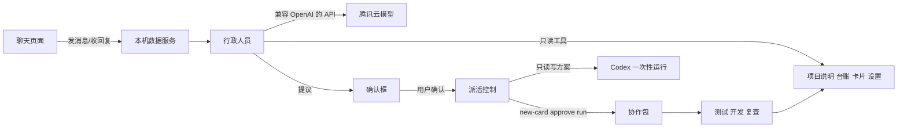
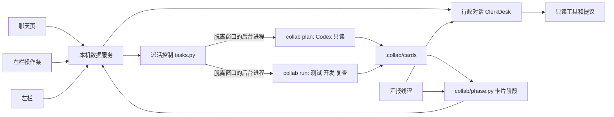

# 方案：行政人员（第一期）

状态：✅ 用户 2026-11-06 批准第一版；同日修订，✅ 用户批准。与“修订”一节冲突时，以修订为准。

## 0. 修订（2026-11-06）

**只走行政一条主路，分两批做。** 没配密钥时保持现在的 Codex 聊天，新功能不做第二套。

**第一批之后，你会看到**

1. 打开软件直接进工作台，不弹密钥框。想用行政，到设置里的“行政人员（可选）”填写。
2. 你说“帮我把按钮改成蓝色”。行政不清楚时，一次只问一个问题，并给推荐答案。
3. 聊天里出现“变成任务？”，写着要做什么、不做什么、怎么算做完。点“确认”生成卡片，点“先不做”什么都不生成。
4. Codex 在后台只读写方案。写好后行政告诉你，左栏置顶“等你处理”。
5. 点开卡片，右栏上方显示方案和允许改动的文件，下面两个按钮：“批准并开工”“不做了”。
6. 后台测试、开发、复查。你可以点“停下”。退出软件施工也继续。
7. 完成或卡住时，行政在原来那段对话里告诉你。中断或卡住的卡显示“接着跑”。

**第二批之后，你会看到**

1. 待验收的卡有“验收通过”和“还要修改”。
2. 点“验收通过”：检查，合并，重跑测试。失败就退回，主项目不变，并告诉你原因。
3. 点“还要修改”：写下新要求，后台再做一轮。
4. 连续确认几张卡，批准后的卡显示“排队中”。上一张合并后，下一张自动开工。
5. 点卡片，中间换成这张卡的对话，后台进展像消息一样出现。施工中发的话显示“已记下”，这一轮结束后问你要不要按它修改。

**泼冷水**

- **第二批要等你验收合并后才接力。** 做不到“一次交代三件事，回来挨个验收”。这是为了让每张卡都基于最新代码，不合出问题。
- **施工中插话不会马上生效。** 后台工具是一次性跑完的。急着改方向就先点“停下”。
- **退出软件施工继续，但电脑关机或休眠时会停。** 重新打开后显示“中断了”，点“接着跑”。排队只有软件开着才接力。
- **写方案要花 Codex 额度。** 一次小样本实测约 2 万 token、30 秒；真实项目会更多。
- **没配密钥就没有新功能。** 这是不做两套的代价。
- **Auto 写的代码质量可能波动。** 高风险部分要拆细、多查，返工两次不过就换模型。
- **工作量比 4 步大得多。** 现在拆成 13 张施工单。整批做完才看，问题可能堆在一起，所以第一批结束必须验收一次。

### 第一批验收后的修订（2026-11-06）

真实走查和独立复查后，下面四点改变了原来的约定。详见 [第一批返工单](施工单/第一批返工单.md)。

- 测试员写的测试文件自动算在允许范围内。开发员仍不能改范围外的文件。
- 测试命令按命令行解释执行，`&&` 这类写法会真跑。
- 复查不通过后点“接着跑”，开发员会带着复查意见重新改，返工次数不增加。
- 新增“开工失败”阶段，可以接着跑或不做了。
- 测试文件由测试员负责。程序在每次判定前恢复测试员交付的版本，开发员删改无效。
- 带管道的测试命令，任何一段失败都算失败。
- 测试员没写出测试时，卡片停下等你处理，开发员不开工。
- 这些保护防的是误改，防不住工具蓄意作弊，所以复查和你的验收仍然需要。

### 行政读项目资料（2026-11-06）

用户试用时指出，行政不该只看《项目说明》。修订如下：

- 行政可以读项目自带的 `README`、`CLAUDE.md`、`AGENTS.md`、`package.json` 的名字和简介，以及顶层文件名。这些内容会发给行政模型。
- 不读代码和隐藏文件，不跟随链接；含密钥字样的行会隐藏。
- 《项目说明》还没写时，行政可以起草，用户点“保存项目说明？”后才写入。已有内容不覆盖。
- 配了行政后不需要调度员，不再提示去选。
- 这一步由行政模型完成。需要看代码细节时派 Codex 查看，这轮不做，等真实使用后再定。

### 第二批修订（2026-11-06）

用户试用后定的规矩：

- **主界面不放终端。** 2026-11-07 用户决定：去掉“聊天 | 终端”切换，终端挪进菜单“对话 → 打开终端（高级）”，保留给只能用终端的调度员和出问题时备用。
- **只和行政说话。** 主对话和任务对话都是行政接待。可以看 Codex、Cursor、agy 在干什么，但不能越级指挥。想立刻停就点“停下”。
- **主对话和任务对话完全分开。** 任务对话顶部显示任务信息，只聊这张卡。主对话只收方案写好、做完、卡住、中断、合并这类一句话汇报。
- **施工中发话：** 问问题行政马上查了回答；要改需求先记下，这一轮结束后出确认框。这里替代了原方案里“施工中一律不调用模型”的做法，施工中问问题会花一点行政模型的额度。
- **方案阶段也能改：** 等批准方案时可以说还要修改，Codex 按新要求重写方案。
- **顺序：** 11 合并、12 还要修改、14 每卡对话这一轮一起做，13 排队放下一轮。
- **合并的安全规则：** 项目必须停在一个分支上，并且没有做到一半的合并或变基。测试没过才退回，退回前核对提交和分支，用户在测试期间有新提交或切了分支就不动。合并停在半路时，再点一次继续验证，点“不做了”退回。这期间别的卡不能开工或修改，免得带上没验证的代码。
- **真冲突：** 点“还要修改”时，先把项目的新内容同步进副本，有冲突的文件留下冲突标记交给开发员解决。还留着冲突标记的文件不能合并。一边删了或不是文本的冲突，开发员看不出来，程序直接拒绝并说明，卡片不变。
- **合并前最后核对：** 这张卡的提交里只能有允许范围和测试员交付的文件，也不能留冲突标记；副本同步的是别的分支时不合并。
- **复查：** 只看这次改动是否符合需求。台账和归档由程序在结束后补写，不算问题。结论要独立成行，认不出就转人工，不能错放。

## 1. 你会看到什么（第一版）

**第一次打开**

1. 第一屏只问一件事：选服务商，填密钥。默认腾讯云和 `deepseek/deepseek-flash`。
2. 点“测试并保存”，通过后进入行政聊天。
3. 行政看一下电脑上已有的工具和团队设置，告诉你缺什么。没选调度和执行角色时，它带你配好。

**平时聊天**

- 左栏“主对话”下面是行政对话，点“+”马上开一段空对话，说第一句才保存。
- 切换对话马上显示，不用连接。
- 回复一个字一个字出来。回复前显示“正在处理…”。
- 行政根据内容给对话起名。
- ~~下面单独一组“Codex 旧对话”，默认收起，点开只能看。~~（2026-11-06 用户决定去掉：只能看、不再增加内容。记录仍在 Codex 里，超级助手里不再显示。）

**变成任务**

1. 你说“帮我把首页按钮改成蓝色”。
2. 行政追问必要的细节，然后弹出“变成任务？”，里面写：要做什么、不做什么、怎么算做完。
3. 点“确认”：生成卡片。点“先不做”：继续聊，不生成任何东西。
4. Codex 在后台读代码，写出方案和允许改动的范围。这一步不改代码。
5. 卡片显示“等你批准方案”，你看完点“批准并开工”。
6. 测试、开发、复查在后台运行，右栏看流程。
7. 完成或卡住时，行政在聊天里用大白话告诉你。

**改设置**

你说“开发员换成 Cursor”，行政显示改动内容，你点确认后才生效。

## 2. 系统记住什么

| 内容 | 放在哪 | 说明 |
|---|---|---|
| 行政对话 | 项目 `.collab/行政对话/` | 只留本机，不进版本记录 |
| 对话列表和标题 | 同上 | 打开时直接显示 |
| 密钥 | 本机钥匙串 | 不写进文件和日志 |
| 服务商、模型 | 本机设置 | 不含密钥 |
| 卡片、方案、流程 | 现有 `.collab/cards/` | 记录方式不变 |

## 3. 行政能做和不能做

| 能做 | 要先问你 | 不能做 |
|---|---|---|
| 聊天、解释报错 | 生成卡片 | 改代码 |
| 读项目说明、台账、卡片、设置 | 改团队设置 | 运行命令 |
| 判断是否任务、起名 | 开工 | 推送、合并、发版 |

## 4. 泼冷水

- **会多一次确认。** 需求确认后还要批准方案。因为现有流程要求列清楚允许改动的文件，只有读过代码的 Codex 才写得准。我不建议省掉。
- **写方案要花 Codex 额度。** 省的是闲聊和查询的额度，真正开发的花费不会变少。
- **回复不一定很快。** 实测每次约 4–6 秒，可能受代理影响。边生成边显示能改善感受，但不保证很快。
- **判断会出错。** 目前只测过 3 句话，开工前要用你的真实对话再测一批。确认框和方案批准是保险。
- **行政的费用另算。** 模型按腾讯云账单收费，价格我还没查到，上线前要确认。
- **聊天里的项目信息会发给模型服务商。** 行政读到的项目说明、台账和卡片会发到腾讯云，敏感项目要注意。
- **没网时行政不能用。** Codex 终端不受影响。
- ~~**旧 Codex 对话不能接着聊。** 这是你选的取舍，想继续就用终端。~~（2026-11-06 整个功能已去掉。）
- **验收后的合并还要进终端。** 这是第一期留下的不方便。
- **工作量不小。** 聊天窗口要重做，要新做密钥、对话存储、工具权限和派活四块。现有聊天连接逻辑会退到旧对话和终端。
- **已贴在聊天里的密钥要换一把。** 正式使用前去腾讯云重新生成。

## 5. 技术设计

写给后续开发，可跳过。

- 新增 `desktop/clerk/`：模型客户端、对话存储、工具、派活控制。第一期沿用 Python 标准库，不加新依赖。
- 模型接口只认 OpenAI 兼容格式：地址、模型名、密钥可配置，默认 `https://tokenhub.tencentmaas.com/v1`。
- 回复走流式事件，复用现有 `/api/chat/events` 的按编号取事件方式，页面状态处理继续走一条路。
- 工具只开放白名单：读取项目说明、台账、卡片、设置，提议任务，提议改设置。模型没有写文件和运行命令的工具。
- “提议”只生成待确认项，确认由页面发给本机服务，不经过模型。
- 派活控制调用现有协作包。需求卡由行政的摘要生成；Codex 只读运行写方案和允许范围；批准后在本机服务的后台任务里运行 `run`，不依赖聊天连接。
- 一个项目一次一张卡，已有运行中的卡时不开工，告诉用户。（第二批改为排队）
- 进度以卡片记录为准，行政不凭记忆回答。
- 密钥由 Mac 窗口用原生输入框收取，存钥匙串，启动后只放在本机服务内存里，不写日志、不进模型上下文。
- ~~旧 Codex 对话从 Codex 记录只读显示，不再打开可写连接。~~（2026-11-06 已去掉。）
- 测试增加假模型服务：流式、工具调用、断网、错误密钥、额度不足。不花真实额度。

### 修订后的技术约定

- **卡片阶段只算一次：** `collab/phase.py` 是左栏、右栏按钮、行政汇报和排队的唯一依据，页面不自己推断。
- **确认不经过模型：** 模型只能提议。按钮由页面发给本机服务，程序执行。
- **后台任务脱离窗口：** 写方案和施工用独立进程，窗口退出不影响。是否在跑看进程是否活着，不看记录里的字样。
- **中断不自动重跑：** 重跑会花额度，必须用户点。
- **Codex 写方案：** 用只读模式和固定输出格式，必须关闭输入，否则会一直等。文件由程序写，不由 Codex 写。
- **汇报用固定模板：** 不调用模型，不花钱，也不会编造进度。
- **施工细节：** 见 [施工单](施工单/README.md)。施工中架构变了，要回来改这一节。
