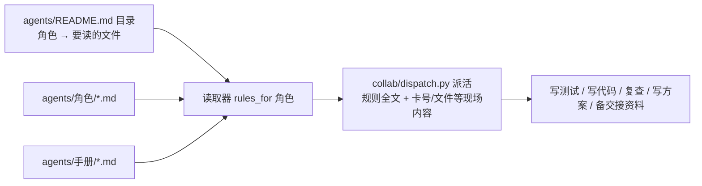

# 方案：规则包（agents/）

> 2026-11-20 · 依据《需求共识.md》（用户 11-20 批准）· 状态：用户已批准（11-20“现在开始吧”）
> 本方案细写第①步，第②～④步只写大致做法，到时各自再出方案。

## 第①步做完后用户能感受到什么

- 项目里多一个 `agents/` 文件夹，打开就能看到：每个角色一份规则、几份手册、一份目录。以后改这几条规则，只改这里的文件，不动代码。
- 跑卡时，写测试、写代码、复查这几位拿到的规则，是程序从 `agents/` 里按角色挑好、直接放进派活的话里的；它们不再需要自己去翻规则文件。
- 下一张卡起，复查员看到的“极巧合”有了具体说法（加载、切换一两秒空档里才出的），标了“极巧合”的问题一律只记“以后再修”、不退回（测试写错、真丢数据照退）。
- 写代码的被退回时，如果修这条要改原来就有的功能，它会停下来写进汇报，交给 Claude 判断。
- 写测试的被要求：页面上的行为用实跑页面的检查。
- Claude（或以后接手的模型）写施工单、接手卡片时，照 `agents/手册/` 里的两份做。

## agents/ 里放什么（第①步）

```
agents/
  README.md            目录：这个包是干什么的；每个角色读哪几份；改规则的规矩
  通用/
    说话口径.md         大白话、不写代码名、汇报写法（从现在的规则文件里搬）
    四道关卡.md         对齐→施工→自测→登记、修问题先过三问（从现在的规则文件里搬）
  角色/
    写测试.md           现规则文件“测试员”一段 + 第 4 条：页面行为用实跑页面的检查
    写代码.md           现规则文件“开发员”一段 + 第 3 条：修退回的问题要改原有行为就停下写进汇报
    复查.md             现规则文件“复查员”一段 + 对着施工单“原有行为清单”看
    写方案.md           现规则文件对应一段（照搬）
    备交接资料.md        现规则文件对应一段（照搬）
  手册/
    复查分级.md         常见 / 少见 / 极巧合怎么分、什么算“安全或丢数据”（第 2 条，从代码里搬出来）
    测试怎么写.md        实跑页面的检查怎么用（tests/ability_69b_dom.js）、什么时候才逐字比对
    施工单怎么写.md      第 1 条：必备几节、状态表、原有行为清单、交出前自查（给产品经理/架构师读）
    施工单模板.md        照抄填写的模板，附 CARD-019 的状态表做例子
    接手卡片.md          第 5 条：卡停下转人接手时怎么做（含：请用户点“接受”前先在副本里把全部测试跑通）
```

- 现在的规则文件 `collab/规则.md` **不删**：程序靠它认出“这是协作包”（窗口外壳和安装程序都在查它）。内容改成一句话：“规则已搬到 agents/，见 agents/README.md”。
- 开发流程规范里第 5、6 节和施工单、接手有关的段落，改成一句“细则见 agents/手册/…”，不写两处。（产品经理、架构师的整套规则留到第④步。）

## 程序怎么改（第①步只动这几处）

1. 新增一个小读取器：给一个角色名，返回这个角色要读的规则全文（角色那份 + 它在目录里登记要读的手册）。读不到文件时，派活的话里写明“规则文件缺失”，并在流转里记一条，**不悄悄用空规则跑**。
2. 跑卡流程里现在开头那句“开工前先读规则：……”（14 处），改成放进对应角色的规则全文。写测试、写代码、复查、写方案、备交接资料各对上自己那份。
3. 复查员派活的话里，“常见 / 少见 / 极巧合怎么分”“什么算安全或丢数据”那几句从代码里删掉，改由 `手册/复查分级.md` 提供。复查清单的格式（七个字段、结论怎么写）这次**不搬**，它是程序要按格式读的约定，留到第③步一起搬。
4. 2b：程序判断“退不退回”时，标了“极巧合”的不退回，不管复查员说是推演还是实跑；测试写错、安全或丢数据照退。
5. 打包：生成应用时把 `agents/` 一起装进去；用户项目里生成的“进门先读”说明，指向 `agents/README.md`。

## 泼冷水

- **第一次放进规则全文，派活的话会变长**：现在是“去读某个文件”，模型多半自己去读；改成直接放进去以后，模型少一步翻文件，但每次派活带的字多了。每个角色只带自己那几份，合计估计几千字，和模型现在自己读一遍差不多，token 不会明显增加。**优化**：规则放在派活的话最前面、每次一字不差，同一张卡同一角色多轮时，OpenAI（Codex）、DeepSeek 的服务会自动记住重复的开头，第二轮起这部分更便宜更快；千问命令行工具是否也这样，不确定，第①步做完跑一张真卡对比用量，记进流程数据。
- **7 个老测试逐字查规则文件里的句子**（另 1 个是 Claude 为第 2 条新写的）。用户 11-20 定的处理：不逐个改路径，**合并成一个“规则包体检”**——
  - `agents/README.md` 里加一节“不能删的要点”：每条写“哪份文件、必须提到什么”（如 复查分级.md 必须提到“极巧合”；写测试.md 必须提到“此时还不过”）。
  - 体检检查：目录里登记的文件都在；每个角色派活时真的带上了规则；“不能删的要点”逐条都还在对应文件里。
  - 好处：以后改规则只改 agents/ 里的文件，连这份清单也在同一个文件夹，不用改测试和代码；有人（或模型）删规则时误删了要点，体检会报出来。
  - 原来 7 个测试里逐字查规则的那几条删掉，它们查的要点全部写进“不能删的要点”，一条不少；只查程序行为的部分（如“靠旧规则文件认出协作包”）保留。
- **代码里大部分提示词这次还不搬**（第③步），所以第①步做完，规则仍有一部分在代码里；目录 README 里写明“哪些还在代码里、第③步搬”，不假装已经全搬完。
- 第 2 条我之前已经在代码和旧规则文件里各改了一遍（未提交），这次撤掉那两处，只写在 `手册/复查分级.md` 一处（用户 11-20 同意）。
- **第①步由 Claude 全程开发、Codex 只做复查，不走开发助手**（用户 11-20 定）：改的是开发助手自己的规则，交给它跑等于一边干活一边改自己的规则。

## 第②～④步（大致）

- ②小修三条：按 `手册/施工单怎么写.md` 写施工单（带状态表、原有行为清单），交开发助手做。
- ③其余提示词按角色搬：写代码、写测试、复查（含复查清单格式）、行政、积木库管家、调度类（起草继续改、交接资料），一个角色一张卡；搬完每个角色跑一张真卡看效果不变。
- ④产品经理、架构师：开发流程规范里给他们的细则全部搬进 `agents/角色/产品经理.md`、`架构师.md`；规范只留给用户看的一页摘要。验收：找一个没参与过的模型只读 `agents/` 试写一份需求共识和施工单，用户和 Claude 对照检查。

## 技术设计（给下一个 AI 看，用户可跳过）



- 目录写在 `agents/README.md` 里一张表（角色 | 要读的文件），读取器解析这张表；不另造配置格式。
- 读取器放 `collab/rulebook.py`（`collab/agents.py` 已被“调用各家工具”占用）。
- 位置：开发时读仓库里的 `agents/`；装好的应用读应用包里的那份（和 collab/ 同样冻结）；卡片副本里跑的程序同样从应用包读，不从被开发的项目读（避免一边干活一边改自己的规则）。
- `collab/规则.md` 保留为“认包标记”，内容改成指向 agents/。
