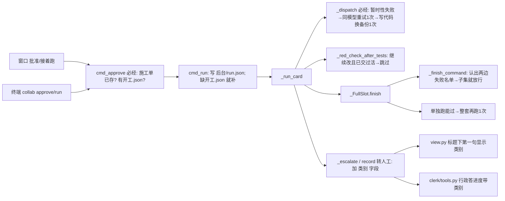

# 方案：跑卡不再停半路（v0.96）

> 2026-11-28，状态：待用户批准。需求共识已批（`需求共识.md`）。
> 照《架构师》三条原则：规则放必经处、和现有做法同构、“不受影响”附证据。

## 做完后你能感受到什么

- 卡跑着跑着停下，基本只剩“真要你拍板”这一种。程序自己误判、模型偶尔不回话，都不再让卡停下等你。
- 卡停下时，中间卡片标题下第一句写着是哪一类：
  - **【要你定】**：比如写代码的说要改范围外的页面。
  - **【程序没判出来】**：比如全部测试认不出是哪几项没过。
  - **【模型挂了】**：比如重试过、也换过备份，还是不回话。

  后面跟一句“点哪个按钮能接着跑”。
- Gemini 或别的模型在终端里开的卡，你在窗口里一样能停、能接着跑，不会再叫你去终端。
- 施工单没存进项目时开不了卡。窗口里只给你“先存再开工”和“先不开工”两个选项。

## 逐项做法

每项都写明来源：用现成的 / 改现有的 / 新做。

### 1. 写代码的说“要拍板”就停下（CARD-035，已改好）
- 来源：11-27 已改，没提交。
- 剩下的：送 Codex 第 2 轮复查，跑全部测试，和本版一起提交。

### 2. 全部测试：没过的是同一批，就放行
- 来源：**改现有**。程序自己逐个文件跑测试的那条路（Python 项目）**早就会比**“改之前就不过的不算这次改坏”。只有“项目自己配的全部测试命令”那条路不会比：改之前也不过，就直接停下。train 就是走这条路，5 次停下全出在这里。
- 改法：
  1. 改前、改后的输出里，都认出“没过的是哪几项”。认得出的有四种输出：node / tsx 的测试输出（train 用的就是这种）、TAP 格式、Python unittest、pytest。
  2. 两边都认得出时：
     - 改后没过的全在改前也没过的那一批里：**放行**，卡片里写明“这几项改之前就不过”，并记进以后再修。
     - 改后多出改前没有的失败：照老规矩退给写代码的，只列多出来的那几项。
  3. 任一边认不出：照旧停下，归【程序没判出来】。
- 证据：拿 11-27 卡 16 真实存下的全部测试输出（6 项没过）做测试材料。

### 3. 测试不稳：整套再跑一遍
- 来源：**改现有**。现在程序会把没过的那几项单独再跑；单独跑能过，就停下，说“写代码的修不了”。
- 改法：
  - 遇到这种情况，整套全部测试自动再跑 1 次：
    - 这次全过，或剩下的都是改之前就不过的：放行，卡片和以后再修里记“某某测试不稳”。
    - 还是不过：照旧停下。
  - 每次交结果最多自动重跑 1 次，不无限跑（停下后点“接着跑”会再给一次；11-28 施工中改，见任务清单“施工中补充”）。

### 4. “继续改”时不再误判“测试一跑就全过”
- 来源：**改现有**。11-27 卡 16 你点了“继续改”，只要求删一条测试。代码早写好了，所以测试全过，程序却当成“测试没写对”，退回重写。测试员为了让测试先不过，硬加了一条新的边角测试，多跑了一轮。
- 改法：这张卡在“继续改”之前，写代码的已经交过活（副本里已经有改动），就不做“先红检查”，直接跑判定。过了就送复查，没过就派写代码的。
- 第一次开工照旧做先红检查。

### 5. 开工前拦住：施工单没存、缺开工记录
- 来源：**改现有**。窗口和命令行开卡都要经过同一个“批准”步骤（窗口在 `desktop/server.py` 里也是调这一步），规矩放在这里，两条路都拦得住。
- 改法：
  - 本卡引用的施工单在项目里没存（包括新建了还没加进项目的），不许批准，说清是哪份文件、怎么存。
  - 没有开工记录（说明没走“写方案”这一步，是手写方案直接批准的），不许批准，说清要先走写方案。
  - 窗口原来的“先存再开工”确认框：施工单没存时，去掉“直接开工”这个选项。
  - 窗口批准失败时，现在一律显示“方案里还有空白”。改成显示真实原因。

### 6. 终端开的卡，窗口里能停、能接着跑
- 来源：**改现有**。窗口开卡时会在后台登记“谁在跑哪张卡”，窗口靠这份登记停卡。终端开的卡不登记，所以窗口说“不是从这里开工的”。
- 改法：
  - 终端开卡时也写同一份登记，跑完删掉（只删自己写的那份）。
  - 终端开卡时如果没有开工记录，就把这次用的测试命令补记进去，窗口点“接着跑”时就读得到。
- 停卡时，终端起的卡没有自己的进程组。现在的停卡代码已经会退一步、只停主进程（v0.95 修过），主进程收到停止会带着它叫起的工具一起收尾。**这一点要在施工时实测**，停不干净就补。

### 7. 模型不回话，先自己重试
- 来源：**改现有**。现在看门人发现模型长时间没动静就停掉它，**不重试**，直接停卡。当初的理由是“卡住的再跑一遍多半还是卡住”。但实际记录里，几次停下后人都是直接点“接着跑”或换个模型，就接着跑下去了。
- 改法：重试放在“派一次活”这一处。写测试、写代码、复查都经过这里，一处改全覆盖。
  - 哪些情况重试：模型没回话、超时、服务限流、服务忙，以及复查员没给结论。
  - 额度用完、你点了停下，都不重试。
  - 怎么重试：先用同一个模型再试 1 次。写代码的还不行，就换“备份写代码的”再试 1 次（团队设置里本来就有，没配就用 Codex）。
  - 每次重试在流转里记一条“重试”，写清楚原因和换了谁。右栏能看到。
- 都不行才停下，归【模型挂了】，附换模型的建议（沿用现有的建议逻辑）。

### 8. 每次停下写明是哪一类
- 来源：**改现有**。每次转人工都会在流转里记一条，现在只有原因文字，没有分类。
- 改法：
  - 每一处转人工都标上类别：【要你定】【程序没判出来】【模型挂了】。
  - 窗口卡片标题下第一句先显示类别。
  - 行政回答“进度怎么样”时也带上类别。
  - 原来的原因字段一个不改。“接受剩下的问题”这个按钮就是靠原因字段认的。
- 归哪一类的对照表放在下面技术设计里，施工时逐处标。

## 泼冷水

- **这版做完，睡一觉起来不一定全做完**：真要你拍板的照样停，停了下一张也没人开。要整批跑完，等 v0.97。
- **第 2 条认不出的项目照旧停**：换了一种测试工具、输出认不出，就退回到现在的样子。
- **第 3 条会让全部测试多跑一遍**：train 一遍大约 2 分钟，开发助手自己大约 3 分钟。
- **第 7 条最多多花两次额度**：一次重试最长可能又等 30 分钟（超时上限）。最坏情况下，一张卡停下前要多等约 1 小时才告诉你。（11-28 施工中补：工具自己本来就会对报错再重跑 1 次，所以最坏共约 5 次调用；复查员“交回了但没写结论”不重派，照旧停下，见替你定的清单第 9、10 条。）
- **第 6 条终端停卡要实测**：如果主进程停了、它叫起的工具没停干净，要多补一段收尾。
- **改的是正在用的跑卡流程**：施工期间 train 不跑卡。装新版要等没有卡在跑。
- 跑卡程序 dispatch.py 有 4700 行，这次改动集中在它里面。复查容易一轮轮收不住，所以按下面拆成几块，各自复查。

## 影响面清单

```
1. 动的是什么？   关键词：_finish_command、_FullSlot.finish、_red_check_after_tests、cmd_approve、cmd_run、
                 后台/run.json、_dispatch、_worker_failed、_escalate、record(…"转人工"…)
                 全仓搜到：代码 collab/dispatch.py、collab/fullrun.py、collab/cli.py、desktop/server.py、
                 desktop/clerk/tasks.py、desktop/clerk/tools.py、desktop/view.py、desktop/static/panel.js；
                 测试若干（按文件归类，没逐行核实）；规则包 agents/手册/盯跑卡.md（停下怎么处理）
2. 谁在读、谁在写？
   - 转人工记录：view.py（卡片标题下原因、右栏）、clerk/tools.py（行政答进度）、clerk/tasks.py（新消息）、
     accept.py（按 cause="复查不通过" 认“接受剩下的问题”）→ 只加“类别”字段，cause 不动，accept.py 不用改
   - 全部测试结果：只有 _FullSlot.finish 一处给结论 → 跟着改
   - 后台/run.json：clerk/tasks.py 写（launch）、读（running、stop_construction）→ 终端开卡写同一格式；
     窗口开卡时它已经写了，终端那段要先看有没有、是不是自己，不覆盖窗口写的
   - 开工.json：planner.py 写；cli.py、look.py、merge.py、server.py、view.py、preview.py 读 → 终端补写时格式和 planner 一致
3. 有几个入口？   开卡：窗口“批准并开工”、命令行 approve+run、行政建卡后在窗口批准 → 都经过 cmd_approve、cmd_run；
                 规则放在必经处了吗：是（放在 cmd_approve / cmd_run / _dispatch）
4. 会连带变什么？ 文档：README 版本说明  测试：新增，个别老测试的预期文字可能跟着变  界面文字：停下第一句加类别、
                 确认框少一个按钮  台账：逐任务  规则包：盯跑卡.md 补“停下三类各怎么处理”
5. 和已批准文档矛盾吗？ 对过：需求共识（已按查实结果改正两处并标注）、v0.6“只有文档没存不弹框”（施工单本来就是例外，不矛盾）、
                 agents.py“看门人停掉不重试”的旧决定 → 本方案改掉它，理由见第 7 条，请你批
6. 老数据、老配置、已装应用？ 老卡的转人工记录没有类别 → 显示时不加类别，照旧；要重装；影响正在跑的卡：装的时候不能有卡在跑
7. 这次明确不改什么？ 复查规矩和上限、开关和飞书、一批卡排队、写方案那一步本身
8. 怎么证明做对了？  测试：每项先写会失败的测试（卡 16 真实输出做材料）；全部测试；走查：重装后窗口里停一张终端开的卡、
                 接着跑，看停下第一句的类别（未做）
9. 有没有奇怪的老代码？ 有：agents.py 第 685 行“看门人停掉不重试”。来历：注释只写了理由“卡住的再跑一遍多半还是卡住”，没写是哪次定的。
                 决定：不删这段，重试放在上一层（派活那一处），看门人本身照旧
```

## 拆不拆、谁来做

- **Claude 自己做**：这次改的是正在用的跑卡流程（《架构师》“危险的”那类），不交给开发助手改它自己。照规矩建一张卡登记进度，你在窗口里看得到。
- **拆成四块**，按顺序做，每块单独复查：
  - A：第 1 条收尾。
  - B：误判那组（第 2、3、4 条）。
  - C：开卡那组（第 5、6 条）。
  - D：重试和分类（第 7、8 条）。
- **展示节点**：
  - B 做完停一次：给你看卡 16 那几种情况现在怎么走。
  - 全部做完、重装后停一次：真实窗口走查。

## 技术设计（给接手的 AI 看，用户可跳过）



- **失败名单怎么认**：新增 `fullrun.failing_names(output) -> set | None`，支持四种格式：
  - node spec：`✖ failing tests:` 段落里的 `test at 文件:行` 和 `✖ 名字 (用时)`，按“文件 + 名字”去掉用时；
  - TAP：`not ok N - 名字`；
  - unittest：沿用 `_ut_failed`；
  - pytest：`FAILED 路径::名字`。

  认出的条数少于汇总里的失败数（比如 `ℹ fail 6`），按认不出处理，不放过。这个口径和 Python 那条路 `files and total > listed` 一致。
- **全部测试的改前输出**：`base_all` 的输出现在只用来判过没过。改后要两边都存进流转，方便事后核对。
- **重试**：
  - 在 `_dispatch` 里判断 `AgentResult`：`ok=False`，并且输出是没回话、超时、429、503 / UNAVAILABLE，或者复查员结论认不出的，都算暂时性失败。
  - `_credit_problem` 认出额度用完的、`已停工` 的，都不算。
  - 重试前记 `kind="重试"`。写代码的换备份，沿用 v0.93 “同根两次换备份”用的 `load_backup_dev`，两处共用一个判断：这张卡已经换过，就不再换。
- **类别**：`_escalate(..., 类别=...)` 参数必填，加一个测试扫遍 dispatch.py 里每一处转人工都带类别，防止以后漏标。初步对照：
  - 【要你定】：写代码的要拍板、需要定规则、要改的文件不在允许范围、复查退回到顶、测试返工到顶、测试两次一跑就全过；
  - 【程序没判出来】：全部测试比不出 / 认不出 / 跑不起来、范围外改动撤不掉、复查格式两次看不懂、原地打转；
  - 【模型挂了】：重试和备份都用过还是不回话、超时、没交出东西。
- **终端登记**：`cmd_run` 开头用和 `launch` 同一把锁、同一格式写 `后台/run.json`。已经有窗口写的、而且是同一进程，就跳过。退出时用 `try/finally` 删掉，只删 pid 是自己的那份。SIGTERM 已经有停工处理（`agents._stopping`），施工时实测停得干净不干净。
