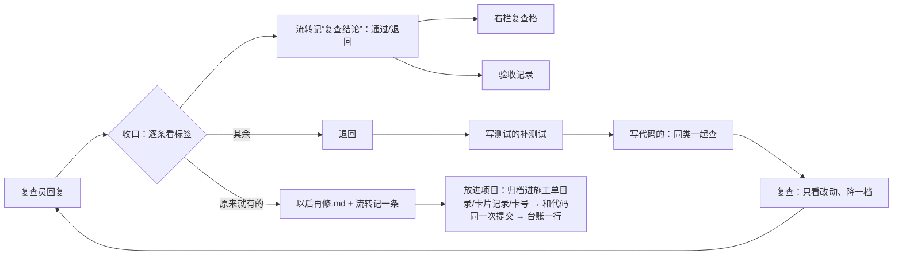

# 方案：跑卡流程调整 · 第二批（跑卡规矩）

> 状态：**已批准**（2026-11-18 用户回“批准”）。大小：**大**。口径见 [需求共识-第二批](需求共识-第二批.md)（已批准）。
> 批准后写《任务清单-第二批》，再批准才写施工单、建卡。

## 一、你会看到什么变化

**跑卡时**
1. 复查挑出问题后，只要是这次改出来的，**哪怕很小**也自动退回去修。右栏照旧显示“退回写代码的（第 N 次，最多 2 次）”。
2. 退回时，写测试的会**先补一条测试把这个问题守住**，再交给写代码的去修；写代码的会被要求**把同类问题一起查一遍**。所以退回一次会比现在多一个“写测试”环节，大约多 2–5 分钟。
3. 退回后的复查只看改了的地方，强度从“极高”降到“高”，在右栏能看到强度变了。
4. 老测试被改坏退回时，写代码的只拿到“哪几个测试没过 + 每个的关键几行”，不再是一大段输出。

**做完时**
5. 复查最后放行了，右栏“复查”格是**绿勾“通过”**。如果复查顺带提到开工前就有的问题，格子下面的小字写“另有 N 件开工前就有的问题，已记进台账”。
6. 点“确认没问题，放进项目”时**不再弹技术条目**，直接放进项目。
7. 放进项目后：
   - 卡片记录存进**施工单所在的文件夹**，路径是 `卡片记录/卡号/`，比如 `docs/跑卡流程调整/卡片记录/CARD-003/`；没有施工单的卡，照旧存到 `docs/卡片标题/`。
   - 卡片原文改名叫“卡片原文.md”，不再冒充“需求共识”。
   - 验收记录写“独立复查：通过”。
   - 记录和代码**存进项目的同一次提交**，不再留下没提交的文件夹。
   - 开工前就有的问题，在台账里记一行，并附上详细清单。

**写方案和开工时**
8. 写方案的不再在步骤里安排“施工方跑全部测试”。
9. “打开改好的版本”的地址要照项目实际的入口写；万一还是打不开，按钮旁边说“预览地址打不开，可以点‘打开文件夹’自己看”，不再打开空白页。
10. 批准开工时：
    - 只有文档没存进项目，**直接开工，不弹**。
    - 真有代码没存，弹一个小框：“有 N 处改动还没存进项目，施工会看不到它们。”，三个按钮：**先存再开工** / **直接开工** / **先不开工**。
    - 卡片引用的施工单本身还没存进项目，也算“要存的”，因为施工方会看不到施工单。

## 二、泼冷水

- **退回会变多、变慢**。小毛病也退回，再加上退回时多一轮写测试，退回一次大约多 5–10 分钟、多 50–100 万 token。上限仍是 2 次，跑满会停下找你的情况可能变多。先跑一张卡看实际数，必要时再调。
- **“这次改的 / 原来就有的”靠复查员自己标**，它可能标错：
  - 把这次的标成原来就有的：问题会溜进台账，不会退回。这个口子由“拿不准的标‘这次改的’”这条现有规矩兜着。
  - 把原来就有的标成这次改的：会白退回一次。
  这点我没法做到百分之百，只能靠复查员的规矩说死，再靠走查抽查。
- **强度降一档只对能调强度的复查工具有效**（现在用的 Codex 可以）。换成不能调强度的工具，就只做到“只看改动”。
- **“先存再开工”会把你项目里所有没存的改动一起存进去**，包括你手上正改到一半的东西。所以按钮下面会列出要存哪些文件，不想存就点“直接开工”或“先不开工”。
- 这张卡改的是跑卡流程本身，**施工用的开发助手跑的是旧规矩**，新规矩要放进项目、重装后，从下一张卡起才生效。所以真实走查要再跑一张小卡。

## 三、改什么（有增有删）

| 文件 | 删 | 改 / 增 |
|---|---|---|
| collab/dispatch.py | 删掉“这次改的轻微问题记进以后再修”的分支；删掉“只有退回过才让复查员标这次改的/原来就有的”的条件 | 收口规则改成：标了“原来就有的”→记进以后再修；其余一律退回（A1）。每一轮复查都要求标这两种（A1）。收口后统一记一条“复查结论”（通过/退回），作为唯一依据（A3）。复查退回、不是测试本身问题时，先派写测试的补测试，再派写代码的，交代里写明“同类问题一起查”（A4）。退回后的复查改成只看改动、强度降一档（A5）。老测试被改坏时，交给写代码的只放失败测试名和每个的关键几行（A6） |
| collab/phase.py | 删掉“等你确认”说明里的“复查另挑出 N 件不急的事……点确认时会列给你看” | 改成“另有 N 件开工前就有的问题，已记进台账”（A2） |
| desktop/view.py | — | 右栏“复查”格读“复查结论”这一条：通过就绿勾（A3） |
| desktop/static/panel.js | 删掉点确认时列“以后再修”的弹窗（`acceptConfirm`）；删掉开工时用浏览器自带弹窗问“有文件没提交” | 开工前问一次“有没有要存的代码”：没有直接开工；有就弹三按钮小框，列出要存的文件（B3） |
| desktop/static/panel.html、panel.css | — | 三按钮小框（B3） |
| desktop/server.py | — | 开工前检查改成返回“要存的文件清单”（排除文档、包含卡片引用的施工单）；新增“先存再开工”动作（B3） |
| collab/merge.py | — | 归档挪到提交之前做，记录和代码进同一次提交（A7）；开工前就有的问题写进台账（A2） |
| collab/archive.py | 删掉把卡片原文存成“需求共识.md”的做法 | 有施工单：存进“施工单目录/卡片记录/卡号/”；卡片原文存成“卡片原文.md”；“以后再修.md”也进过程记录；验收记录的复查结论读“复查结论”这一条（A7、A3） |
| collab/planner.py | — | 写方案的要求加两句：步骤里不安排施工方跑全部测试（B2）；预览地址要照项目代码里实际的入口写，不许猜（B1） |
| desktop/preview.py | 删掉“有回应就算打开了”（404 也算） | 预览服务起来后，地址返回“找不到”时，按钮显示大白话说明，不打开空白页（B1） |

不新增产品文件。

## 四、影响面清单

1. **动的是什么？** 关键词和搜索结果：
   - `_triage`：dispatch.py 只有一处定义、一处调用。
   - `triage_on`：dispatch.py 两处。
   - `以后再修`：dispatch.py 多处；phase.py 第 244、249、419 行；panel.js 第 58、61 行。
   - `acceptConfirm`：panel.js 2 处 + 测试。
   - `uncommitted`：dispatch.py 第 54 行定义，server.py 第 36、1665 行，panel.js 第 280 行。
   - `archive_card`：archive.py 定义，cli.py 第 388 行、merge.py 第 444 行调用。
   - `_reachable`：preview.py。
   - `view_url`、`view_command`：planner.py。
2. **谁在读、谁在写？**
   - “以后再修”：dispatch 写；phase、panel 读。改成只装“原来就有的”，读的两处跟着改说法。
   - “复查结论”是新记的一条：dispatch 写；view、archive 读。原来两处各自去猜，CARD-001 一个亮红叉、一个写“不通过”，就是猜的。
   - 归档：merge 和命令行 cli 两处调用，两处都要走新的“存进施工单目录”规矩，所以规矩放在 archive_card 里面。
   - 开工检查：只有 panel 一处调用。
3. **几个入口？**
   - 开工：开发助手窗口的“批准并开工”，加命令行 `collab approve`。命令行不弹窗，这次不改，理由是你不用命令行。
   - 放进项目：窗口按钮，加命令行 `collab merge`。两处都经过 merge.py，规矩放在 merge.py 里就是必经处。
   - 复查收口：只有 dispatch 一处。
4. **会连带变什么？**
   - 测试：见第 8 问。
   - 台账：每张卡放进项目时，多出“开工前就有的问题”一行。
   - 项目文档：归档位置变了，之前已经归档的不动。
   - README：要查有没有写归档位置，写了就同步。
   - 记忆：不用改。
5. **和已批准文档矛盾吗？**
   - 推翻了“第四轮 57”定的“轻微问题记进以后再修、点确认时列给用户看”。这一条改动由《需求共识-第二批》A1、A2 批准。
   - 推翻了“退回后的复查不带整卡交接、只看要改的几条”里“强度不变”的隐含约定，由 A5 批准。
   - 其余我没找到冲突。第一批方案没有涉及这些。
6. **老数据、已装应用？**
   - 已经跑完的卡不动。老卡没有“复查结论”这一条，右栏和验收记录照旧去读最后一次复查原话，不会报错。
   - 开发助手要重装才生效。
7. **明确不改什么？**
   - C 类显示和措辞。
   - 退回上限（2 次）。
   - 复查严重度的标准。
   - 复查不通过时全量测试被跳过。
   - 命令行开工不弹窗。
   - 已归档的老记录。
8. **怎么证明做对了？**
   - **新测试**（先写，先红）：
     - 收口规则：这次改的轻微问题退回；原来就有的记进以后再修；第 1 轮也要求标这两种。
     - 复查结论：右栏格子是绿勾；验收记录写“通过”。
     - 退回时：先派写测试的，再派写代码的；交代里有“同类问题一起查”。
     - 退回后的复查：交代里写“只看改动”，强度比第 1 轮低一档。
     - 老测试被改坏时：交代里只有失败测试名和关键行。
     - 点确认不弹窗。
     - 归档：位置、改名、以后再修.md 进过程记录、和代码同一次提交。
     - 台账多一行。
     - 写方案的要求里有那两句。
     - 预览地址“找不到”时显示说明。
     - 开工检查：只有文档时不弹；有代码时列出文件；卡片引用的施工单没存也算要存。
   - **要改的老测试**：按“第四轮 57”口径写的、断言“轻微问题记进以后再修”“点确认列以后再修”“归档成需求共识.md”的测试。施工单里逐个列出文件名和原因，Claude 先改好再建卡（第一批的做法）。
   - **全部测试**跑一遍。
   - **复查**：Codex 极高档。
   - **走查**：重装后跑一张小卡，看需求共识第五节第 2 条列的几项。没走到退回的，照实写“未在真实跑卡中走到”。

## 五、技术设计（给下一个会话的 AI 看，你可跳过）

- **唯一依据**：复查最终是通过还是退回，只看流转里的“复查结论”这一条。右栏和验收记录都不再自己去解析复查原文。
- **降一档**：从复查员所选模型支持的强度列表里，取第 1 轮所用强度的前一档（现有 `_top_effort` 已经能读到这个列表）。读不到就不降，只做“只看改动”。
- **“文档”的判定**：`docs/` 下的文件和任何 `.md` 文件算文档，但卡片里引用的施工单除外（`existing_orders` 已经能找到）。`.collab/` 照旧不算。
- **归档先于提交**：merge 在提交前把记录写进施工副本，跟着这张卡的提交一起进项目。验收记录在这时写“最终状态：已放进项目”。如果放进项目失败、退回了，记录也一起退回，不会残留。

## 六、施工中补充（Claude 记，用户 2026-11-18 确认）

- **2026-11-18 写台账的时机挪到复查收口时**（原写在“放进项目”时，第三节 merge.py 一行）：卡 C1 上线后，“等你确认”就会写“已记进台账”，如果要等 C2 的放进项目才写，C1 到 C2 之间这句话是假的。改成复查记进“以后再修”的同时写台账，这件事挪进卡 C1（dispatch.py），C2 不再管。代价：这张卡最后要是放弃了，台账里也会留下这一行。它说的是项目里本来就有的问题，留着也是真的。
- **严重的老问题照旧退回**：共识 A1 写的是“只有开工前就有的才记进以后再修”。现有规矩里，开工前就有的严重问题也退回修，这次保留不放松，也就是只有开工前就有的、不严重的问题才记进以后再修。
- **2026-11-18 C1 收尾方式改变（用户选）**：CARD-003 复查 4 轮 + Claude 接手 + Codex 最高强度复查后仍有 2 严重、5 中等，多数是“程序认不全复查员随手写的格式”（观察第 35 条）。C1 比改之前严、没变坏，用户选**先放进项目、另开一张卡治根**：复查员必须按固定格式写意见，程序认不出就整段退回、绝不放行。新卡排在 C2 前，遗留清单见 [C1遗留问题](C1遗留问题.md)。
